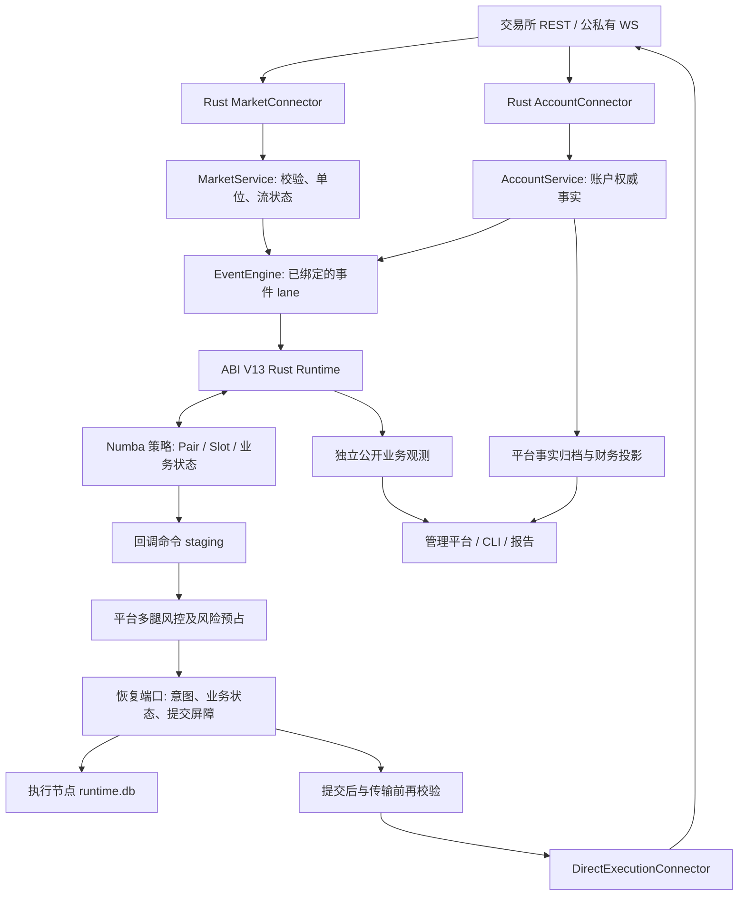
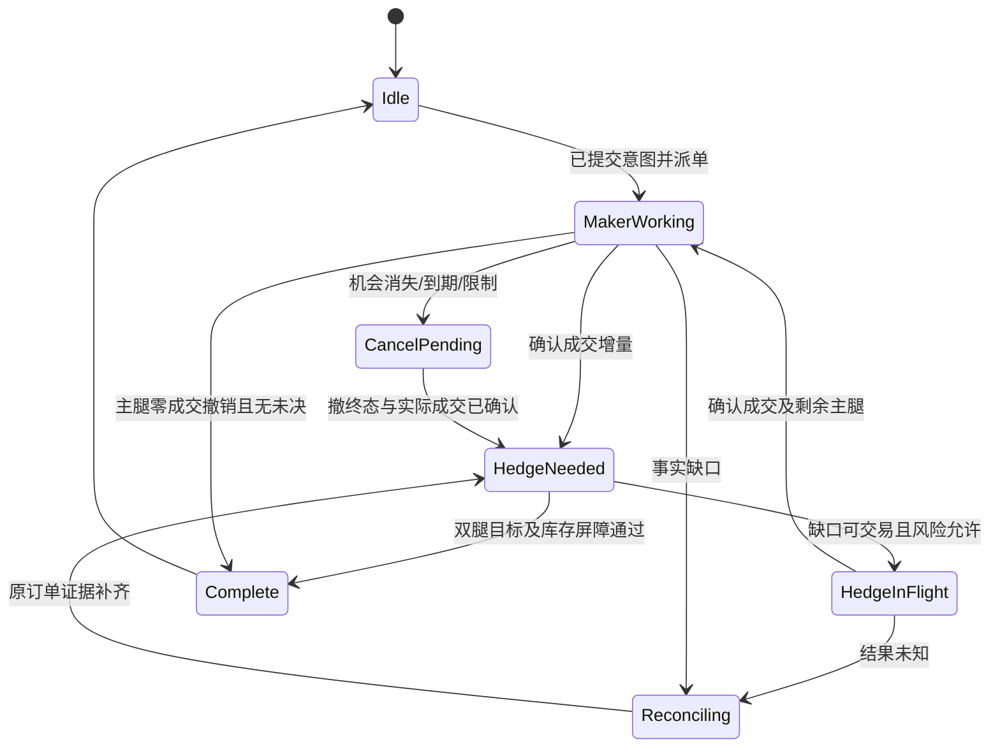

# Titan 永续 DEX 接入与跨所交易技术设计

版本：v0.1  
日期：2026-10-27（Asia/Shanghai）  
状态：技术设计提案，待分阶段实现与验收。本文中的新类型、字段、配置和能力均不是已经发布的接口。  
研究依据：[四个项目的固定源码调研](perp_dex_research.md)；执行安排：[任务与验收](cross_venue_implementation_plan.md)。

## 1. 目标、范围与核心决定

将四个项目中有价值的交易所协议知识、跨所执行方式和证据管理机制吸收到 Titan，沿用 Rust 平台、Numba 策略及 ABI V13。首期建立 Lighter Core 与 EdgeX 的可审计双腿交易闭环，其后增加 Extended、GRVT、Backpack，再按需求覆盖调研中的其他 provider。

核心决定如下：

1. 行情、账户、执行、风控、恢复仍由 Rust 平台拥有；策略只保存配对、slot、目标库存、统计窗口等业务状态。
2. 接入以能力与验证范围准入，不以“有 HTTP 下单函数”准入。每个部署、账户模式、合约类型有独立能力记录。
3. 跨所交易默认同经济资产的线性永续，按基础资产 delta 配对；不默认 USDT=USDC，不默认 ticker 相同即资产相同。
4. 双腿采用持久化执行计划、逐腿订单事实及补偿决策。一个回调内 staging/落盘成功不代表交易所原子执行。
5. 新版 `pair_arb` 增加确认成交后的增量对冲。现有“主腿完整目标后正常对冲”的语义保留为旧版本，不能静默修改旧策略或恢复点。
6. UNKNOWN 保留风险预占并查询原订单；不重发不确定下单，不将超时、空活动列表或网络错误解释为成交/撤单。
7. 保证金与清算逐原生抵押域计算。组合净 delta 小不释放任何一所的保证金预留。
8. 恢复遵循既有[数据持久化设计](data_persistence_design.md)，使用平台恢复端口；本方案不创建第二套交易账本或数据库 writer。

本次交付只修改文档，不增加 connector、改变策略参数、执行构建、部署或读取实盘账户。资金费 carry、跨所库存网格和 beta 配对是后续新策略设计，不宣称四个上游已经完整提供。AMM swap/链上确认与订单簿永续执行分属不同模型，[原链上 venue 草案](onchain_venue_broker_design.md)不能直接当作本方案的订单状态机。

## 2. Titan 现状、复用点与实际缺口

审查基线：`5997364864861fdd5d8c649b93e54161018f703d` 加阅读时工作区。工作区已有持久化和恢复改动，以下仅陈述所阅读源码，不引用历史测试数量证明新设计可用。

| 领域 | 当前代码/文档 | 复用与扩展 |
| --- | --- | --- |
| Broker REST | [BrokerApi](../connector/src/api.rs) | Binance USD-M、OKX、Hyperliquid、Gate CrossEx；新所按相同领域语义适配 |
| connector 注册 | [lib](../connector/src/lib.rs)、[账户工厂](../connector/src/account_runtime.rs)、[行情工厂](../connector/src/market_runtime.rs) | 现有四组 factory；新增 feature 与具体实现，不恢复旧插件总线 |
| 行情标准化 | [MarketService](../crates/titan-market-service/src)、[事件桥接](../connector/src/market_event.rs) | 复用 arena/整数 tick/lot/source identity；扩展深度质量、跨腿时间约束 |
| 账户与执行 | [账户模型](../crates/titan-account-service/src/model.rs)、[直接执行](../crates/titan-account-service/src/execution.rs) | AccountHandle/generation、SecretRef、DirectExecutionConnector、Accepted/Rejected/Unknown |
| 权威账户快照 | [account_runtime](../connector/src/account_runtime.rs) | 保留会话 epoch、提交边界、bootstrap 和传输前 guard |
| 策略与订单意图 | [runtime_v13](../crates/titan-strategy-runtime/src/runtime_v13.rs) 的 `commit_commands` | 已有整批本地校验、登记意图、checkpoint/flush 再执行的路径；扩展多腿预占与提交后重查 |
| 受控执行风险 | 同上；[risk](../crates/titan-account-service/src/risk.rs) | `execution_limits` 路径当前要求 `inner.markets.len()==1`；跨所不能直接沿用此门禁，必须补多绑定风险 |
| 双腿策略 | [pair_arb](../strategies/pair_arb.py)、[需求](pair_arb_strategy_requirements.md) | 单 slot、maker/taker 与 taker/taker、ratio、撤确认再替换、分级姿态；新增成本、增量对冲与多腿金额约束 |
| 网格 | [现有网格设计](grid_strategy_technical_design.md)、[grid](../strategies/grid) | 保留当前网格业务与停止证据；新模式单独版本化，不将外部 grid 整体替换现有策略 |
| 持久化与观测 | [持久化设计](data_persistence_design.md)、[身份与观测](strategy_observation_protocol.md) | 恢复 BLOB/摘要/代次、账户财务事实、公开业务帧分别归属；适配正在演进的存储实现 |
| 回测 | [共享撮合与账户](../hftbacktest/src/backtest/execution) | 多 venue 到达/交付、费用、资金费与本地可见账户；增加故障和未知结果模型 |

Hyperliquid 已有签名与 connector 只是 Entropy 的可复用基础；不证明当前已支持 HIP-3 `io` 市场、账户抽象模式或 Entropy builder。Gate CrossEx 的聚合网关与直接交易所也不因 ticker 相同而互相替代。

## 3. 技术框架与数据流



服务与运行时端口依赖领域类型，具体 connector/存储实现这些端口，CLI 负责组装。热路径不动态导入 Python 包、不读取数据库历史、不调用管理 HTTP，也不从恢复 BLOB 解析实时监控。

首期一个 Pair 的两腿由同一执行节点、同一运行宿主管理，两端接收时间使用该节点的时钟。不同 Pair 可以部署在不同节点，但共享 native account、collateral domain 或 signer 时仍须统一占用准入。首期不实现跨节点拆腿、分布式风控事务或自动主备接管；宕机接管先证明旧宿主死亡/失去合法 owner，再执行原订单对账，不能因心跳超时直接重派。

拟新增文件布局（路径为规划，尚未创建）：

```text
connector/src/lighter/{mod,rest,signing,public_stream,private_stream,brokerapi,model}.rs
connector/src/edgex/{mod,rest,signing,public_stream,private_stream,brokerapi,model}.rs
connector/src/venue_capabilities.rs
crates/titan-domain-types/src/venue_identity.rs
crates/titan-account-service/src/portfolio_risk.rs
crates/titan-strategy-runtime/src/execution_plan.rs
strategies/pair_arb.py             # 显式新 source/schema 版本
```

按实际职责抽模块，不预先拆成多个进程、引入 Redis/Kafka 或建立独立通用 OMS。新的 execution plan 是现有 runtime 命令批次和恢复协议的领域扩展；不增加第二条命令队列或独立派单器。

## 4. 设计模式与决定依据

| 模式/决定 | 应用位置 | 边界与代价 |
| --- | --- | --- |
| Ports and Adapters | 签名、传输、账户查询、恢复、事实存储 | 业务不依赖 SDK 对象；不构造包含所有所可选字段的万能请求 |
| 工厂+显式能力 | Market/Account factory、CLI 组装 | 启动时验证，热路径不按字符串分支；不支持的方法返回类型化拒绝 |
| Anti-corruption layer | 原生 JSON/单位/身份到领域事实 | 防止 SDK 的默认值、近似数字或“市场单”命名污染交易语义 |
| 单写者与序列化 lane | 账户事实、运行时回调、nonce 域 | 有界队列；跨源锁顺序固定；不持 Mutex 跨 await |
| 状态机 | 订单、slot、暂停、停止、对账 | 每个迁移要求对应证据；不由 UI 文本驱动 |
| Saga/补偿流程 | 非原子的双腿计划 | 补偿是新订单，可能亏损/失败；不宣称回滚原成交 |
| Durable intent / outbox 原则 | callback commit 到外部提交 | 复用恢复提交屏障，不引入自动重放不确定写请求的通用 outbox worker |
| CQRS 式查询投影 | 财务、公开业务观测、管理历史 | 查询与交易隔离；不把本项目描述为完整 event-sourcing 系统 |
| 熔断+bulkhead | 所/账户/签名者/行情流隔离 | 故障阻断新增风险；撤单、查询和保护资源单独保留 |
| 策略组合 | sizing、cost、hedge policy | 平台保证不变量，策略决定业务目标；不由 connector 擅自补腿或止损 |

ADR-01：独立 Rust 实现新接入，不搬运上游 bot。ADR-02：逐腿事实确认，不实现跨所伪事务。ADR-03：按 delta 配对。ADR-04：UNKNOWN 不释放预占。ADR-05：存储沿用既有平台端口。ADR-06：先实现硬限额与压力情景，统计风险仅作辅助。ADR-07：账户/品种首期独占，分配共享能力验收后再开放。变更这些决定时同步本文、实施计划与工程记忆。

## 5. 身份、合约、单位与能力模型

### 5.1 身份不混用

拟议领域键：

```text
VenueDeployment = (venue_family, network, deployment_id, signing_domain)
NativeAccount = (VenueDeployment, native_owner, native_subaccount_or_account_id)
SignerScope = (VenueDeployment, signer_public_identity, native_nonce_domain)
CollateralDomain = (NativeAccount, native_margin_group, collateral_currency)
InstrumentKey = (VenueDeployment, native_market_id, native_symbol, contract_kind)
PairBinding = (left_account+instrument, right_account+instrument, equivalence_revision)
ExecutionIdentity = (strategy_id, run_id, run_generation, slot_id, leg, attempt)
```

native account 是风控与占用身份；API key 是凭据，不因换 key 创建新账户。相同 signer 为多个子账户签名时可能共享 nonce 域。Lighter Core/RH、mainnet/testnet 永不因 account index 相同而合并。原生字符串大小写、前缀、DEX namespace 保留；稳定内部 ID 由注册表分配，不截断原生 ID 或用不校验碰撞的 hash 替代。

本地 client ID、venue order ID、交易提交 tx hash、trade ID、operation ID 各有独立映射。原生整型 index 有位宽上限时，在有效范围内持久化分配，不用毫秒时间戳作为唯一性证明。过期订单命名空间也要保留恢复/迟到事实隔离。

### 5.2 InstrumentSpec 与资产等价

合约元数据至少包括经济资产 ID、原生资产 ID、base/quote/settlement/collateral currency、线性/反向/quanto、乘数、tick、lot、最小数量/金额、最大单量、交易状态、交易时段、保证金档位、mark/index 来源、资金费周期/下一结算点、原生数量编码及元数据版本。`unknown` 与 0 分开；不能证明最小金额不代表没有最小金额。

跨所绑定要求显式 EquivalenceRecord：两端经济标的、合约交割/指数含义、乘数映射、允许的报价换汇、交易时段差异、最大跟踪误差、证据来源和版本。同名股票永续、不同 oracle、包装资产、指数资产均不能自动判等价。首期不支持 inverse/quanto 自动映射；明确拒绝，而非代入线性公式。

原生十进制字符串 → 检查有效范围 → 精确比例 → 整数 tick/lot。多乘数先约分并用 checked i128；溢出拒绝。买入/卖出保护价分别向内取整以不突破授权价格上限/下限，maker 再检查不穿价；数量向下取 lot，剩余 dust 单独估值。`Decimal.quantize` 的位数对齐不等价于任意 tick 倍数对齐。

### 5.3 能力清单

能力是 `Supported / Unsupported / Unverified` 加验证范围及证据引用，不能仅为 bool。启动要求满足策略的全部必需能力。

| 能力组 | 必填细节 |
| --- | --- |
| 市场 | snapshot/delta、sequence/checksum 规则、深度上限、时钟质量、交易状态 |
| 订单 | GTC/IOC/FOK/post-only、reduce-only、原生 position side、改单及批量的逐项结果 |
| 查证 | client ID 查单、活动/历史订单、独立成交、分页及保留窗口、终态与成交完整性 |
| 账户 | NET/HEDGE、cross/isolated、抵押域、余额/available/权益定义、保证金与流水 |
| 安全 | cancel-all/dead-man 范围、速率权重、只读权限、签名域、时钟/nonce 限制 |
| 成本 | maker/taker 档位、返佣币种、builder/integrator 字段、实际 funding 与手续费证据 |

没有已验收原生 IOC 的所不得通过 GTC+本地定时撤单冒充 IOC；如果未来支持这种模拟，应是独立策略能力，承担整个在途与撤单风险。缺少可证明原订单历史的所，不能开放自动崩溃恢复后续交易。

## 6. 交易所接入技术方案

### 6.1 每个 connector 的实现清单

每所实现公开目录、ticker/BBO、L2 snapshot/stream、原生签名、server time、账户与持仓模式、余额、委托/成交查询、submit/cancel、私有事实流或有界轮询、bootstrap/reconcile、错误映射、限流及受控关闭。Funding/ledger/cancel-all-after 等通过显式可选能力提供。账户与公开行情独立实例，共享不可变元数据，不共享未隔离可变 signer context。

SDK 优先只用于经过审计的签名/编码。不让 SDK 内部重试写请求、生成未知 client ID、自动切网、修改账户模式、绑定推荐码或发送 wallet 操作。Rust 缺少成熟 signer 时可评估固定版本 C ABI/native 库：隔离 handle、固定 artifact hash/target ABI、审计分配与线程安全、生成官方对照向量。无法满足这些条件则该所停留在只读阶段；不增加 Python 实盘 sidecar 绕过平台边界。

### 6.2 分组适配方案与阻塞条件

| 所/部署 | 技术路径 | 上线前必须解决的问题 |
| --- | --- | --- |
| Lighter Core | Rust REST/WS；固定官方 native signer 接口 | chain/account/key/nonce 隔离、client/order/tx 区分、snapshot 衔接、私有 trade 去重、实际费用单位 |
| EdgeX | Rust 协议层+经官方向量核对的 STARK 签名 | 当前官方 schema、contract 元数据、post-only/IOC、client 查单窗口与完整 trade 证据 |
| Extended | Rust SNIP12/Starknet 编码；API key 读、签名写 | vault 身份、mandatory headers、异步受理、external ID、私有流、普通簿与 RFQ 模型区分 |
| GRVT | 独立 Rust REST/WS+签名 | trading account/API session、过期时间、精度、post-only/IOC、子请求独立终态 |
| Backpack | 复用已有 Ed25519 基础库实现原生请求 | 精确签名字节与时间窗、子账户、合约乘数、历史成交窗口 |
| Aster | 可复用 HMAC/HTTP 基础件 | 必须独立验证 path/params/status/position mode；不能改 Binance base URL 即宣布接入 |
| Paradex | STARK 签名及 token 生命周期 | L1/L2 身份、环境、最新 auth 流程、原生订单与账户查询 |
| ApeX Omni | 独立产品模块，固定 zk/seed 编码 | SDK/native 签名可移植性、产品/网络、client ID、私有交易和手续费 |
| Nado | 原生 owner/subaccount/x18/appendix 编码 | nonce 与过期、产品目录、轮询可达新鲜度；低速 polling 不标为低延迟准入 |
| Ethereal | EVM signer/linked signer+原生 API | subaccount UUID、授权与 nonce、产品 ID、私有流和结果未知查询 |
| StandX | 可审计的登录及临时请求 signer 生命周期 | 交易权限最小化、JWT/session 刷新、临时 key 绑定、禁止自动 wallet 审批 |
| Arcus | 原生 Ed25519 canonical order | 补官方鉴权规范、ns/expiry 单位、perp 与 spot 区分、IOC 终态与 fill 证据 |
| Lighter RH | 同 Lighter 协议族独立部署配置 | host/chain/key 绝不回退 Core，独立完成全部准入 |
| Entropy | 扩展现有 Hyperliquid 基础能力 | HIP-3 DEX/asset 路由、agent owner/expiry、collateral source/模式、builder 字段；共享底层账户占用 |
| Ondo Perps | Rust HMAC+认证账户发现 | 补官方 spec、原生 key 前缀、accountID、cross 抵押估值、未知最小金额/费用、client 查单 |

该表是实施设计与未知项清单。协议细节来自[固定源码矩阵](perp_dex_research.md)，不把任何待补项写成已支持。

### 6.3 官方规范差异

[Extended 官方 API](https://api.docs.extended.exchange/)明确下单异步确认，并区分普通订单簿和 RFQ 市场。首期只开放已验证普通线性永续；RFQ indicative book 不能当作确定可成交深度。

[Lighter 官方 WS](https://apidocs.lighter.xyz/docs/websocket-reference)区分 order/client/tx 与 trade，包含多类取消原因、keepalive、source 时间等字段；签名提交成功不等于订单执行成功。精确字段和单位以接入时冻结的 schema 为准。

[Hyperliquid 官方 nonce 文档](https://hyperliquid.gitbook.io/hyperliquid-docs/for-developers/api/nonces-and-api-wallets)说明查询地址与 agent signer 不同，nonce 按 signer 跟踪；不能把每个账户一个计数器推广到共享 agent 的所有配置。

## 7. 行情一致性与跨所可成交报价

### 7.1 单所建簿

状态为 `Disconnected → Connecting → Snapshotting → CatchingUp → Ready`；序列缺口、校验和错误、队列溢出、 crossed/非法簿或元数据变化进入 `Stale/Recovering`。先关新增风险门，再恢复。公开订阅 ACK 只表示订阅确认，不代替首个有效 snapshot。

按各所规定处理 snapshot 与缓冲 delta：可能是范围序号、offset、水位或完全替换快照；不统一假设 `seq+1`。只支持 BBO/无序号快照的来源明确降低质量等级，不包装成完整 L2 增量簿。重连分配新 source session，旧连接迟到事实不能推进新连接的 Ready。

### 7.2 时钟与新鲜度

记录原生 event time、完整帧接收时间、解析完成、策略交付与派单时间。间隔用同机 monotonic；恢复/审计同时保留 UTC 和 boot/session 身份。远端 timestamp 用于诊断和排序，不能未经时钟偏移估计直接与本机相减当网络延迟。

Pair quote 必须满足两腿的最大接收年龄、两腿接收时间差、各自 Ready/metadata revision、非 crossed 以及所需数量的深度。不用“不断读取同一缓存”刷新数据时间。行情过期关闭开仓，但订单确认、撤单、恢复和风险计时继续运行。

### 7.3 按量报价

`Quote(side, quantity)` 返回精确 VWAP、worst level price、可用量、source/session/sequence、接收时间、spec revision、深度完整标志。计划量全部有可用深度才是完整 quote；BBO 只能用于快速筛选，不能替代提交前按量校验。

订单保护价遵守 `buy_limit ≤ authorized_max_buy`、`sell_limit ≥ authorized_min_sell`。从 VWAP 计算收益时已经包含当前盘口冲击，额外 slippage buffer 只覆盖行情到达后变化，不能重复扣同一深度成本。首期固定 slot 量遇到不足则等待；自适应缩量必须是显式 sizing policy，且两腿共同重新计算最小量与风险。

## 8. 账户事实、鉴权、nonce 与错误模型

### 8.1 启动与重连屏障

启动流程：核对配置/凭据范围 → 只读识别 native account 与模式 → 启动私有事实缓冲 → 获取权威账户快照 → 衔接订单/成交/持仓/余额增量 → 提交一致账户映像 → 对账 runtime 未决意图与库存 → Ready。某所只能轮询时，必须给出快照时间窗与完整性证明；不能伪造 sequence。

订单终态、独立成交、持仓投影是三种证据水位。订单 cumulative filled 不能制造缺失成交价格；独立成交不能覆盖权威持仓元数据。NET/LONG/SHORT 分别保存；空 positions 返回不代表 NET 模式。账户余额、可用保证金、权益与可提现余额分别定义。

### 8.2 nonce 与签名者

每个原生 nonce 域只允许一个合法 allocator/owner；分配、使用与未决范围持久化。平台账户占用之外，存在共享 signer 的进程还须争用 signer scope。异步准备前后及传输前检查 owner/epoch/revision、签名期限与风险门。

没有进入传输且能证明未发送的请求可记为 AbortedUnsent；一旦尝试传输而没有确定拒绝，记 UNKNOWN。不能因 nonce error 换 nonce 重发原经济意图；先查原 client/tx/order 身份及 nonce 结果。过期 signed payload 也不能自动“刷新重签”当恢复；重新计划必须在旧订单风险已证明后进行。

### 8.3 规范化错误

| 分类 | 示例 | 行为 |
| --- | --- | --- |
| LocalRejected/Unsent | 无能力、精度非法、派单前 guard 拒绝 | 不产生外部写；保存原因，按既定流程释放本次预占 |
| VenueRejected | 可确认未受理的签名/保证金/post-only 拒绝 | 记具体原生原因；不能把所有 HTTP 4xx 直接归此类 |
| UnknownOutcome | 发送后超时、连接重置、5xx、ACK 不完整 | 原身份查证，保留预占、关闭新增相关风险 |
| ReadUnavailable/Stale | 短时查单/行情失联 | 有界退避和熔断，数据缺失不补零 |
| IdentityConflict/FactGap | owner 不符、累计倒退、分页缺失 | 故障关闭并保留冲突证据 |

只读重试采用 endpoint 白名单、总 deadline、指数退避和 jitter；POST `/info` 这类只读查询可按语义允许。写调用不套通用重试。限流按 IP/key/account/signer/endpoint 权重分域，撤单、原订单查询及 stop 保留容量；重试次数不能重置业务截止时间。

## 9. 双腿执行、增量对冲与停止

### 9.1 本地计划与非原子派单

拟议 ExecutionPlan 关联两腿 intent、client ID、绑定修订、quote 证据、价格界限、风险预占 token、截止时间及业务 slot。平台持有订单事实与命令派发状态；策略持有 slot/role/目标配比。计划关联不重复保存第二套完整订单账本。

顺序：校验整批绑定/能力/量价 → 原子预占多腿最坏风险 → 持久化业务状态+完整意图 → 等待指定提交确认 → 重查行情/账户/风险/期限 → 逐腿直接派单 → 持续接收事实/原订单补查 → 按业务策略补偿 → 证据齐备后释放预占/完成 slot。

持久化后、传输前拒绝也保留该 intent 及明确未发送证据。两个派单 future 之间进程崩溃是正常需要覆盖的故障点；第二腿未派出不使第一腿自动撤销。不能把一腿派单失败作为已发送另一腿的本地回滚。

对必须分配 nonce/生成 signed payload 的新所，增加第二个**平台提交屏障**：语义意图先耐久提交，异步准备原生请求，再把 nonce、expiry、原生 client 身份、request hash 及必要加密 payload 与原 intent 关联提交；只有该指定提交成功后才进入传输。由平台注入受限 PreparedRequestEvidence 端口，connector 不自建数据库、writer、命令队列或自动重放器。该端口与 execution attempt context 属于待实现的 Rust 接口，不改变 Numba 下单 ABI。

准备阶段失效、签名失败或第二屏障失败均不能发送。提交后重新检查价格/epoch/权限/期限；签名过期不重新签发未知订单。严格连续 nonce 协议出现“已预留但未发送”空洞时，按原生查询及安全规则处理，证据不足暂停该 nonce 域，不用递增/重发猜测修复。

计划字段及唯一归属：

| 字段组 | 内容 | 所有者 |
| --- | --- | --- |
| 业务关联 | pair/slot/leg/attempt、目标数量与 ratio、停止/补偿 policy | 策略业务状态；计划仅引用已冻结目标 |
| 冻结证据 | run generation、binding/spec/cost/risk revision、quote source/time | Runtime 计划 |
| 执行身份 | intent/client/native order/tx 映射、传输尝试、原生准备引用 | Runtime 与 connector 的平台事实接口 |
| 风险与期限 | 预占 token、delta 区间、价格上限、成本预算、原 deadline | 平台风险；策略可以收紧 |
| 财务事实 | 独立 fill、fee、funding、position/balance | AccountService；计划只保留事实引用/水位 |

Prepared/Submitting/Acknowledged 描述执行尝试，不替代原生订单 Working/Partial/Terminal。UNKNOWN 是证据状态，不是订单终态；账户订单、执行结果与业务 slot 不能共用一个枚举。

### 9.2 Maker/Taker



此图为业务流程，实际需同时容纳 maker 活动与 hedge 在途，不能实现成互斥状态而漏掉主腿并行成交。每次独立成交只消费一次，通过已确认成交量计算应对冲量，不反复按 cumulative total 下单。

设对手腿 lot 单位下的精确应对冲量为 `r × confirmed_maker_base`，已确认 hedge 数量为 `H_f`，未终结 hedge 最大剩余为 `H_pending`。新 hedge 只能根据缺口区间规划：`gap ∈ [target−H_f−H_pending, target−H_f]`。不能忽略在途、也不能将 UNKNOWN 当 0。平台保留上下界，策略仅在能证明不会突破允许过对冲/欠对冲上限时提交。

默认增量对冲：可交易增量达到 hedge lot/min-notional 即触发；小增量累计为 dust，但 first-imbalance 时钟不重置。主腿需保证累计 dust+下一次最坏 fill 不超限。小于最小交易量且超出风险容忍时撤剩余 maker、进入受限/人工处理；不放大退出或补腿数量凑最小单。

替换主腿必须先收到旧主腿终态并消化所有相关成交证据。撤单 ACK、撤请求发送和活动订单消失不能开启 replacement。maker 已部分成交时不等待其完整 slot 才处理风险。

### 9.3 Taker/Taker

两腿均使用原生已验收 IOC 保护价，同回调 staging、提交同一个本地计划，独立派单。完成条件是两腿实际成交达到目标/容忍范围且订单/成交/库存证据完整；不是两个 HTTP 成功。

| 分支 | 平台事实 | 策略处理 |
| --- | --- | --- |
| 双腿全成 | 已确认数量及独立 fill | 等库存投影，再完成 |
| 双腿零成交终态 | 没有剩余未决 | 完成无仓位尝试；下一机会用新 intent |
| 单腿/双腿不等量成交 | 真实敞口已知 | 停止新 slot；按预先允许的 HedgeMissing/UnwindFilled 决策 |
| 一腿 UNKNOWN | 成交范围不确定 | 冻结扩大风险、查原单；不盲目发第二个完整 hedge |
| cancel 与 fill 交叉 | 订单可能部分完成 | 按独立 fill+终态收敛，不清空业务关系 |

补偿与原策略同样先预占、落盘、价格保护、确认。不保证原入场利润仍然成立；风险退出可突破“入场盈利阈值”，但不能突破独立的紧急价格/损失/敞口硬上限。

### 9.4 对冲策略与授权边界

`HedgeMissing` 会在对手所新增仓位，通常不是 reduce-only，必须显式纳入预授权的救援预算；`UnwindFilled` 在已有持仓所 reduce-only 退出；`HoldAndAlert` 保留敞口等待处置。策略版本固定优先级、最大数量、累计成本、重试身份规则和期限。

UNKNOWN 时可否发保护单依据整个可能成交区间评估；如果没有一种操作在所有分支都满足风险限额，则保持关门并报警，不把“紧急”当无限扩大仓位的理由。connector 不自行选择哪条腿补偿，也不自动加保证金、转账或改账户模式。

### 9.5 暂停与停止

Pause 禁止新 slot/新 maker，继续消费事实和计时，撤现有 maker；已授权的保护行为按独立门禁执行。Resume 必须重新验证账户/行情/期限与未决意图；不会清空 HALT 锁存。

Stop 必须选择明确业务目标：CancelOnly/DrainHedge/FlattenOwned。前者可能保留库存；后两者也必须等待实际风险结果。调用既有 STOP_BARRIER，持续处理撤单/成交/库存到截止时间；超时给出 UnresolvedRisk，保留账户占用与证据，不能用进程已退出标为安全完成。账户级 cancel-all/dead-man 若影响其他策略，仅在已取得整个账户范围占用时启用。

## 10. 策略模型与定价公式

### 10.1 统一计价与数量

以下为同一经济资产的线性永续公式。`Q` 为基础资产数量，`P` 为原生 quote/base，`X_v` 为原生 quote 到风险计价币的汇率，`c_v` 为每原生数量单位的基础资产乘数。基础资产持仓 `q_v = signed_native_qty × c_v`；delta `Δ_base = Σq_v`，名义金额 `N_v = |q_v|P_vX_v`。

同资产默认 `q_right_target = −q_left_confirmed`，若是 lot 数比例则 `right_lots = left_lots × lot_left × c_left /(lot_right × c_right)`。比例以有理数保存并校验，不能把不同 lot 的 1:1 当基础币 1:1。量化方案须同时满足两侧 minimum、dust delta 和所有上限；若量化后找不到合法小批量，则该 pair 不准入。

等金额模型 `q_R≈−q_L P_LX_L/(P_RX_R)` 与 delta 中性不同，只允许显式 `sizing_policy=notional_match` 研究。不同资产的 beta 模型需独立数据集、校准窗口、失效检验与风险上限；首期拒绝自动 beta 配对。

### 10.2 可执行价差与成本

买 A、卖 B 的按量价差及成本后收益：

```text
gross_edge = Q × (VWAP_sell_B(Q) × X_B − VWAP_buy_A(Q) × X_A)
entry_cost = fee_A + fee_B + adverse_move_buffer + latency_buffer
net_entry_edge = gross_edge − entry_cost
round_trip_expectation = net_entry_edge + expected_exit_price_PnL
                         − exit_fees − exit_buffers + expected_funding
edge_bps = net_entry_edge / reference_notional × 10000
```

逆方向独立计算。费用使用 account/instrument/maker-taker 角色的当前档位与实际币种，返佣率可能为负但不作为确定收入预支；缺失费率则禁止收益驱动开仓，或使用经过批准的保守上界并标明假设。builder/integrator/gas 等如适用单独计入，不默认“DEX 免费”。

`net_entry_edge>0` 只是入场成交价差，不代表结算到账的利润；两所未平仓、基差扩大、资金费变化和保证金约束仍会造成亏损。预期退出收益与实际已实现损益分开记录。

Maker 模式将候选 maker price 代替主腿 VWAP：买 maker 上限满足 `P_maker×X_A ≤ executable_sell_B×X_B − required_cost_per_base`，再取该所合法 post-only 价。`P_fill`、排队延迟与成交后的 adverse selection 用于评估 `E[edge]`；不能把“挂在 bid”视作必然能以 bid 买到。持仓越接近上限，扩大开仓门槛或只允许减仓方向。

### 10.3 滚动基差中心

拟议可选参数为窗口长度/时间范围、最小有效样本、最大缺口、中心方法（median/EWMA）、波动方法（MAD/EW variance）、entry/exit band、持仓偏移与冷却时间。

```text
b_t = log(mid_B × X_B) − log(mid_A × X_A)
center_t = robust_center(valid history before decision)
z_t = (b_t − center_t) / max(scale_t, scale_floor)
```

统计量只调整机会阈值，最终仍用按量可执行价格和成本。样本必须时间对齐、只使用决策时已交付数据；交易暂停、坏簿、零 scale、不足窗口时不入场。重启可从固定业务状态恢复窗口，也可明确重新 warmup，不能重置统计状态后立刻交易。制度性基差、指数变化与非同步交易时段触发模型失效，不假设均值必然回归。

### 10.4 资金费 carry（后续）

各 venue 保留原生预测/实际、fraction/percent/bp、计费周期、结算点、费率上限、持仓计费规则。统一 rate 使用无量纲每次结算的 fraction，不能把每小时与每八小时直接比较。

对持仓符号 `s_v∈{+1 long,−1 short}`，正资金费定义为多付空收时：

```text
forecast_cashflow_v,k = −s_v × eligible_notional_v,k × forecast_rate_v,k
carry_expectation(H) = Σ[v,k in holding horizon H] forecast_cashflow_v,k
                       − entry_and_exit_cost − basis_stress_cost
```

实际入账以 ledger/payment ID 去重计量，未结算预测不进入已实现收益。跨结算点的持仓资格、预测修订与支付币种分别处理。准入要求明确退出期限、基差止损、最小资金费安全边际、双所资金缓冲及低费率反转退出。不能为赶结算取消单腿硬限额。

### 10.5 网格与跨所库存策略（后续）

保留三种独立策略语义：交易所常驻网格、程序触发 IOC 目标库存网格、maker 库存变化由另一所对冲的跨所网格。几何可共用 `L_i=L_0+i(U−L_0)/N` 或 `L_i=L_0(U/L_0)^(i/N)`，按 tick 对齐后必须严格单调且相邻净格距覆盖成本；量化重合则拒绝。

网格资金约束按所有可同时成交的订单与边界库存估值，不用 `investment/(N×mid)` 替代最坏保证金。跨所网格把每个已确认 maker 成交映射为 pair slot/owned inventory，对冲成本可能吃掉格距；网格配对毛收益、交易费、实际 funding、净权益分开。跳空不直接跨过多个格并假定逐格成交，循环完成需真实订单与成交证据。

### 10.6 合成计算例（非实盘参数）

假定两所同币种报价，买 A 的 0.01 BTC VWAP 为 100000，卖 B 为 100100；gross edge 为 1。若 A/B 费率分别为 2/3 bp，入场费分别为 0.2/0.3003，加 0.2 的额外行情变化预算，则成本后入场 edge 为 0.2997，约为 1000 参考名义的 2.997 bp。退出费用和基差变化尚未计算，不能将此值显示为已实现净收益。

若 maker 已确认买入 0.004 BTC，对手已确认卖出 0.003 BTC，另有最大 0.001 BTC 的 hedge 在途，则欠对冲区间是 `[0,0.001] BTC`。直接再卖 0.001 可能造成过对冲；应先查证在途，或证明新操作在所有分支都不超预算。每笔 fill 后重算，不从“下单量相同”推导两腿已中性。

## 11. 风控模型

### 11.1 分层责任与门禁

| 层 | 硬约束 | 所属模块 |
| --- | --- | --- |
| 合约准入 | 经济等价、线性计价、最小量、交易状态/时段、能力和证据 | 元数据/绑定解析 |
| 订单 | price collar、qty/notional、post-only/IOC/reduce-only、重复 ID、在途上限 | Account/Runtime pre-trade |
| Pair/slot | 最大单腿 delta、最长裸露时长、dust、slot deadline、补偿预算 | 策略业务+平台复核 |
| 抵押域/账户 | 原生 available、IM/MM 档位、清算缓冲、币种、未决预占 | 平台账户风险 |
| 组合 | gross/net、基础币 delta、venue/稳定币集中度、损失和压力情景 | 平台组合风险 |
| 系统 | 事实缺口、持久化、队列/时钟、owner/epoch、连接和证书 | Runtime/connector 生命周期 |

所有硬门禁由平台执行，策略只能进一步收紧。不能只依靠 Numba 的 `risk_check` 拦截平台层风险。入场批次整体验证与预占；每一腿传输前重核对，已发送一腿不会因另一腿新拒绝而被视为零风险。

### 11.2 仓位与在途风险区间

对账户/合约建立 position+pending envelope。已确认库存、成交消费投影和未决订单用稳定 client ID 合并，同一订单不得因 REST、WS、runtime 三处观察而三次计量。订单剩余量 = 请求量−已证明成交量；CancelPending/UNKNOWN 的剩余量仍可能成交。

对一组可独立成交的订单 `j`，在已确认基础币库存 `q0` 上计算：

```text
Δ_min = q0 + Σ sell_order_possible_remaining_signed
Δ_max = q0 + Σ buy_order_possible_remaining_signed
worst_abs_delta = max(abs(Δ_min), abs(Δ_max))
```

当权威持仓与已消费成交不一致，保留两种库存及合法未决分支的保守包络，不同时累加已确定属于同一成交的两份库存。无法证明归因则扩大不确定范围并阻止新增。gross 使用每个原生仓位方向绝对值和可能开仓量，不用多空净额抵消。每所 guarantee/available 单独检查。

预占包含账户/抵押域、订单数量、基础币 delta 上下界、最大金额、费用/紧急退出成本、签名/限流资源。释放需要终态+已消费成交+库存确认，或证明本地未发送。risk token 带 owner、revision、account epoch、绑定/价格修订与期限；旧 token 不能跨恢复会话使用。

### 11.3 保证金与清算

按原生抵押域维护 `equity`、`available_to_trade`、IM、MM、open-order margin 和抵押折扣；定义不明的值不互相换算。多币种抵押依原生可交易额度及保守汇率估值，不推导可提现余额。逐所压力后可用缓冲：

```text
buffer_v(scenario) = eligible_equity_v_after_shock
                     − maintenance_requirement_v_after_shock
                     − unresolved_order_margin_v
                     − reserved_exit_fee_and_slippage_v
require min_scenario buffer_v >= configured_min_buffer_v
```

原生风险档位/公式未能校准时，只能使用更保守硬名义/杠杆限制并拒绝依赖精确清算线的功能；不能自造统一 MM 比例。原生 available 已扣过的挂单保证金与本地尚未反映的预占做去重，避免双扣或漏扣。cross/isolated 和 position side 明确分域。

若清算价有可靠定义，显示 `|mark−liq|/mark` 并检查方向；风险决策仍结合原生 account health 和压力情景，不把统一 1% 缓冲作为充分保护。mark、index 与可执行价格分别使用：清算看原生 mark/规则，平仓损失看可执行深度。

### 11.4 单腿金额与时长

`unhedged_notional = worst_abs_base_delta × conservative_reference_price × FX`。首期对同资产 pair 检查 soft/hard USD 上限、base dust 上限、`max_unhedged_duration` 和 `max_delta_time`；后者累计 `∫|unhedged_notional|dt`，避免长期小裸露逃过瞬时阈值。

首次确认或可能发生不平衡时启动时钟；查询、撤单重试、重连、进程重启不能重置。无法证明原时钟连续性或历史风险起点时按已超时处理。soft 先撤 maker/禁止新 slot，hard 启动预授权保护；超过保护预算则 HALT/人工处理，不能无限追价。

### 11.5 损失、收益与资金流

每笔 fill 原币保存 price PnL、fee/rebate、资金费、利息、外部转账、清算/ADL 与汇率重估。不能从余额变化倒推成交或资金费。

```text
equity_pnl = equity_now − equity_start − external_net_cashflow
strategy_trading_pnl = realized_price_pnl + unrealized_price_pnl
                       − net_trading_fees + attributed_actual_funding
```

两者口径不同。策略费用/funding 无法可靠归属时标 unknown，账户权益保护仍按账户事实运行；公开观测不把 pair 毛价差当净收益。最大回撤使用扣外部资金流后的同币种曲线；汇率变动影响单列。数据覆盖不完整时不发布精确策略净回撤。

配置绝对日损失、运行累计损失、最大回撤、补偿累计亏损、交易周转/手续费磨损预算；周期边界与基准权益持久化，不因重启重置。时间周期为配置时区的日界，原始事实存 UTC。积分/空投预期估值默认 0，不允许抵扣已知交易损失或提高风险额度。

### 11.6 压力模型

必需情景包括：标的大涨/大跌、跨所 basis 扩大、某所对冲不可用、订单全部朝不利方向成交、盘口深度折减/价差扩大、资金费反转、USDT/USDC/抵押资产脱锚、venue 停机/提款受限、mark/index 偏离、交易时段中断及 ADL。每所权益与可平仓能力独立评估，不能用另一所浮盈填补本所实时保证金。

报价重估与 delta loss 场景避免重复计同一 PnL；最终取一致情景结果及最坏 envelope，而非随意叠加所有独立最坏值。VaR/ES/相关性可在后续报告增加，不能替代上述硬限制与故障情景。

### 11.7 风险姿态与动作

| 姿态 | 触发例 | 允许行为 | 退出条件 |
| --- | --- | --- | --- |
| NORMAL | 所有证据/额度满足 | 新 slot、正常对冲、撤单 | 持续检查 |
| RESTRICTED | 行情陈旧、soft delta、接近额度 | 撤主腿、只在独立准入后保护/减仓 | 明确健康证据及滞回 |
| EMERGENCY | 单腿 hard/期限、保证金告急 | 使用预先定义的 HedgeMissing/UnwindFilled 预算 | 风险与证据收敛，再人工/明确策略恢复 |
| HALT | 身份冲突、无法对账、持久化/关键队列失败 | 关闭新增；独立安全通道能否撤单依其健康证据决定 | 锁存；人工处置与新准入 |

HALT 是不可被迟到 Start/Resume 翻转的运行终止状态。存储故障时，只有事先设计并验收的耐久安全动作通道可以发送撤单；不能一边声称所有写都先落盘、一边在磁盘坏时随意开例外。首期不宣称具备独立安全通道，保留现有失败关闭和场所原生 dead-man 能力的范围化验收。

## 12. 持久化、恢复与审计

### 12.1 数据归属

| 数据 | 所有者/存储 | 一致性 |
| --- | --- | --- |
| Pair/slot/统计窗口/对冲目标 | 策略 typed state，经 Runtime 恢复端口 | 与该回调未决意图同提交 |
| 命令计划、client 映射、预占、代次 | Runtime/platform，节点 `runtime.db` 的既有协议扩展 | 外部写前指定提交确认；单 owner/条件 head |
| 原生订单、独立成交、账户、fees/funding | AccountService 的事实及财务投影 | 业务去重、缺口、持久化水位 |
| 冻结绑定/能力/风险配置 | 管理冻结版本，引用写入 run/恢复点 | 修改生成新修订，不覆盖旧运行 |
| 业务观测与运维指标 | 独立公开帧与历史采样 | 不作为恢复事实，不解析私有布局 |
| 原始行情及研究结果 | 数据集/结果对象存储 | 固定 manifest/hash，声明缺口与模拟假设 |

不在策略增加 SQLite 连接。执行恢复不依赖远程 PostgreSQL/S3 在线。新 schema 通过平台迁移，保留旧载荷原字节/hash；新增业务结构版本改变须遵守现有恢复身份约束。

### 12.2 崩溃位置处理

| 故障位置 | 恢复行为 |
| --- | --- |
| 意图提交前 | 不允许外部写；保留/拒绝不完整本地事务 |
| 提交成功、派单前 | 若不能证明从未发送，仍查询原身份；不能单凭缺少 ACK 重发 |
| 仅第一腿进入传输 | 查询两腿原身份，保留单腿风险；未发送另一腿是否补偿由业务准入决定 |
| 两腿 ACK 后、fill 前 | 原订单/成交核对，ACK 不推进库存 |
| 独立 fill 已来、持仓未跟上 | 重建 expected inventory，等待权威持仓屏障 |
| terminal 已来、fill 未齐 | 有界查询原成交；未知不完成 slot |
| 补偿已发送、记录结果前 | 同样只查补偿原订单；不重复补偿 |
| 旧数据库备份/系统重启 | 校验代次/订单 namespace 安全下界及期限；证据不足保持关闭 |

恢复依次检查策略身份、编译内容摘要、ABI/schema、绑定/能力/配置修订、owner/generation、载荷 checksum；然后启动账户权威映像、逐订单查证、重建风险/库存/slot 关系，最后才允许 Ready。不能通过删除 order_refs、修改 epoch 或清空旧状态绕过检查。

### 12.3 签名材料与凭据

最少持久化稳定原生查询身份、nonce/期限及不可变请求摘要。若某原生协议必须保存 prepared signed payload 才能证明发送身份，则在平台存储扩展中加密、限访问、记录 key version 和完整性；它是敏感可执行材料，不能进入日志、业务观测、报告或普通备份导出。过期后仍保存审计 hash 与身份映射。

签名私钥经 SecretRef 在受限范围解析并 zeroize；不传给 Numba、编译 worker、浏览器或公开 DTO。请求错误日志采用结构化 code/endpoint/phase，不记录 token/header/raw signed body。恢复数据库与密钥备份策略须一致；缺密钥时拒绝相关恢复，不降级明文。

### 12.4 事实去重与覆盖

优先 `(deployment,native_account,trade_id)` 去重，必要时加 native execution subtype；原生无全局 trade ID 时按已验证序号/索引构造键，不能只用价格+数量+时间。累计量单调，重复事件无副作用；同 ID 不同内容作为冲突保存并关闭新增。

历史分页固定查询上界、游标与覆盖窗口。REST 与 WS 的衔接缺口、截断和 native retention 分开显示。来源 clean marker、持久化水位与账户 epoch 不能相互代替；完整 checkpoint 不意味着完整历史。GC 不能删除未决 intent、对应成交去重基线或已 pin 恢复引用。

## 13. 安全、权限与供应链

接入只接受现有交易授权；权限默认只读+必要交易，禁止转账/提现路径进入策略可调用面。更改 leverage/margin/账户模式须独立管理操作、明确授权及原生 read-back，不能在 bot 启动时默认写入。wallet login、builder approval 或 linked signer 授权如需要，单列准备步骤，不由重试流程自动执行。

官方/第三方 SDK、签名 native 库分别固定版本、源 SHA、二进制 SHA256、许可证、目标架构和测试向量。不得关闭 TLS 校验或通过未审计代理发送签名。REST/WS/RPC host 与 signing domain 在冻结配置中配对，并校验重定向和 network；禁止失败后回退另一个部署。

builder/referral/integrator 参数默认禁用。某 venue 模式依赖官方 builder 时，先声明身份、费率/上限与权限要求，配置显式开启并验收；不携带上游推荐码。依赖存在隐藏收费默认值且无法证明关闭时，不开放实盘能力。[许可证与复用边界](perp_dex_research.md#5-复用方式与许可证证据)

首期账户/品种和策略订单 namespace 由一个受控运行独占；重复 native account、共享 signer 或 collateral domain 的并发准入要整体判断。管理目录与用户授权限制只读查证范围，不能任意查询其他账户的 client ID。共享分配未来引入时，由平台唯一 allocation ledger 对账，不由每个策略自建账户净仓副本。

## 14. 性能、资源预算与可观测性

### 14.1 性能边界

公开行情热路径复用借用解析、精确比例、arena 与已分配事件 lane。Pair 仅处理绑定的 source/asset/account，不扫描全部所/市场。统计窗口固定容量，热路径不分配变长 JSON、不做网络/历史查询。签名/HTTP 与持久化等待放在各自可控执行边界；策略回调不 await。

`commit_commands` 必要耐久确认可能阻塞回调完成，必须测量磁盘/fsync 与 scheduler 的真实尾延迟；不以删除 flush 获得漂亮数字。高频模式若耐久预算无法满足，应调整 slot/批次节奏或另行设计并验证耐久方案，不宣称零延迟可靠提交。

分别度量：完整 WS 帧→策略回调、策略决策→意图提交、提交→传输、传输→ACK、第一成交→hedge 传输、第一成交→hedge 确认、fill→position 确认。报告 P50/P95/P99/P99.9/max、负载、丢帧/缺口和样本数；同机 monotonic 与远端时间分开。没有测量前不承诺微秒端到端或网络 SLA。

### 14.2 有界容量

逐层配置 depth×instrument、raw frame、arena、策略市场视图、active orders、pending intents、fill 去重窗口、执行任务、恢复队列、历史队列及管理缓存容量。每个容量单独估算 `峰值率×最大处理/恢复窗口+余量`；不能统一扩大一个全局常量。

关键账户事实/执行回执/恢复提交容量耗尽即失效新增交易，记录缺口；行情队列溢出触发重建。历史采集与管理查询不占交易锁，资金/风险事实缺失在页面明确显示。stop/cancel/query 的保留容量不能被批量开仓消耗。

### 14.3 指标与事件

必需指标：各流年龄/断线/缺口、签名与 nonce 冲突、API 权重/429、ACK/UNKNOWN、partial fill、cancel 确认时延、hedge gap 上下界、裸露时长和 delta-time、每所 available/MM buffer、风险预占、持久化延迟/错误、补偿滑点与费用、stop/recovery 进度。

审计关联 `strategy_id/run_generation/slot/leg/attempt/client/native_order/trade/risk_decision`。高基数 ID 放结构化事件，常规 metrics label 限定所、部署、模式、原因类；避免无限增长。页面显示实际来源、采样时间、水位、覆盖和 unknown，不用绿色连接灯等价于可交易。

新增公开业务观测仅包含业务值：slot 阶段、hedge policy、target/confirmed/pending range、成本后机会、冻结阈值、风险姿态及原因。账户净收益、保证金、独立成交仍来自平台。观测不影响恢复周期、运行身份校验或停止屏障。

## 15. 配置与版本化契约

以下为拟议配置示意，不能直接用于现有 CLI。风险金额均以十进制字符串携带币种；动态 quote 与额度由平台生成，不能从配置手工伪造。

```yaml
design_schema: cross_venue_v1
strategy:
  strategy_id: btc-edgex-lighter-research
  strategy_type: pair_arb
  source_version: next-reviewed-version
  execution_mode: maker_taker
  hedge_policy: incremental_confirmed_fill
  sizing_policy: base_delta_match
bindings:
  left: {account_ref: edgex-account, instrument_ref: edgex-btc-verified}
  right: {account_ref: lighter-core-account, instrument_ref: lighter-btc-verified}
  equivalence_ref: btc-linear-pair-revision
admission:
  capability_profile_ref: tested-profile-revision
  cost_model_ref: verified-fee-and-fx-revision
  risk_profile_ref: bounded-pair-risk-revision
  stop_policy: drain_hedge
```

RiskProfile 必填：slot/max pair base qty、各腿最大订单量/金额、net/gross/pending 上限、soft/hard unhedged、dust、时间/资金费窗口、quote age/skew、保护价、最小各所 buffer、损失与补偿预算、所有相关容量/截止时间。不提供通用实盘风险默认值；缺任何必填字段拒绝启动。

运行冻结 params/source/artifact/bindings/equivalence/capability/cost/risk 各自摘要。费用档位或 spec 变化触发 revision 和重新准入；可继续处理已授权撤单及事实，不在旧冻结运行内自动换合约/放宽风险。修改策略业务状态布局生成新 schema 与编译内容，旧恢复点不自动迁移。

## 16. 分阶段迁移与兼容

1. **基础协议**：先建立部署/经济资产/抵押域/能力与证据模型，多绑定风险，不改变旧单所配置语义。
2. **只读接入**：Lighter Core、EdgeX 先目录与行情，再账户/订单/成交只读；每步单独记录范围。
3. **受控执行**：实现原生签名、单笔 submit/cancel/查证，先模拟和编译服务器公网只读验证；实盘操作另走指定服务器和授权。
4. **双腿执行**：演进现有 `pair_arb`，新增 source/schema、增量 hedge 与两腿恢复；先完整模拟与离线故障矩阵，再受控双腿验收。
5. **扩所**：Extended、GRVT、Backpack 复用公共不变量，不能复用不属于该所的序列/签名假设；其余按需求逐个接入。
6. **扩策略**：滚动基差、资金费 carry 和跨所网格在协议/财务事实齐备后独立验收。

能通过现有 host 事实与命令表达的扩展保留 ABI V13；若策略确需新 fee/funding/capability view，则先提出显式 ABI capability/schema 设计，旧 host 拒绝未知能力。当前 V13 fill 不提供完整手续费/资金费，不能为了显示净收益而把财务数据塞进私有恢复布局。运行旧签名策略不强制依赖新 Python 包，管理 DTO 与公开观测保留版本适配。

未通过新多腿风控之前，不以关闭 `execution_limits` 的方式绕过单行情限制；保留旧运行能力并明确拒绝新多腿受控配置。持久化迁移尚在演进时，接入工作先依赖领域端口，不创建临时文件恢复旁路。

## 17. 验证标准与交付完成定义

新功能按[实施计划](cross_venue_implementation_plan.md)执行协议向量、状态机/不变量、回放/回测、崩溃恢复、持久化故障、资源压力与受控实盘验收。源码可读不等于官方协议验证，单笔零成交撤单不等于部分成交/独立费用已验证。

开发环境遵守 [AGENTS.md](../AGENTS.md)：本地仅编辑/审查；构建、代码生成、格式、静态检查和非实盘测试在 `192.168.3.88`；确认远端路径/版本/工作区再同步，优先隔离目录。真实账户只在远程实盘服务器，部署产物只能来自编译服务器；未通过前阶段不得前进。

完成准入需要：冻结源码/依赖/协议/配置身份、可重复测试和日志、部署二进制摘要、所/账户/市场范围、真实订单/成交/残留核对（如已授权执行）、明确未验证部分，以及管理页面能正确显示未知/故障。当前三份文档只完成设计交付，不代表上述实现或验证已经完成。

## 18. 实施前仍须冻结的技术项

| 待冻结项 | 何时关闭 | 不关闭时的行为 |
| --- | --- | --- |
| EdgeX/Arcus/Ondo 最新官方签名与查证规范 | 对应 connector 写能力前 | 保持只读/不可准入 |
| Lighter signer Rust/native 方案及二进制许可/ABI | Lighter 交易实现前 | 不引入 Python 实盘桥接 |
| 15 个 provider 的实际订单/成交历史完整窗口 | 各所恢复准入前 | 禁止自动恢复后新增交易 |
| 多腿风险批次预占及 collateral/signer 冲突模型 | 任意双腿受控运行前 | 不关闭旧风控绕过 |
| 新 pair_arb 增量对冲业务 schema 与保护预算 | 新策略编译前 | 继续沿用旧版本明确语义 |
| 各所 IM/MM、费用/资金费单位与实际入账 | 保证金/净收益相关能力前 | 保守硬限额或 unknown，禁止声称完整模型 |
| 账户模式、市场、数量与实时风险参数 | 每次受控实盘前 | 不读取账户或发单 |
| 独立存储故障撤单安全通道（若要求） | 宣称支持该故障下撤单前 | 明示未实现，不能旁路持久化 |

这些是具体实施的验收前置条件，不要求在本次文档任务中提供账户或执行交易。协议与配置冻结后可以在保持本文不变量的前提下细化实现。
