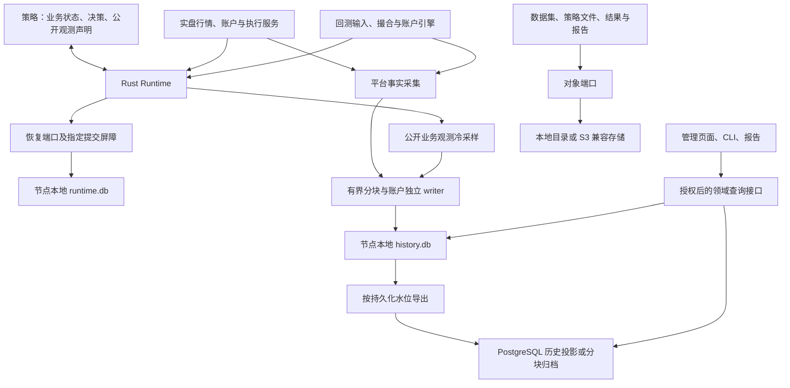

# Titan 数据持久化设计

版本：v0.9
日期：2026-10-28  
状态：M1–M4 首轮限定范围已完成；真实成交补验未通过，按用户要求停止并保留占用
实现基线：`5997364864861fdd5d8c649b93e54161018f703d` 加工作区修改，实际源码及验证见[M1 记录](verification/2026-10-27/data-persistence/m1/README.md)和[M2 记录](verification/2026-10-27/data-persistence/m2/README.md)  
M3 证据：[PostgreSQL/S3、切换及预算验收](verification/2026-10-28/data-persistence/m3/README.md)  
M4 证据：[受控实盘验收](verification/2026-10-28/data-persistence/m4/README.md)  
真实成交补验：[未通过，用户要求停止并保留占用](verification/2026-10-28/data-persistence/m4-filled/README.md)；不扩大首轮 M4 通过范围。
完整 A/N/E 非实盘：[候选 04 重放负例，修复候选 05 通过](verification/2026-10-28/data-persistence/m4-ane/README.md)。  
候选 05 故障补验：[部分成交、bootstrap 重放、断线重连与异常态 Stop 的五场景契约通过](verification/2026-10-28/data-persistence/m4-faults/README.md)。  
故障后安全恢复：[候选 07 补查事实、闭门重放、新代次固定点恢复与原期限 Stop 通过](verification/2026-10-28/data-persistence/m4-safe-recovery/README.md)。  
实施安排：[数据持久化实施计划](data_persistence_implementation_plan.md)

## 1. 目标与确定的决定

实盘和回测由 Rust 平台采集、保存和查询数据。策略只定义业务状态、决策及可选的公开业务观测字段，不调用存储 API，不持有数据库连接，不根据数据库类型分支。更换存储配置不修改策略源码、策略 ABI 或既有策略编译文件。

本设计确定以下边界：

1. 恢复点与运行代次统一存入执行节点本地 SQLite；恢复文件退出正常运行的写入路径，仅保留显式导入导出。
2. 恢复数据使用独立 `runtime.db`，与历史批量写入和管理操作分库。统一存储技术不要求所有数据共用一个数据库文件。
3. 领域协议和能力接口独立于后端；业务模块只依赖接口，后端由宿主组装时注入。
4. 实盘执行所需的持久化确认与历史采集使用不同路径。数据库事务成功不能替代交易所事实确认。
5. 实盘和回测共用事实类型、身份、单位、完整性与查询语义，分别保留真实交易所来源和模拟执行假设。
6. 账户、收益、费用、资金费和风控继续由原引擎计算；存储、管理器和报告不建立第二套交易账本。
7. M1/M2 使用 SQLite、本地对象目录及分块数据文件；M3 已通过真实 PostgreSQL 历史投影和 S3 兼容对象适配的双向切换验收。ClickHouse 和其他恢复后端属于后续扩展。

本文不授权迁移现有生产数据、部署程序或访问真实账户；不引入分布式交易、自动主备接管、通用消息总线或新的管理任务状态机。

## 2. 实现状态与后续迁移

| 当前能力 | 代码或协议 | 需要的变化 |
| --- | --- | --- |
| 策略恢复抽象与恢复载荷 | [runtime.rs](../crates/titan-strategy-runtime/src/runtime.rs) 的 `StrategyRecoveryStore`、`StrategyRecoveryPoint` | M1 已增加指定 token 等待、固定引用、代次预留、pin 和显式关闭；策略 ABI 不变 |
| SQLite 恢复实现 | [recovery_storage.rs](../crates/titan-strategy-runtime/src/recovery_storage.rs) 的 `SqliteRecoveryStore` | M1 已替换正常文件 writer；`service_core` 持有领域 trait，旧 `checkpoint_root` 仅兼容映射到 SQLite |
| 派单前恢复点提交与 flush | [runtime_v13.rs](../crates/titan-strategy-runtime/src/runtime_v13.rs) 的 `commit_commands` | M1 已等待指定提交；保留提交前后风险复查和故障关闭 |
| 账户事实记录 | [observation.rs](../crates/titan-account-service/src/observation.rs) 的 `AccountFactJournal` | M2 复用原 writer/财务投影，同事务追加统一事实与水位；关键审计故障阻止新单 |
| Runtime 组装 | [core_runtime.rs](../crates/titan-cli/src/core_runtime.rs) | 配置解析、能力检查、存储实例创建和依赖注入 |
| 恢复受理、载荷摘要及宿主所有权 | [control.rs](../crates/titan-cli/src/management/control.rs) | M1 已将完整 `RecoveryPointRef` 固定进 managed spec 并 pin；保留 Operation、账户占用、宿主独占与停止期限 |
| 管理目录及本机进程记录 | [management/store.rs](../crates/titan-cli/src/management/store.rs)、[registry.rs](../crates/titan-cli/src/registry.rs) | 保存存储引用及配置版本；进程 Registry 仍属于节点，不变成交易账本 |
| 回测审计与数据读取 | [result.rs](../hftbacktest/src/backtest/result.rs)、[data](../hftbacktest/src/backtest/data)、[历史回测入口](../hftbacktest/examples/grid_history/engine.rs) | M2 接入共同审计边界与平台 RunRecorder，有界背压输出 SQLite/Parquet；保留旧 reader |
| 结果包 | [ResultBundle v1](result_bundle_schema.md)、[run.rs](../crates/titan-persistence/src/run.rs) | M2 保留 v1 原字节；内容对象校验、发布登记及本地 manifest 最后提交 |
| 独立业务观测与查询 | [策略身份与观测协议](strategy_observation_protocol.md)、[facts.rs](../crates/titan-persistence/src/facts.rs) | M2 冷采样公开帧，管理 API/页面共用 HistoryQuery 和固定上界游标 |

恢复维护语法见[恢复存储运行手册](recovery_storage_operations.md)，M2 目录、查询、导出和登记修复见[本地历史与结果存储手册](local_persistence_operations.md)。M3 已实现并验收 PostgreSQL/S3、切换与回切，恢复点继续本地 SQLite。

## 3. 数据归属和分库

| 数据类别 | 唯一业务来源 | 默认存储 | 一致性要求 |
| --- | --- | --- | --- |
| 策略、参数版本、策略版本、部署、管理 Operation、账户占用 | 管理应用及其执行回执 | 管理服务的 `management.db` | 原有事务、幂等键、条件修订与授权边界 |
| 节点进程身份、owner token、心跳 | 节点 Registry | 现有节点 Registry 数据库 | 保留 PID 与启动身份核对；不能据此推断账户安全 |
| 运行代次、完整恢复点、最新恢复点引用 | 策略运行宿主 | 执行节点 `runtime.db` | 必要提交确认后才派单，禁止陈旧宿主覆盖 |
| 订单、独立成交、余额、持仓、资金流水、执行与风险事实 | 账户、执行与回测引擎 | 节点 `history.db` | 追加、业务去重、冲突保留、来源覆盖可追溯 |
| 权益曲线、风险采样、业务观测 | 引擎权威输出和公开业务观测 | `history.db`，后续分块归档 | 采样策略、单位、来源水位与缺失显式表达 |
| 原始及标准化行情、回测输入 | 行情服务与数据准备器 | 分块文件；新增长期归档采用 Parquet | 输入 manifest、精度、顺序及缺口固定 |
| 策略程序、冻结输入、结果包、报告 | 编译、运行与报告模块 | 本地对象目录或 S3 兼容后端（M3 已验收） | 不可变引用、摘要校验和显式发布 |
| 运行日志、诊断、操作审计 | worker、Runtime 和管理应用 | 有界轮转日志文件；结构化诊断进历史库，操作审计留管理库 | 容量与截断显式记录；文本日志不作为订单终态或恢复证明 |

`runtime.db` 可由同一执行节点多个受控宿主使用，每个运行命名空间只能有一个合法宿主。它与历史库分离，降低写锁争用；共享物理磁盘仍会相互影响，必须实测，不承诺分库即可消除 I/O 延迟。

账户事实归属于平台账户；可证明的策略归属通过关联记录表达。同一成交被多个运行观察时，不复制为多份财务事实。共享行情及数据集同样不变成策略私有状态。

## 4. 结构与依赖方向



策略不持有图中的任何存储端口。Runtime、账户服务和回测执行器使用领域端口；SQL、连接池、对象路径、重试和序列化 I/O 留在适配模块。工厂在启动阶段选择具体实现，事件回调中不解析配置、不选择后端、不访问远程历史库。

首期沿现有 Rust crate 增加模块。恢复端口留在 `titan-strategy-runtime`，SQLite 具体实现隔离到其存储适配模块，通过构造参数注入；账户事实端口及现有实现留在账户服务，管理仓储端口留在 CLI 管理层。驱动依赖及 feature 只由适配模块使用。共享基础类型按实际需要放入 `titan-domain-types`，不创建包含全部业务状态的万能仓储，也不按接口数量拆 crate 或服务。

## 5. 存储端口与能力契约

| 端口 | 主要语义 | 默认及后续实现 |
| --- | --- | --- |
| `StrategyRecoveryStore` | 独立预留代次、提交完整恢复点、等待指定提交、按固定引用读取、保留与释放引用、健康检查和关闭 | M1 已实现 SQLite；可注入领域接口，不开放未验收恢复驱动 |
| `FactArchive` | 有界批量追加、来源去重、业务冲突处理、持久化水位、缺口及清洁关闭 | M2 SQLite；读取独立走 HistoryQuery |
| `CatalogRepository` | 领域查询、Operation 与占用事务、条件修订、授权所需轻量投影 | 首期包装现有 SQLite；其他实现需单独通过事务契约 |
| `HistoryQuery` / `HistoryProjection` | 授权范围内稳定分页、曲线和观测查询；按源水位幂等构建可重建投影 | SQLite；第二实现为 PostgreSQL |
| `ObjectStore` | 按内容引用写入、校验读取、不可变清单发布、受限导出 | 本地目录；第二实现为 S3 兼容存储 |
| `MarketDataSource` | 按固定数据集清单扫描、分块读取、返回输入顺序及质量 | 保留现有 NPY/CSV 准备链；新增 Parquet 读取适配 |

M2 在独立 `titan-persistence` crate 实现 `FactArchive`、`HistoryQuery`、`ObjectStore` 和 `ResultCatalog`；账户服务、回测引擎与 CLI 依赖它，它不依赖策略 Runtime、账户服务或管理应用。`HistoryProjection`、统一 `CatalogRepository` 和 `MarketDataSource` 名称仍为后续接口设计；本轮 reader 使用既有扩展点。调用者传入领域查询和类型化结果，不传任意 SQL 或表名。分页携带查询身份、固定上界、覆盖、水位和缺口。

M1 工厂检查 `durable()`、互斥的配置来源、数据库角色/schema 和恢复/历史路径冲突，生产 core 拒绝非耐久测试 sink。后续端口按需检查 `atomic_write`、`conditional_update`、`immutable_read`、`ordered_scan` 等能力。不满足要求时启动拒绝，不能运行中降级成内存或文件写入；实盘账户绑定不能禁用必要恢复存储。

M1 已冻结的恢复接口如下；这些类型仅属于 Rust 宿主，不进入策略 SDK：

```text
reserve_generation(runtime_strategy_no, minimum) -> 已持久化的运行代次
submit_token(point) -> RecoverySubmitToken { session, sequence }
flush_through(token, deadline) -> ()，成功即指定提交已完成
load_reference(RecoveryPointRef) -> 经核验的 StrategyRecoveryPoint
load_pinned(runtime_strategy_no, sha256) -> 同摘要记录；缺失拒绝
pin(reference, operation_id) / unpin(reference, operation_id)
close(deadline) -> 排空、join writer 后释放执行锁
```

`RecoverySubmitToken` 只证明本次宿主会话接受了提交；等待成功才证明持久化。`RecoveryPointRef` 在冷路径从已提交记录取得，包含 `store_id`、`runtime_strategy_no`、`record_id`、`payload_sha256`。M1 不为热路径构造一个额外的回执对象。等待指定 token 不要求其他命名空间的队列永久清空，失败状态不会被后续成功清除。

高频诊断与普通文本日志不逐条占用恢复提交队列。沿用现有后台排空、总字节上限和 worker 清理规则；轮转日志按配置保留，结束后可登记只读对象。运行事实和管理回执以结构化存储为准，不能从日志关键词推断操作已经完成。

## 6. 身份、时钟、单位与格式

### 6.1 稳定身份

沿用 [策略身份定义](strategy_observation_protocol.md)：`strategy_id`、`strategy_version_id`、`run_id`、`run_generation`、`runtime_strategy_no`、`worker_session_id` 分别表达业务归属、版本、执行、代次、路由与会话。更换文件路径、数据库地址或展示名称不重新分配业务身份。

M1 运行命名空间由随机持久化 `store_id` 和原有 `runtime_strategy_no` 共同确定，不新增策略业务 ID。数据库另绑定规范化位置；移动副本不允许直接激活。迁移不能通过生成新 namespace 绕开既有账户占用或订单命名空间；跨节点迁移需显式核对旧宿主退出、账户事实及占用，首期不自动接管。

事件至少保留以下字段，按类型允许空值：

| 分组 | 字段及含义 |
| --- | --- |
| 协议 | `kind`、`schema_version`、载荷格式版本、内容摘要 |
| 范围 | 节点、环境、策略/版本、运行/代次、账户、交易所及品种原生身份 |
| 记录身份 | `recording_id`、来源流 ID、来源 epoch、来源 sequence；重传保持不变 |
| 业务身份 | 原生 trade/order/ledger ID、命令关联 ID；跨连接去重使用原生业务身份 |
| 顺序与因果 | 来源序号、宿主实际处理序号、关联命令及回调边界；不制造全平台总序 |
| 时间 | 交易所时间、平台接收时间、采集时间、模拟时间分别表达 |
| 质量 | 覆盖范围、缺口、冲突、是否补查、是否采样、缺失原因 |

进程内 EventEngine source ID 不能独自作为跨重启持久化身份。没有可靠原生序号的连接，使用记录会话内自增序号并保留来源能力；不能因此声称证明交易所没有漏推。

### 6.2 精度与兼容

- 时间沿用有符号纳秒；单调期限另保存 boot ID 和相应单调时钟证据，不能从墙钟重建。
- ticks、lots、金额单位与币种随事实冻结。平台原本精确的数值保存为整数刻度或精确十进制，不能先转浮点再入库。
- 对原本是浮点的引擎指标保留其数值及计算口径；存成十进制字符串不意味着提高了计算精度。非有限值和未证明值按协议标记缺失。
- Rust `u64` 超出 SQLite 有符号整数范围的字段不得强制转换为负数；使用校验过的十进制文本或有序二进制编码。排序、比较及跨后端往返必须有契约测试。受约束的代次仍检查现有 ABI 可用范围。
- 数据库 schema、事件 schema、恢复载荷格式、状态 schema、公开观测 schema、对象 manifest 各自版本化；拒绝高于本程序理解范围的必需格式。
- 新增兼容字段可按显式 reader 规则读取；破坏顺序、单位、财务口径或恢复语义的改变必须升级协议，不能就地重写旧摘要。

## 7. SQLite 恢复存储

### 7.1 文件与基础配置

`runtime.db` 位于执行节点本地、经过规范化且具有固定存储身份的目录。启用 WAL、`synchronous=FULL`、外键校验和有界忙等待，实际启动后读取 PRAGMA 确认生效。每个写连接均设置必要参数；不依赖初始化连接替其他连接配置。

WAL 支持并发读，但同一数据库仍只有一个并发写事务；不能把 WAL 文件放到共享网络文件系统供多机访问。WAL 与 `FULL` 的提交同步语义见 [SQLite WAL](https://www.sqlite.org/wal.html)、[同步配置](https://www.sqlite.org/pragma.html#pragma_synchronous)、[事务说明](https://www.sqlite.org/lang_transaction.html)。M1 固定 `rusqlite=0.40.2`、bundled SQLite 3.53.2，并拒绝运行时 SQLite 低于 3.51.3；该门槛用于确保包含官方 WAL-reset 修复，不接受尚未单独验证的旧分支回补版本。

写线程使用有界队列；恢复事务保持短小，事务内不等待网络、不扫描历史、不执行对象上传。业务 checkpoint 与 SQLite 的 WAL checkpoint 是两种操作，配置和指标使用不同名称。

### 7.2 核心表

M1 实际 schema 为 `user_version=1`；具体 DDL 见 `recovery_storage.rs`。未知高版本及其他用途数据库被拒绝打开。

| 表 | 关键字段与约束 |
| --- | --- |
| `storage_meta` | 单行随机 `store_id`、`activation_allowed`、规范化 `bound_path`；身份不从路径推导 |
| `strategy_generations` | `strategy_no` 主键、已预留最大代次、`owner_session`；独立提交且不回退 |
| `recovery_points` | 不透明 `id`、运行编号/代次、十进制文本恢复序号、原始 `payload BLOB`、SHA256、编译/绑定/state schema 摘要；同编号/摘要唯一 |
| `recovery_heads` | 运行编号主键、代次、record 引用及 revision；复合外键与条件更新 |
| `recovery_pins` | record ID、Operation ID 联合主键；外键保护固定引用 |
| `recovery_commits` | session/sequence 联合主键及 record ID；提交与 head 同事务，供指定提交追踪 |
| `migration_receipts` | 运行编号/旧字节 SHA256、导入目标、代次下界；与目标记录同事务 |
| `generation_imports` | 运行编号/原代次文件 SHA256、已保全下界；先独立提交，支持只有代次文件的失败启动迁移 |

核心业务状态只存在 `recovery_points.payload`。新恢复点将现有 `StrategyRecoveryPoint` 序列化一次，以同一组原始字节计算 SHA256 并保存；首期可继续使用现有 JSON 载荷作为 BLOB，不再拆解私有状态字段。导入旧文件直接保存已核验的原始字节，不重新序列化。

列中的检索元数据必须与载荷中的策略身份、代次、编译内容、schema 及绑定一致，读取时核对。载荷 SHA256 固定原始字节，内部 checksum 继续验证原有结构。数据库文件摘要、策略编译摘要、载荷 SHA256 不相互替代。

### 7.3 运行代次及宿主所有权

预留代次使用独立短事务：读取已持久化上界及恢复要求的最小代次，检查范围后递增并提交，提交成功才能返回。预留后启动失败也不回退；不得把代次更新放进后续可能回滚的 checkpoint 事务。

首期保留规范化存储目录下的操作系统所有权锁，锁范围对应稳定运行命名空间。锁文件只保存数据库身份见证，不保存恢复点或代次；数据库被删除重建时拒绝旧位置静默重置身份。提交须精确匹配已预留代次和宿主会话，并条件推进 head revision。新代次一经预留，旧代次即失效，不等新 head 出现。

宿主先停止和清理全部运行，再通过 `close(deadline)` 排空并 join writer 后释放锁。超时保留锁；不能依赖仍被 EventEngine 引用的 Arc 何时析构来决定新宿主能否启动。

数据库复制、别名目录和备份恢复不能制造两个可交易宿主。管理账户占用、节点进程身份、namespace 锁分别继续有效。首期不凭数据库行中的过期时间自动接管账户。

### 7.4 一次恢复点提交

```text
在成功回调或既有恢复屏障边界取得完整恢复点
  → 完成原有状态、订单清单、绑定及账户恢复基线校验
  → 冻结完整恢复对象及 namespace/代次
  → 入有界队列，返回会话内 SubmitToken
writer 序列化一次并核验原始字节、计算摘要，开启事务
  → 校验当前代次、宿主所有权及预期 head
  → 幂等插入不可变恢复记录
  → 条件推进 recovery_heads
  → COMMIT 成功
  → 发布对应 token 的已提交水位；固定记录引用由冷路径读取
```

同一幂等身份和同一内容允许返回原记录；同一身份不同内容明确报冲突。数据库记录 ID 独立于墙钟和内部恢复序号，不能假设时间戳天然唯一。

接收端分配会话内连续 token，单 writer 按 FIFO 依次提交，并在事务内读取及推进 head 修订。这样连续排队不会都持有同一个旧 head。未成功入队不消耗 token；前驱失败后后续提交失败关闭，不能跨越失败边界。回调不为取得下一修订读取数据库。

完整恢复点继续包含业务状态、未决订单意图、原生订单记录、已消费边界及账户恢复基线。首期不另建与状态分开提交的执行意图日志，以免产生第二个恢复提交边界。

### 7.5 固定恢复引用与读取

恢复受理固定以下不透明引用：逻辑存储/数据库实例身份、namespace、record ID、载荷 SHA256；同时核对策略及运行归属。存储映射由节点可信配置解析，HTTP 客户端不能通过任意数据库路径指定目标。

节点按请求中的原字节 SHA256 核验记录，建立 pin，再把完整引用固定进 `managed.json`。受理不通过 latest 选择恢复点；pin 再次核验同一不可变记录，期间若记录已被离线清理则拒绝。节点 pin 与中央受理不是跨库事务；中断或受理失败留下的 pin 保守保留，释放前核对同一 Operation。缺失记录不能改取 `latest`。

pin 的幂等身份使用既有 `operation_id`，总量上限 4096，同一操作/记录重复建立幂等。孤立引用清理先核对管理回执，不能仅凭墙钟超时删除未知操作仍可能需要的证据。

恢复继续经过原有签名/编译内容、ABI、私有状态 schema、绑定、校验和、账户事实、订单结果、库存屏障及单调期限检查。公开业务观测兼容不能放宽这些条件。

首期每次提交保留完整载荷，容量约为“载荷大小 × 保留提交数”，不等同于每分钟一个采样点。按引用保护后保留必要最新记录、停止/故障点和有限滚动窗口；清理在冷路径分批执行，不在派单事务内清表或 VACUUM。不可删除未决操作引用、迁移回执依赖和恢复证据；头损坏时明确拒绝，不能自动选择更老业务状态继续交易。

## 8. 实盘执行与持久化屏障

```text
回调生成命令
  → 校验完整命令批次、库存和风险
  → 形成含未决意图的完整恢复点
  → 等待指定 SQLite 提交成功
  → 复查账户代次、行情新鲜度及价格/敞口约束
  → 进入现有执行接口
  → 接收交易所订单、独立成交和账户事实
```

每个 tick 不强制 fsync。保留现有周期恢复点、命令提交、恢复及停止屏障的触发语义；不能为提高历史刷新率而提高策略恢复写入频率。后续优化可以合并安全的事务，但每个外部副作用仍须等待覆盖自身完整状态与意图的提交。

| 故障位置 | 必须行为 |
| --- | --- |
| 入队失败、校验冲突、事务失败 | 不执行该批外部命令，进入既有故障关闭流程 |
| COMMIT 已成功但确认未送达 | 对调用者结果为未知；不派单、不更换命令身份重试交易所操作，保留原提交引用供恢复 |
| flush 或锁等待超时 | 关闭交易门，保留迟到提交诊断；迟到完成不自动重开门、不补发该批命令 |
| 提交后再次风险复查失败 | 不派单，按现有恢复/对账流程处理已经记录的未决意图，不伪造交易所终态 |
| 请求可能已进入传输但无结果 | 按原 client order ID 只读核对；不能由数据库提交成功推断交易所受理，也不能盲目重发 |

停止与保护性操作继续保留独立有界容量。存储失败不能因“优先停止”绕过原有身份、意图或风险检查；既有确认、对账和允许的安全退出路径继续由平台控制，不由存储适配器发单。

## 9. 账户事实、历史写入与完整性

### 9.1 写入及去重

复用 `AccountFactJournal` 的有界非阻塞采集和独立 writer，统一追加订单生命周期、独立成交、持仓、余额、资金流、账本记录及风险事实。先在平台来源边界采集，不依赖策略是否订阅对应回调。

记录去重分两层：记录流身份抵御导出重传，交易所原生业务身份抵御重连后的同笔成交或流水。相同身份和摘要返回已有记录；不同摘要保留首笔及冲突证据，标记受影响覆盖范围。累积订单量更新与独立成交不能混成同一类去重键。

实盘业务键包含环境、原生账户、交易所及该交易所规定的 trade/ledger ID 唯一作用域，必要时加入品种；不能只用一个裸 trade ID。回测的模拟账户及业务键另包含 run ID，同样输入重复回测也属于不同执行事实，不能被上一轮去重掉；模拟事实与真实账户事实禁止合并。

一批事实、其去重状态和连续持久化水位在同一个 `history.db` 事务内提交。写线程完成后才能推进 `durable_watermark`；接收计数、队列排空和心跳不代表落盘。clean marker 在排空并提交最终水位后写入，记录源存活继续由操作系统锁证明。

### 9.2 分级策略

| 类别 | 实盘背压或失败 | 回测背压或失败 |
| --- | --- | --- |
| 执行恢复必需数据 | 必须等提交；失败关闭交易门 | 请求恢复能力时同样校验，不用不完整载荷冒充可恢复 |
| 必需订单、成交、账户审计 | 有界写入；缺口立即标记并按录制策略阻止新增风险，进入受控处置 | 等待 writer 或暂停推进；失败使持久化结果不完整，不能成功封存 |
| 业务观测、图表采样 | 可按声明采样或合并，超限显式计数及缺失，不代替恢复证据 | 按冻结采样规则输出，不能声称逐事件完整 |
| 行情归档 | 明确 `off/sampled/full` 及覆盖范围，满队列产生缺口 | 回测输入不因输出采样而删减，必需全量输出采用背压 |

录制策略属于冻结运行配置，不能由适配器隐式选择。原有只读观察实例在非必需采样失败时可继续观察，但必须展示不完整；实盘交易实例默认要求关键审计，持续故障不能静默忽略。该处置规则在平台统一实现，策略不感知数据库故障。

异步接收至 SQLite 提交之间存在崩溃丢尾风险，不能宣称零丢失。无 clean marker 的来源按账户/流标记不完整；只有交易所权威补查和明确覆盖证据才能修复相应范围。平台接收到的连续性、交易所推送完整性和账本补查覆盖分别表达。

## 10. 回测持久化与复现边界

回测执行器注入与实盘相同的事实及观测端口，事实来源标记为模拟。订单/成交、费用、资金费、权益、风险和最终账户状态取自引擎，策略无需调用 recorder。迁移现有策略中显式保存结果的样板逻辑时，将采集移至共同宿主边界。

执行过程使用有界 chunk，达到容量先写入再推进，不无限积累全部结果。`audit=full` 必须走流式不丢弃路径；采样或关闭审计有独立完整性声明，不与完整模式混用。

每次运行冻结策略版本与原生库身份、参数、绑定单位、引擎版本、输入 manifest、准备回执、顺序规则、撮合/队列/延迟/费用/资金费模型、种子、结束规则及录制配置。相同冻结输入的确定性范围在验收中声明，不能把异步实盘归档说成交易所可精确重演。

状态分别表达：引擎完成状态、业务成功与否、结果持久化状态、报告生成状态。引擎完成但结果未提交，不显示完整成功；失败运行可保存带失败原因的完整诊断结果包，不能改变其业务结果。

实盘恢复点不能直接充当完整回测进度：恢复回测还需要数据游标、模拟时钟、调度队列、撮合器及模拟账户等一致快照。本期不承诺任意中断回测续跑，默认以固定输入重新运行；策略状态可持久化不等于整个模拟器可恢复。

## 11. 行情数据与不可变对象

保留现有 NPY/CSV 及准备缓存 reader；新增 Parquet 作为长期行情、曲线和大批量审计归档格式，不在本次设计中强制重写已有冻结数据集。Parquet 是列式文件格式，适合作为此处的批量归档载体，见 [官方概述](https://parquet.apache.org/docs/overview/)。

数据集 manifest 固定原始和标准化数据引用、大小、摘要、品种元数据、分区时间范围、schema、来源质量与准备操作回执。分区按事件类型、交易所/品种和时间组织；chunk 大小按记录数及字节双重限制，避免每个事件一个对象。

盘口归档必须保留快照/增量、原生序号及补快照边界。只录 BBO 或 OHLC 的数据不能声明可支持完整盘口撮合。源成交价格精度不应被订单 tick 提前截断，录制降频也不能改变回测引擎的风险观测输入。

对象写入流程为：写暂存对象或独立内容键 → 完成大小与 SHA256 校验 → 发布不可变 manifest → 登记可查询引用。本地使用经过同步的原子文件提交，S3 兼容实现使用经过验收的条件创建/不可变键协议，不能假设对象存储支持文件 rename 或 ETag 等于 SHA256。

对象存储与目录数据库之间没有统一事务。manifest 已发布但索引未登记时，重试登记同一引用；只有索引而无有效 manifest 时保持待完成或损坏，不能展示成功。重启核对只修复存储登记，不重执行交易或回测。无人引用的暂存对象保留宽限期后再清理。

ResultBundle v1 继续保存原始结果字节及 manifest，报告 renderer 通过只读适配获得经校验的输入；需要本地路径时在隔离目录物化原字节。不改变 v1 的文件列表、摘要和财务语义；未来分块结果包若改变读取契约，另发新 manifest 版本并保留显式 reader。

实盘归档生成新回测数据集时须重新登记输入质量和模型。历史真实成交是核对证据，不能在新的回测中冒充撮合输出。重放和查询工具不持有真实交易权限。

## 12. 查询、业务观测与管理集成

查询经过账户、节点、环境、策略及运行归属授权后再分页。稳定游标包含逻辑来源、查询条件、排序键及固定上界；可迁移逻辑游标时保留其语义，否则明确返回游标失效并重新同步，不能静默从新后端第一页续接。

SQLite 查询使用独立只读连接和阻塞任务线程，不持有操作受理或交易写入互斥锁扫描大对象。查询有时间、条数和字节限制；长读事务、WAL 增长和归档查询必须受控。SSE 延续资源修订和快照游标协议，不把投影水位当成 Runtime 生命周期。

公开业务观测仍从成功回调发布的原始标量帧采集，保留 schema hash、发布序号、回调水位、运行代次与采集时间。重复读取同一发布帧不制造新业务事件；采样记录可以标明此次采样但不能推进业务发布序号。起止、失败及最终帧按录制规则保留。

管理层展示恢复点公开元数据、固定引用、可用性及拒绝原因，不解析私有状态 BLOB；观测页面不查询恢复表恢复业务字段。账户权益、原币种回撤、策略配对毛收益和净收益口径继续分别表达。

## 13. 配置、后端矩阵与切换

### 13.1 当前配置与后续配置

M1 已支持 `[strategy_service.recovery_storage]` 的 `driver/path/queue_capacity/busy_timeout_ms`，完整示例见[运行手册](recovery_storage_operations.md)。旧 `checkpoint_root` 仅映射到目录内 `runtime.db`，两者不能同时设置；旧文件没有显式导入回执时拒绝启动。

M2 直接运行支持 `[account_service].history_path` 和 `recording_environment`（账户运行限 `live/simulation`，默认 `live`）；即使未启动管理观测，也自动接入账户记录器和派单健康检查。管理节点继续使用已有 `work_root`，在其下保存 `account-facts.sqlite3`、单次回测历史和共享 `storage/objects`、`storage/catalog.db`。具体目录和默认值见[本地存储手册](local_persistence_operations.md)。

M3 使用独立、不可变的 JSON 存储 profile，经 `titan storage initialize --storage-root <work_root>/storage --profile <private.json>` 写入控制库。实际字段及可执行示例见[配置样例](../configs/storage-profile.postgres-s3.example.json)和[运行手册](local_persistence_operations.md)。后端连接、预算、目标身份及路由由宿主维护，不进入策略参数；第 19 节说明已实现的切换协议。

账户与回测仍写本地 SQLite，查询经路由选择 SQLite/PostgreSQL；内容对象经同一工厂选择 filesystem/S3。恢复路径继续由 `strategy_service` 单独固定。worker 不直接打开中央管理库，控制/恢复/历史/目录数据库角色冲突拒绝。

敏感连接信息使用平台 secret reference，不进入策略参数、结果 manifest、审计明文和命令行。未知 driver、同一路径误配到恢复和历史角色、版本不支持或能力不满足时启动失败。

### 13.2 交付矩阵

| 能力 | 本地闭环 M1/M2（P01–P09） | 后端切换 M3（P10–P13） | 本期不宣称 |
| --- | --- | --- | --- |
| 执行恢复 | SQLite，唯一正常写入后端 | 仍为节点本地 SQLite | 远程 PostgreSQL/ClickHouse 恢复、文件自动降级 |
| 关键事实耐久缓冲 | 本地 SQLite | 继续保留本地 SQLite | 交易热路径等待远程库、无界缓冲 |
| 历史查询投影 | SQLite | PostgreSQL 第二实现及双向切换验收 | 仅有 trait 即视为支持任意数据库 |
| 管理目录 | 现有 SQLite 的领域仓储封装 | 保持 SQLite，可独立扩展 | 未验收的管理数据库无缝替换 |
| 对象 | 本地目录 | S3 兼容第二实现及兼容性验收 | 所有 S3 服务能力天然相同 |
| 大数据分析 | 现有 reader 与新增 Parquet 适配 | 从相同 manifest 读取 | ClickHouse 已实现、任意跨平台结果逐位相同 |

PostgreSQL 历史投影由本地归档异步生成，不负责交易准入。投影批次和其源游标在目标事务中共同提交，重复传输按原记录身份幂等；事务隔离及重试按 [PostgreSQL 官方说明](https://www.postgresql.org/docs/current/transaction-iso.html)和端口契约验证，不能假设两种数据库默认隔离行为相同。

### 13.3 切换流程

历史后端切换先冻结目标配置，回填至固定来源水位，继续追平增量，比较计数、去重、摘要、精度、权限、分页和缺口，再在查询边界切换。重传从已持久化游标继续；远程不可用不删除本地缓冲。回切时本地必须具备目标范围的历史，已归档删除的部分先从经验证的归档回填，否则拒绝无损回切承诺。

对象后端切换按 manifest 复制并逐对象校验，完成后变更可信位置映射；对象逻辑身份和原字节摘要保持不变。每次运行固定存储配置版本与逻辑引用，位置迁移使用显式映射，不覆盖运行输入。

执行恢复存储变更只在停止、排空、核对旧宿主退出和账户占用后进行。即使仅移动 SQLite 文件，也要核对数据库实例、namespace、代次下界、pin 和固定引用；不能运行中热换数据库文件。后续其他恢复后端需另行设计及通过全部安全契约，本期配置只接受 SQLite。

## 14. 旧文件迁移、兼容与回滚

迁移工具在节点冷路径执行，不在策略回调、页面读取或自动失败重试中触发。默认离线迁移：

1. 核对节点、源码及配置身份，停止对应宿主并证明其已经退出，保持账户占用；取得原 namespace 独占锁。
2. 冻结原 JSON、代次文件、相关固定摘要/Operation 引用及版本信息，生成只读迁移清单。
3. 按原始字节验证文件 SHA256，再解码并执行现有结构校验。保留 alias 兼容 reader，不改旧载荷内容。
4. 在独立事务预留/提高代次下界，至少覆盖原代次文件及导入恢复点的代次；失败产生空号允许，下界不能回退。
5. 在单个导入事务写入不可变 BLOB、元数据、旧摘要别名、head/pin 和迁移回执。明确选择的恢复点不能被“最新”替换；重复导入同内容幂等，冲突拒绝。
6. 逐字节导出核对、执行拒绝矩阵和无真实账户恢复探针，再切换节点可信存储配置。跨中央引用通过同一 Operation 补齐回执，不原地重写旧请求及摘要。
7. SQLite 成为唯一写入来源；保留旧文件为只读备份和审计证据，不继续双写，不在 SQLite 故障时自动切回文件。

首期 loader 可经显式旧引用适配查到同摘要的新记录；必须先保留并核验原请求/文件，不能以改字段名重新计算旧幂等摘要。新接口使用不透明固定引用，公开 `recovery_point_sha256` 表示原始恢复载荷字节 SHA256，与旧文件的字节意义连续。

回滚程序也必须经过停止和账户核对。若新版本已经预留代次、提交状态或产生外部副作用，不允许直接用迁移前的旧 JSON 或数据库备份恢复交易。仅在状态及格式兼容已证明、导出的是所选最新合法记录、代次下界同步且原期限连续时回滚；否则保持交易门关闭，修复或走人工明确对账。旧二进制不能理解新 schema 时拒绝打开。

## 15. 备份、保留与容量

SQLite 备份使用受控 Online Backup API，或停止并排空所有连接后的完整备份流程；在线运行时不能只复制 `.db` 主文件并遗漏 WAL。备份记录数据库身份、schema、各 namespace 的代次/head、pin、事实水位、对象 manifest 与备份时间，方法依据 [SQLite Backup API](https://www.sqlite.org/backup.html)。

三类数据库和对象目录没有跨存储原子快照，备份清单分别声明其边界。恢复 runtime 备份不意味着历史或账户已经对齐；恢复历史库也不授权新宿主启动。

旧备份可能丢失已经预留的代次和已经发生的交易。灾备后默认关闭交易门，必须从未回退的管理/节点证据及权威账户查询证明代次下界、订单归属与未决请求；证据不足不得自动重新分配旧代次或生成新 namespace 绕过检查。首期不声明整节点数据丢失后可自动无损恢复。

恢复点按 pin 和安全保留窗口清理；本地事实只有在目标投影/归档已提交并验证覆盖之后才允许按策略回收；永久保留缺口、冲突及必要审计证据。对象 GC 保护运行、报告、数据集、备份及迁移引用。磁盘余量、恢复提交队列和历史归档配额分开预算，磁盘满不能触发丢弃安全证据。

## 16. 故障语义与可观测性

| 情况 | 结果与后续 |
| --- | --- |
| 恢复库忙、磁盘满、只读、校验损坏、writer 退出 | 指定提交失败或未知，交易门关闭；保留原恢复引用与诊断 |
| 历史 writer 崩溃、队列溢出、未清洁关闭 | 对账户/流标记缺口，按关键事实策略处置；不能伪造完整曲线 |
| PostgreSQL/对象目的地离线 | 从本地已提交事实补传，暴露投影延迟；容量耗尽按冻结策略处置 |
| 同一事实身份不同内容 | 保留原事实和冲突，受影响范围不完整；不覆盖以使汇总看起来正常 |
| manifest 未发布或摘要错误 | 查询结果待完成/损坏，报告不读取未校验字节 |
| 旧宿主写入、旧回执到达、恢复引用被删改 | 条件更新或身份检查拒绝，不能释放新运行占用 |
| 后端切换中断或游标不兼容 | 保留原生效配置；重新核对固定水位，必要时要求客户端重同步 |

至少输出恢复提交耗时与队列深度、已确认提交序号、busy/flush 超时、writer 健康、数据库/WAL 大小、磁盘余量、来源 clean 状态、丢弃/冲突/缺口数、事实持久化水位、远程投影水位及积压字节、对象发布/摘要错误、备份水位与 pin 数。指标使用有限标签，避免每个订单一个时序标签。

恢复数据包含私有策略状态和账户事实，文件权限及备份访问按节点角色限制；管理 API 仅输出授权元数据。SQL、诊断和日志不输出 secret、完整私有 BLOB 或未脱敏连接字符串。

## 17. 验收与发布边界

验收矩阵、工作包及证据模板见[实施计划](data_persistence_implementation_plan.md)。必须以同一份未经重编译的策略文件证明切换前后策略行为与持久化语义符合冻结输入，不能只用内存 mock 证明后端可切换。

本地仅编辑和审查文档/代码；构建、格式、静态检查、代码生成、单元/集成/性能与非实盘故障验证全部在 `192.168.3.88`。同步前确认远端仓库路径、版本与工作区状态，保存源码清单，避免覆盖既有修改。

M1 的实际验证与限制见[本轮记录](verification/2026-10-27/data-persistence/m1/README.md)。它覆盖 SQLite 恢复闭环，不证明第二后端、完整回测归档或整机断电耐久性已验收。真实账户检查另需明确目标和受控授权，且只能在实盘服务器使用编译服务器产物执行。

M2 的[最终验收](verification/2026-10-27/data-persistence/m2/README.md)覆盖同一源码的 M1 回归、636 项 Rust、2 项 doctest、SDK 115 项、报告 5 项、32 项回环流程、18 组历史回测和 24 项本地闭环。42,743 条事实的 SQLite/Parquet 有序摘要一致，同一原生策略文件切换输入格式后引擎与事实一致。实际恢复 FULL 提交 P99 为 13.107 ms，原生回放峰值 RSS 为 20,248 KiB；该测量不替代生产预算及完整争用门禁。

## 18. M2 实现契约

### 18.1 事实和来源

`FactEnvelope` schema v1 固定环境、节点/账户、可证明的策略/运行/代次、录制 ID、流 ID、来源 epoch/序号、类型、交易所与接收纳秒时间、原 payload、可选原生业务键和摘要、采样声明。大整数按十进制字符串编码；Parquet 的序号使用 UInt64，时间使用 Int64。账户仍使用配置中的平台账户键，不能在同一历史库中把旧键重新指向另一原生账户；交易所原生成交键继续由既有账户模块按 provider/账户/品种/原生 ID 和单位生成。

直接执行器未获知节点 ID 时保留空值，不伪造节点身份。管理节点的来源归属由授权的节点端点、不可变请求和存储身份确定；后续跨节点投影必须携带该来源映射，不能将空节点 ID 或账户别名当全局唯一键。

原始账户事实没有可证明的策略归属时 `strategy_id=null`，不以录制运行冒充财务归属。回测使用 `environment=backtest`、模拟账户和独立 run ID，真实账户模拟使用 `simulation`，与 `live` 分离。公开业务帧有冻结的策略身份，保留原公开 schema/hash 与发布序号。

统一归档表与旧账户 `user_version=2` 共存，归档另用 `archive_meta.schema_version=1`：

| 表 | 语义 |
| --- | --- |
| `archive_sources`、`archive_source_scopes` | 开始接收前持久化来源及账户/运行范围；零条记录也可显示未关闭来源 |
| `archive_records` | 原 envelope 字节与 SHA256、不可变来源身份、查询字段及业务重放标志 |
| `archive_watermarks` | 同事务提交的来源序号和 durable row；序号为大端 8 字节，覆盖 u64 全范围 |
| `archive_business` | 环境/账户/回测 run 作用域下的原生业务键、首笔摘要和行号 |
| `archive_conflicts`、`archive_gaps` | 保留矛盾新载荷及来源缺口，不改写原事实 |

旧账户财务投影仍由同一 writer 维护，统一归档不重算费用或资金费。默认查询排除已证明相同的业务重放，录制证据仍保留。必需事实队列满、writer 故障或身份冲突使关键审计不健康；执行层在首次轮询新单 future 时检查，拒绝码 `CRITICAL_AUDIT_UNAVAILABLE`，撤单保留。该检查不能撤回已经进入网络传输的请求。

### 18.2 有界输出与数据格式

`RunRecorder` 由执行宿主持有，策略不获得 recorder 或存储配置。完整模式使用同步背压，不复用旧内存 audit 的截断模式。SQLite 和事实 Parquet 每批最多 64 条，并按 4 MiB 限制缓冲，单条最多 1 MiB；`FactArchive` 公共批量上限为 256。writer 失败状态保持，最终封存必须先排空 SQLite，再关闭/同步 Parquet footer，失败不发布结果 manifest。

三种精确列定义各自校验：`titan_facts_v1` 保留 envelope JSON，标准行情 `Event` 保留 8 个原字段和 f64 位值，历史 prepared tape 保留 6 个 Int64 与资金费原位编码。prepared 数据同时输出旧二进制和 Parquet，回放按原始事件顺序逐条扫描、保持同时间戳调度阶段。普通 Event reader 按既有内存分片机制读取，单 Parquet shard 上限 1,048,576 行；超过须拆片，不能宣称任意大单片也流式常量内存。CSV 准备阶段仍沿用原排序流程。

CLI 的轻量 trace JSON 入口仍一次解析输入；审计输出有界不表示该入口的输入加载也流式。大历史输入采用原生扫描或既有分片 reader，资源报告区分输入准备、执行和结果输出。

结果记录模型、输入/原生策略摘要、单位与准备回执。行情输出声明为输入 manifest，本轮不额外复制逐条行情；权益/业务帧明确采样，不能当完整连续曲线。引擎 FAILED、业务成功、录制完整、结果 COMMITTED 和报告状态分别表达。

### 18.3 查询与发布

`HistoryQuery` 用独立只读 SQLite 连接和短事务，HTTP 放入阻塞任务池，不持有控制写锁。游标绑定 store ID、过滤和方向摘要、固定 upper row 和 after row；授权在查询前完成，每页最多 200 条/约 4 MiB，busy timeout 200 ms。默认按来源顺序，`newest_first` 为权益图等读取最新记录；换方向须重取，连续翻页仍保持原上界。载荷摘要和返回 scope 再次校验。来源覆盖诊断反映查询时健康，换库或改变条件要求重取。

M2 的 `ObjectStore` 实现本地摘要目录，M3 增加 S3；`open_verified` 均在冷路径返回经校验的本地只读文件。文件写入临时路径、同步后不覆盖发布，已有摘要对象必须核验长度和原字节。物化使用复制，不对对象建可写硬链接。`ResultCatalog` 的条件登记在 SQLite 写事务中完成；相同引用幂等，冲突拒绝。

M2 对象发布覆盖数据准备和结果包；M3 已把策略编译文件及报告接入相同内容对象和目录，平台冷路径处理远程物化，不要求策略变化。归档 reader/writer 都拒绝未知 schema，恢复、历史、管理和对象目录数据库角色不能混用。

ResultBundle 在对象登记前保留原始 `manifest.pending.json`，数据准备保留 `dataset-publication.pending.json`，失败后按原字节重试发布/登记，禁止重执行业务。原 v1 `manifest.json` 最后出现，报告继续读取原文件和原引擎结果。孤立对象不自动 GC。M3 驱动、容量与切换实现见第 19 节及[本轮验收](verification/2026-10-28/data-persistence/m3/README.md)。

M3 的[最终验收](verification/2026-10-28/data-persistence/m3/README.md)覆盖产品源码保持不变的 M1–M3 全部非实盘门禁（批量等待超时后仅修订 2 份验收脚本并续验，同一迁移计划未重跑引擎）：37 个步骤、644 项 Rust、2 项 doctest、真实驱动 14 场景、传输/进程故障 10 场景及身份/修订负例 3 项；18 组回测逐组裁剪、查询并回填，5468 条成交与引擎一致。恢复提交 288 样本的最大值 132.230 ms，16 个小载荷突发最大 314.449 ms，满足冻结的 750 ms / 5 s 预算；没有改变原生模拟的恢复/停止期限。

## 19. M3 后端与切换实现

本节为 M3 已验收实现，证据见[最终候选](verification/2026-10-28/data-persistence/m3/README.md)；更换软件、硬件或预算后须重新验证。

`storage initialize` 在节点 `work_root/storage/control.db` 保存 schema v1 的可信配置、配置摘要、控制实例 UUID、目标 UUID、路由修订和维护回执。配置只包含环境变量引用，连接串和访问密钥不进入数据库、Operation 或输出。相同配置可重试；修改既有配置或复用其他节点的对象 prefix 会拒绝。生产连接要求 TLS；只有显式启用的 loopback 测试配置允许无 TLS。初始化后历史和对象仍以 SQLite/目录为生效后端，必须完成核对及 `activate` 才切换。

### 19.1 PostgreSQL 投影

SQLite 是唯一事实 writer。后台 `ProjectionWorker` 在独立线程读取已提交快照，按源库 UUID 和原始行号复制 `FactEnvelope` 原始字节、SHA256、重放标记及来源/缺口/冲突/去重水位。PostgreSQL 的事实行和该批游标在同一事务提交；同一源的并发导出通过行锁串行化，相同行号异内容拒绝。源序号保留无符号大端 8 字节，时间和载荷保持原字节，不重算成交、费用或权益。

一次批次最多 200 行（可配置至 256），读缓冲最多 4 MiB，来源元数据最多 16 MiB；单源快照最多 4,096 个来源/缺口/冲突、16,384 个范围/水位，冲突原文合计最多 8 MiB，超过时明确拒绝而不截断。分页最多 200 条/4 MiB，目标事务使用 repeatable read、只读快照；游标绑定源、目标、授权过滤、方向、固定上界及路由修订。后台注册和投影不会进入策略回调、恢复 writer 或执行派单前的恢复提交链。

驱动同时设置服务端 statement/lock timeout 和客户端总期限；默认一次调用为连接预算 2 s 加事务预算 2 s，含认证和响应读取。期限到达关闭专用运行时及传输，不累积脱离管理的阻塞线程。目标离线时本地继续采集，查询明确报不可用并暴露已知水位、积压上界和 worker 状态，不自动换回 SQLite 或宣称数据完整。后台每个周期只处理一个源，按源轮转；长期积压最终受本地配额限制，关键采集 writer 失败会关闭新单准入，取消和既有意图核对保持原语义。

### 19.2 S3 内容对象

`ObjectStore` 增加 S3 实现，策略程序、准备数据、原 v1 结果包和报告通过相同端口发布及读取。所有内容使用 `prefix/objects/<sha前两位>/<sha256>`，不使用 rename 或 ETag 作为摘要。SDK 显式采用仅必需时计算附加传输校验的兼容策略，平台大小/SHA256 读回校验不变，不能把 CRC/ETag 视为发布证明（[AWS SDK 校验配置](https://docs.aws.amazon.com/sdkref/latest/guide/feature-dataintegrity.html)）。单次 PUT 最大 5,000,000,000 字节，采用 `If-None-Match: *`；冲突后必须读取并核对大小及 SHA256。启动用真实条件写/重读探针检查兼容能力，并固定 store UUID 和控制实例 owner。协议依据 [AWS 条件写说明](https://docs.aws.amazon.com/AmazonS3/latest/userguide/conditional-writes.html)及 [PutObject API](https://docs.aws.amazon.com/AmazonS3/latest/API/API_PutObject.html)，兼容服务必须通过同一契约。

独立 SDK worker 使用容量为 4 的请求队列，排队满立即报错；操作和响应 body 均有客户端期限。文件流经私有临时目录和增量 SHA256，下载验证后才返回可读文件。采用单 PUT，不创建 multipart upload；崩溃临时文件通过独立 session/owner 锁识别，`clean-staging` 只清理无人持有的会话。上传结果未知可以按原始文件重试，不能因此重跑回测或报告。catalog 登记与发布清单使用发布共享锁，切换使用排他锁，避免复制校验和逻辑登记之间遗漏新对象。

编译产物、数据准备和报告的固定文件可以从当前后端重新物化；原生策略文件和 layout 原字节不变。报告仍使用原 ResultBundle v1 reader，缓存缺失时从已登记清单补齐，不覆盖已有文件掩盖篡改。原有签名校验、文件下载白名单和路径边界继续生效。

### 19.3 双向切换及回切

历史和对象各自维护独立路由修订。`prepare-*` 创建持久化 `copying` 回执；`resume` 固定范围并追平、计算范围摘要，完成后标记 `verified`。`activate` 再次追平及核验，以本地 FULL 事务对原修订进行 CAS 更新，同时提交 `committed` 回执。中断后读取路由及回执可识别当前后端；重复激活已提交计划幂等，过期计划拒绝。旧游标在两次切换后也不能重新使用。

原 v1 结果包中的 `history.db` 保持字节不可变；登记时通过 SQLite Backup API 生成 `history-source.db` 工作副本，后续投影、裁剪和回填只操作该源。查询继续接受原逻辑路径，账户私有账本不复制或改名。控制库读连接保持开启但不持有长事务，冷路径仅对 SQLite 锁竞争做有界重试，I/O 或未知提交不自动重试。源路径与 UUID 双向绑定，同路径换库不能重置为一个新来源。

PostgreSQL 生效后可以显式 `prune-history` 清理已关闭来源的已核验前缀。仍保留来源、缺口、冲突、业务去重和单调行号水位；直接查询被裁剪本地库会拒绝。回切必须先把 PostgreSQL 原始行号和载荷回填到同一源库，再比较整个范围摘要，不能把空本地库作为完整回切结果。当前一次裁剪后需先回填才能再次裁剪，避免多段保留证明被错误拼接。

对象切换复制并校验完整内容库存，同时验证每个已登记 manifest、所有文件引用和结果包原始 v1 manifest。缺失引用、错摘要、目标身份变化均阻止激活。S3 生效后 `evict-local-objects` 先逐个核验远端字节，再驱逐本地内容；S3→目录回切从真实远端库存回填。恢复库、账户私有账本、Registry 和控制库不参与对象驱逐或后端切换。

### 19.4 容量、保留和新运行准入

默认每个事实库 DB+WAL 上限 20 GiB、最低可用空间 1 GiB，本地对象目录上限 100 GiB，单对象上限 5 GB；事实配额在 writer 批次边界检查，允许一个有界批次的增长余量；对象流每跨 1 MiB 复查最低余量，避免大对象消耗未复查的剩余空间。账户采集同时限制 4,096 条和估算 16 MiB 队列，单条估算上限 3 MiB；可选公开采样丢弃独立记缺口，关键事实失败不报告成功。历史查询、投影和完整回测写入保持各自的有界 chunk 与背压。

默认不按日期自动删除业务事实或内容对象。保留窗口是“直到显式维护或达到容量门槛”，达到门槛故障关闭；裁剪和驱逐需要上面的摘要证明。`clean-staging` 不执行内容 GC；未登记对象也保留，避免删除待重试发布、备份或固定清单引用。实际部署须按容量安排离线保留维护，不能以 silent drop 解决积压。

新 SQLite 运行提交的编码载荷上限 2 MiB，默认队列 16；兼容导入/读取仍保留旧 32 MiB 上限。新运行要求显式回调预算至少 750 ms；通用 5 ms 默认值保持原值但不满足 SQLite 准入，启动即拒绝。该检查不修改已存在运行的恢复、行情新鲜度或停止期限。门禁分别测单提交 750 ms 和 16 个小载荷突发 5 s，原生模拟保持原配置回调 5 s、停止 10 s；超时始终关闭该运行的执行门，迟到提交不自动重开。

`SIGKILL`、事务回滚和传输中断证明的是对应软件边界；不把它们表述为真实设备断电耐久证明。

## 20. M4 受控实盘交付（2026-10-28）

P14 已使用编译服务器冻结并通过 M3 的原程序，在用户明确授权的 `43.130.234.54` 完成受控验收，见[最终记录](verification/2026-10-28/data-persistence/m4/README.md)。实际登录入口为 ubuntu，使用既有 sudo 权限访问本节点账户后端；root 直接 SSH 认证失败的历史记录与后续授权均保留。没有修改策略、ABI、SDK 或平台实现；M4 仅补充验收脚本和只读准入测试。

现场确认 CrossEx gate（ID 1）、`GATE_FUTURE_BTC_USDT`，tick 0.1、lot/最小量 0.0001 BTC、SINGLE 模式和目标零挂单/持仓。按 100 USDT 含在途上限、50 bps 价格保护、120 s 原总期限、1 s handler 和 10 s Stop 执行，七个管理操作、十三项流程检查在 22.02 s 内通过；六笔最小 post-only 委托全部撤销，18 条持久化订单事实一致，无独立或累计成交。最大含在途采样为 16.20044 USDT，实际采样为 0；采样覆盖不完整，不能表述为连续行情最大值或完整策略收益。

恢复继续本地 SQLite；选定原记录的 payload SHA 和 pin 均经核对，代次从 1 到 2 且 expires_at_ns 完全相同。受控崩溃保留旧来源缺口，新来源干净封存且与旧运行隔离；收到的片段完整不表示交易所历史已补全。实盘历史采用本地 SQLite，外部 PostgreSQL/S3 往返沿用 M3 的非实盘证据，本轮不声称实盘外部后端已迁移。

独立 GET 复核、占用、进程和清理均通过；临时明文凭据与中转文件已删除，数据库、固定恢复记录和完整账户证据留在节点私有目录。未注册长期策略服务。本轮没有真实成交，故不声称已验收真实成交后的恢复或有仓位平仓；P14 完成范围为本轮授权的最小下撤单、零风险恢复及停止。

## 21. 真实成交补验与停止决定（2026-10-28）

后续[真实成交补验](verification/2026-10-28/data-persistence/m4-filled/README.md)确认最小真实买入及费用已进入统一事实与周期 SQLite 点，但恢复回调拒绝，未完成恢复及有仓位 Stop 闭环。候选未激活，原代次下界、引用及期限保留；独立安全平仓后 GET 复核为目标零挂单/持仓、零验收进程。

平台已修复 SQLite 初始化目录窗口、迟到 Fresh Start 未激活证明及 CrossEx 独立成交采集；网格修复先持仓后成交的业务顺序判断，策略仍不接触存储。新签名策略和守卫已在编译服务器验证，尚未再次实盘验证。用户明确选择保留两条占用、停止本轮复验，未人工释放、未新建 namespace 绕过。首轮 M4 的历史通过记录保留，补验状态为未通过并停止；详见[实施状态](data_persistence_implementation_plan.md)。


## 22. 完整 A/N/E 模拟成交恢复验收（2026-10-28）

[本轮非实盘验收](verification/2026-10-28/data-persistence/m4-ane/README.md)在编译服务器使用冻结候选 04、原签名策略和 loopback Gate 接口，复现了跨进程成交重放问题：财务账本不重复，但恢复未重建已消费累计量，终态订单又不在新连接活动订单种子中，导致库存重复推进。候选 04 保留失败，不标记通过。

候选 05 在原校验和无未决执行对账通过后，从恢复点订单记录重建消费边界，并跳过重复累计成交的策略回调、库存推进和成交计数。策略原字节、ABI 和恢复 schema 不变，财务归档继续保留 replay 来源。完整 A/N/E 模拟验收 78.876 s 通过，代次 1→2、原 expires_at_ns 不变；有仓位 reduce-only Stop 回执 1.607 s、连同 E 退出 3.690 s，均在原 10 s 内。两笔独立成交、费用、消费次数及来源缺口通过持久化审计。

本轮未访问实盘服务器，没有解除两条真实占用或创建人工释放回执。新增结论仅覆盖非实盘；真实恢复与有仓位 Stop 状态仍未通过，维持用户的停止决定。

## 23. 候选 05 非实盘故障补验（2026-10-28）

[故障矩阵](verification/2026-10-28/data-persistence/m4-faults/README.md)复用冻结候选 05，65 项发布文件和平台/策略源码均未变化。部分成交仅从同一源码编译双 lot 参数包，其余场景保持原签名文件；策略仍不接触存储。恢复始终使用本地 SQLite，历史/对象后端切换边界保持 M3 约定。

部分成交和 bootstrap 重放均经过原 60 s 点、E 崩溃、A/N 重启与固定引用恢复，代次 1→2，BLOB/pin 和原 120 s 到期值保持。部分成交、bootstrap、行情重连三个场景均安全平仓停止，连同 E 退出和 A 释放占用分别 3.354、3.447、3.550 s，均小于原 10 s。

私有流虽完成重连，旧运行的失效门仍保持关闭；缺失独立成交的 RECONCILING / 205 也不能凭持仓和订单累计量补造事实。这两类 Stop 预期失败，A 最终 FAILED，安全释放证明 false，保留各自模拟残仓和占用。异常 Stop 引擎在原 10 s 排空期限失败，客户端经调度/收尾/轮询观察回执为 11.702 s，不记为 10 s 平仓成功，也不以观察等待延长引擎期限。

独立 SQLite 审计核对成交、费用、重放归档、原始载荷摘要和最终状态；崩溃来源及私有流缺口保留。全部测试进程退出，临时合成凭据/签名私钥清理。实盘未访问、两条真实占用未动；本轮不新增真实恢复、异常态自动平仓或长期运行的通过结论。

## 24. 故障后的原生成交补查与安全恢复（2026-10-28）

[候选 07 验收](verification/2026-10-28/data-persistence/m4-safe-recovery/README.md)补齐账户领域的可选原生成交证据端口：稳定前后查单、原生身份去重、累计量/费用/绑定核对和有界扫描。Gate 非零成交补查失败或不完整时拒绝；稳定零累计量保留原有恢复兼容性。REST 事实仍进入原账户采集与财务账本，激活前等待提交并核对冲突健康，不创建平行账本。

新代次校验原固定 BLOB 和无未决执行边界后，只在闭门阶段重放完整原生证据证明的未消费增量。回调尝试派单/撤单即拒绝；泛型库存和原策略恢复回调均通过后才提交新点并显式激活。策略源码、签名文件、ABI、恢复 schema 与存储接口保持原边界，原失败状态不被改写为健康。当前只支持可精确证明的净持仓增加和零已实现盈亏，不支持任意平仓/反转历史重放。

候选 06 的故障验收保留失败证据：外层激活门已失效，但原生命令门标志未关闭。候选 07 的通用失败路径同时关闭双门，旧运行仍 FAILED、安全证明 false；新 E 不复用旧交易门。5 个新增场景、5 个既有故障回归、655 项 Rust/2 doctest、115 SDK 及完整管理/Web 门禁通过，563 项源码一致。

缺成交和私有断线恢复正例分别 89.283 / 77.525 s 完成，新 Stop 连同退出/释放为 3.566 / 3.615 s。代次 1→2，固定 BLOB/pin 和原 boot ID、BOOTTIME 截止时间、到期值保持；旧 Stop 失败回执不被延长或改成成功。补查不完整、同 ID 矛盾、与已有费用账本冲突均拒绝激活并保留模拟占用。实盘和两条真实占用未动，真实补验继续停止。
