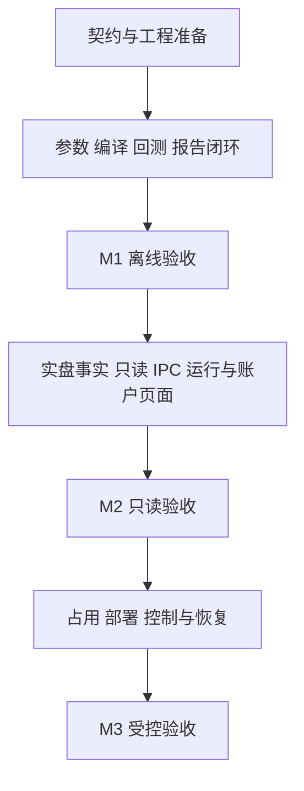

# Titan 管理平台实施计划

版本：v0.1  
状态：M1、M2、M3 均已实现并验收\
更新日期：2026-10-23  
代码基线：`master`，提交 `5f424533bc7f053a929a21bd4edb4249c99e7aee`

本计划将 [管理平台需求 v0.2](management_console_requirements.md) 和 [Web 管理模块技术方案 v0.1](web_console_technical_plan.md) 拆为可交付、可验证的工作包。先完成离线闭环，再补齐实盘只读能力，最后开放部署、生命周期控制与恢复。既有引擎能力作为复用基线，新增管理接口需要独立验收。

功能范围与职责以需求文档为准，Web 实现以技术方案为准；本计划维护任务依赖、迁移顺序和交付状态。实施中每完成一个工作包，在对应记录中补充代码提交及验证报告链接，不以页面截图或旧测试结果代替完成证据。

## 1 交付阶段与推进规则

| 阶段 | 业务结果 | 工作包 | 阶段完成条件 |
| --- | --- | --- | --- |
| M1 离线闭环 | 在页面完成参数配置、冻结、编译、历史回测和报告查看 | T01 至 T09 | 编译节点实际执行，输入结果可追溯；权限、取消、重启和幂等验证通过 |
| M2 实盘只读 | 展示有来源和完整性的运行、账户、网格状态及诊断 | T10 至 T13 | 实盘事实留存和指标补齐；离线故障测试与所属实盘节点的受控只读验收通过 |
| M3 生命周期操作 | 在同一操作协议上部署、启动、暂停、停止和恢复 | T14 至 T17 | 占用、代次、停止与恢复拒绝测试通过；目标账户受控验收完成 |

按工作包前置依赖推进；同一阶段内不相互依赖的内容可以并行开发。跨阶段接口可以提前约定，下一阶段能力的发布必须等待上一阶段验收。开发 Mock 仅用于界面与故障模拟，交付环境移除演示账户和伪造结果。

每批修改采用“本地编辑与审查 → 编译服务器验证 → 记录证据”的流程。涉及真实账户时，再部署已通过验证的产物到实盘服务器。验证失败先修复和重验，不进入下一交付门槛。

## 2 现有代码迁移与复用

| 现有入口 | 本期迁移动作 | 保持的职责边界 |
| --- | --- | --- |
| [CLI main](../crates/titan-cli/src/main.rs) 的 controller、worker、stop、report | 将本机执行例程整理给 N；增加管理模式 CLI 客户端及受控任务入口 | HTTP 不直接执行 controller；纳管节点的 CLI 经同一管理入口 |
| [CLI lib](../crates/titan-cli/src/lib.rs) 与 [运行组装](../crates/titan-cli/src/core_runtime.rs) | 按实际复用需要整理模块接口，保留 runtime 组装 | 基线库仅导出 core runtime；现已增加共享 management、registry 与 runtime_host 入口 |
| [Rust 编译器](../crates/titan-cli/src/compiler.rs) | 补齐描述/校验结果导出，保持独立任务进程执行 | 当前入口注册进程级信号，不在 HTTP 进程内直接运行 |
| [本机 Registry](../crates/titan-cli/src/registry.rs) | 保留 owner token、PID/启动身份与心跳，补充操作回执和重启核对 | N 管本机事实，A 不远程修改 Registry |
| [历史回测入口](../hftbacktest/examples/v13_grid_history.rs)、[场景脚本](../scripts/run_grid_history.sh) | 将准备数据、制品及执行模型显式化，为 N 提供固定调用入口 | 复用真实回放和 Rust 记账；脚本不再成为第二个管理调度器 |
| [历史回测输出](../hftbacktest/examples/grid_history/engine.rs) 与 [ResultBundle](result_bundle_schema.md) | 在 E 中适配结果描述、完整性清单和报告输入 | 统一字段和引用，不在 A 或 U 增加收益公式 |
| [策略管理接口](../crates/titan-strategy-runtime/src/service.rs)、[生命周期与恢复](../crates/titan-strategy-runtime/src/service_core.rs) | worker 增加薄 IPC 适配，调用已有服务并返回实际 operation | N 只维护客户端，E 不再实现平行生命周期状态机 |
| [账户服务](../crates/titan-account-service/src/service.rs) 与 [策略模型](../crates/titan-strategy-runtime/src/model.rs) | E 补齐事实持续留存、统一指标及版本化业务快照 | A 仅保存索引和只读投影，策略只保存自身业务状态 |
| 新增 `web/console/` | 固定 PureAdmin 精简版上游提交，复用已有请求、状态及组件设施 | 不重复建设请求库、状态缓存或通用页面引擎 |

Rust 侧先按 U、A、N、E 的逻辑依赖整理代码，不按每个工作包建立新 crate。A 的 Operation 是唯一管理队列；节点回执与 runtime operation 关联到同一操作，不能演变成另一套 Job 系统。

## 3 M1 离线闭环

### 3.1 工作包

| 编号与任务 | 主责与前置 | 实施内容与交付物 | 完成条件 |
| --- | --- | --- | --- |
| T01 基线与契约 | U/A/N/E；无前置 | 核对源码及远端环境；确定最小 Rust DTO、Operation 输入/状态、资源引用、节点能力、错误与快照契约；准备类型生成及验证入口 | DTO 唯一维护，大整数与十进制 wire 格式明确；编译服务器目录、工具链、数据和验证清单有记录 |
| T02 管理应用基础 | A；T01 | SQLite 初始化与升级；静态节点/权限配置；统一授权、审计、Operation 持久化、幂等、待执行列表和并发上限；提供可替换的模拟节点用于故障测试 | 同一操作者同键同输入复用操作，同键异输入拒绝；重启先核对未完成操作；取消、失败和未知结果分别处理 |
| T03 编译节点执行 | N；T01 | 整理 CLI 本机执行代码；提供认证的固定执行/查询/文件协议；按角色核对能力，显式指定任务程序；补齐 Registry 操作回执、进程身份和重启核对 | 同一操作不产生第二个进程；PID 复用、旧回执和错误目标被拒绝；编译节点不接受真实账户操作 |
| T04 参数与编译适配 | E；T01 | 导出当前网格模板元数据；补齐统一校验和规范化结果；冻结源文件/参数/品种单位来源；描述与编译使用同一快照，输出制品引用与摘要 | 错误参数和无法确定的单位被明确拒绝；取消/超时清理子进程，不覆盖有效制品，私钥留在 Rust 侧 |
| T05 Web 与 HTTP 基础 | U，授权复用 A；T01、T02 | 引入 PureAdmin 精简版和上游记录；裁剪演示内容；接入 Axum、Rust 会话及 CSRF；消费 T01 契约生成的 TS 类型，保留模板请求与 Pinia；提供同源静态服务 | 真实会话可登录退出，只读/操作员接入 A；直接调用 API 不能绕过权限；类型检查和生产构建通过 |
| T06 参数到构建闭环 | A/U 编排，N/E 执行；T02 至 T05 | 建版本目录、草稿修订、复制/差异/冻结、制品索引；页面与管理模式 CLI 经同一 API 发起校验与构建；关联同一 Operation 和回执 | 页面生成实际制品；冻结不可覆盖、旧修订不能覆盖新草稿；页面/CLI 的授权、校验与结果一致 |
| T07 数据 回测与报告适配 | E/N 为主，A 登记引用；T02、T03、T04 | 登记三段 BTCUSDT 数据及回放所需布局等附属文件的冻结引用与摘要；接入数据准备、三种方向及两种执行模型；将现有回放和报告变为固定操作；统一结果与文件清单 | 同一冻结输入可重跑；原始数据、模型、制品和结果可追溯；失败/取消/残仓不显示成功，报告读取权威输出 |
| T08 离线页面与实时查询 | U/A；T05、T06、T07 | 复用 T06 的参数/制品界面，补齐回测结果页；统一分页查询、Operation 面板、日志/报告下载及 SSE；实现快照与游标交接、版本合并、过期、重连和有限轮询 | 页面完成整个离线流程；请求超时后找回同一操作，刷新不重复执行；断线和慢客户端明确重同步且缓冲有界 |
| T09 M1 验证与发布 | 各模块对自身实现负责；T08 | 在编译服务器执行离线端到端与故障验证；形成 Rust 程序和静态资源配套产物、摘要、发布/回滚说明与验证报告 | M1 的功能和异常验收通过，发布物可复现且记录完整；管理入口尚不开放实盘交易写动作 |

T02、T03、T04 在 T01 契约稳定后可以并行；T05 先接会话与基础资源，业务页面随 T06/T07 完成。T07 的结果适配必须打通现有 renderer 输入，需要补齐的权威输出由 E 提供，不能在适配器或前端从缺失数据推造指标。

### 3.2 M1 验收范围

M1 覆盖 U01/U02、A01/A02/A03、A04 的离线查询、N01、N02 的制品校验基础、E01/E02。跨节点账户占用和实盘生命周期在 M3 完成，不能因 Operation 基础已完成而提前勾选。

正常场景使用实际编译产物，完成三段行情、三种方向、两种执行模型共十八组回测，并核对页面与原始结果的收益、回撤、实际敞口、在途上界及最终残留。增加失败、取消和残留结果的展示验证；通过与否以本次版本结果为准。

异常场景至少覆盖：

- 重复点击、相同键不同输入、HTTP 回执丢失，以及 A 重启后核对同一操作。
- 节点在接收、进程启动、结果落地等边界重启，不能产生第二个执行或伪造成功。
- 编译输入漂移、取消/超时、产物篡改，以及既有有效文件保护。
- 只读身份直接调用写接口、越权文件引用、会话过期和 CSRF 拒绝。
- 查询与订阅间变化、旧事件、过期游标、慢页面、日志洪峰及页面刷新。
- 静态路由、API 错误、契约不兼容和前后端配套版本回滚。

## 4 M2 实盘只读

### 4.1 工作包

| 编号与任务 | 主责与前置 | 实施内容与交付物 | 完成条件 |
| --- | --- | --- | --- |
| T10 平台事实与指标 | E；T09 | 在账户/运行层补齐订单、独立成交、费用、资金费、资金流和权益持续留存；按原身份去重、保持连续性；统一净收益与含在途风险输出，保留归属及完整性 | 重复、乱序、重连和重启回放结果一致；缺费用/汇率/归属时明确不完整；不把成交数量重复计入持仓与剩余预占 |
| T11 只读 IPC 与转发 | E 服务端、N 客户端；T10 | worker 建立薄 IPC 的查询部分，返回身份、运行、账户、网格快照和历史引用；N 扩展同一节点协议与实盘只读角色，转发分页数据 | 节点按目标代次查询；只读能力不能发交易写动作；网络失联、记录缺口及来源变化可识别，worker 不连接中央数据库 |
| T12 运行与账户页面 | A/U；T11 | 建只读索引/缓存与诊断告警、确认状态；完成运行/账户/网格面板；分别显示进程、策略、账户、观察状态及完整性 | 所有数值可追溯 E；留仓与缺失指标表达准确；告警保留诊断码与来源，页面不重新判断交易风控 |
| T13 M2 验证与发布 | 各模块；T12 | 编译服务器完成事实回放、故障、性能隔离和浏览器测试；在所属实盘节点进行受控只读验证，形成部署与数据核对证据 | 真实查询来源和权限明确；记录失败、积压或缺口不会静默变成完整结果；业务热路径不等待页面，交易写能力保持关闭 |

T11 建设的 IPC 端点和身份协议继续用于 M3；M3 只扩展控制动作，不再建立第二套控制服务。只读验证不顺带启动长期交易策略。已有实盘 worker 若不具备该接口，按受控升级流程处理，不自动接管身份无法确认的进程。

### 4.2 M2 验收范围

M2 完成 E03、N03 的只读部分、A04 的实盘查询/告警及 U 的运行和账户页面。当前 live worker 的空 `returns` 与零订单/成交计数不能作为实现来源或页面默认值。

重点覆盖事实重复、订单终态早于独立成交、账户快照一致边界、重连缺口、费用/资金费/资金流缺失、币种估值缺失、策略归属不足和来源代次变化。逐项核对 E 输出、N 转发、A 查询及 U 展示；需要修复计算或事实处理时，只在 E 修改并补回归。

记录落盘失败、后台积压超限、管理服务不可用和慢浏览器需要独立故障验证。缺口必须进入数据完整性和诊断，不能通过丢弃事实或补零维持正常展示；已有交易意图持久化和执行门约束不得被监控改造削弱。

## 5 M3 部署 控制与恢复

### 5.1 工作包

| 编号与任务 | 主责与前置 | 实施内容与交付物 | 完成条件 |
| --- | --- | --- | --- |
| T14 占用与受控部署 | A/N，校验复用 E；T13 | 在启动受理事务分配账户/品种占用；补齐失联/留仓保留与安全释放；实现文件验证、原子落地和部署回执；纳管节点的 CLI 接入授权/分配，关闭直接启动旁路 | 两个节点或 CLI 与页面竞争时只有唯一合法启动；错误代次和直接绕行被拒绝；传输失败保留有效版本，结果未知不释放占用 |
| T15 生命周期控制 | E 管业务，N 转发，A/U 提交展示；T14 | 扩展 T11 同一 IPC，实现启动、暂停、恢复运行、停止；调用已有 StrategyAdminService 和 runtime operation，关联管理 Operation；补齐页面动作能力与实际停止方式 | HTTP 受理不提前改变生命周期；进程启动与可交易分别确认；停止等待撤单/成交/持仓与屏障，`stop_action` 不被页面覆盖 |
| T16 checkpoint 恢复 | E 判定，N 定位，A/U 引用与展示；T15 | 登记和查询固定 checkpoint 身份；经同一 Operation 执行恢复；展示制品/schema/绑定、对账、拒绝原因与交易门 | 旧 schema、错误身份、缺证据、未消费成交及期限耗尽被拒绝；不重置保护性退出预算，不隐式迁移状态或自动跨节点接管 |
| T17 M3 验证与受控发布 | 各模块；T16 | 编译服务器完成控制、竞态、恢复及占用故障矩阵；仅部署已验证产物到目标实盘节点；完成目标账户最小风险受控验收及残留核对 | 本阶段非实盘与受控实盘证据齐全，停止/留仓/失败含义准确；有明确部署身份、回滚步骤和最终账户状态 |

纳管切换前核对现有进程、账户与品种占用。身份不能证明的旧实例不能直接收编；先通过正常停止、账户核对等受控流程明确状态，再开放新启动。A 占用记录与 N 本机身份核对分别承担各自职责，不各建一套全局租约算法。

### 5.2 M3 验收范围

M3 完成 A02 的占用、N02 的部署/唯一启动入口、N03 的控制、E04 及对应 U 操作交互。以下场景必须先在编译服务器通过，再进入真实账户受控验收：

- 并发启动、相同操作重派、A/N 重启、旧连接、PID 复用、旧代次和直接 CLI 竞争。
- 部署中断、摘要/签名/ABI/CPU 不兼容和配置漂移；失败不能破坏当前有效文件。
- 撤单期间成交、订单终态先于独立成交、持仓推送延后及受理后结果未知。
- 连续零成交退出、退出期限耗尽、人工留仓停止、平仓超时和不可交易尾仓。
- checkpoint 制品/schema/绑定不符、缺少终态证据、未消费成交、时钟回退和退出期限不能重置。
- 未派发取消、已派发取消待确认、取消启动但实例实际已启动，以及进程退出但账户残留。

实盘验证前须确认目标节点与账户引用、环境、品种、最小数量、价格保护、最大敞口、停止方式和验证期限。目标信息或授权未具备时，工作包保持待实盘验收；不能把离线通过标记为 M3 完成。长期实盘运行、扩大仓位、转账和账户模式修改仍不属于本计划的默认执行范围。

## 6 需求与验收追踪

### 6.1 功能覆盖

| 需求编号 | 主要工作包 | 交付阶段 |
| --- | --- | --- |
| U01 页面与客户端 | T05、T06、T08、T12、T15、T16 | M1 离线页面，M2 监控，M3 控制 |
| U02 实时展示 | T01、T08、T11、T12 | M1 建一次协议，M2 扩展数据 |
| A01 版本与统一校验 | T04、T06、T07 | M1 |
| A02 Operation 与队列 | T02、T03、T06、T08、T14 | M1 基础，M3 占用 |
| A03 权限与审计 | T02、T05、T14、T15 | M1 建统一入口，M2/M3 扩展资源与动作 |
| A04 查询与告警 | T08、T12 | M1 离线查询，M2 实盘与告警 |
| N01 本机执行与回执 | T03、T09、T14 | M1 基础，M3 纳管入口 |
| N02 制品与运行入口 | T03、T06、T14、T15 | M1 校验基础，M3 部署启动 |
| N03 控制与转发 | T11、T15、T16 | M2 只读，M3 控制 |
| E01 编译元数据 | T04、T06 | M1 |
| E02 历史回测 | T07、T09 | M1 |
| E03 实盘事实 | T10、T11、T13 | M2 |
| E04 生命周期与恢复 | T15、T16、T17 | M3 |

### 6.2 跨模块验收覆盖

V 编号对应需求文档第 8 节，W 编号对应 Web 技术方案第 10 节。基础能力的测试在后续扩展到真实资源和控制动作时继续执行。

| 验收主题 | 来源编号 | 首要执行工作包 |
| --- | --- | --- |
| 唯一规则、参数/结果和精度 | V01、V05；W01、W02 | T09，T13 扩展实盘指标 |
| 身份、权限、目标及会话 | V02；W05 | T09，T13/T17 扩展节点与控制 |
| 幂等、取消、未知结果与重启 | V03；W03 | T09，T17 扩展实际交易动作 |
| 编译失败清理与有效制品保护 | V04 | T09 |
| 部署不兼容及账户品种争用 | V06、V07 | T17 |
| 状态来源、过期及重同步 | V08；W04、W06 | T09 建协议，T13/T17 验证真实状态 |
| 成交撤单竞态与停止语义 | V09、V10；W06 | T17 |
| 证明式恢复与拒绝原因 | V11；W06 | T17 |
| 事实去重、数据缺失与归属 | V12；W01、W02 | T13 |
| 有界缓冲、慢客户端和失联 | V13；W07 | T09、T13、T17 |
| 静态部署、版本与回滚 | W08 | T09，每次发布继续执行 |

## 7 验证环境与证据

| 环境 | 本计划内用途 | 约束 |
| --- | --- | --- |
| 本地开发机 | 编写、阅读和修改代码及文档 | 不执行项目构建、依赖安装、代码生成、格式/静态检查和测试 |
| `192.168.3.88` | Rust/前端构建、TS 类型生成、非实盘集成和浏览器自动验证 | 执行前确认远端路径、源码版本和工作区；不读取真实账户 |
| 所属实盘服务器 | M2 受控账户只读及 M3 最小风险下单/撤单与生命周期验收 | 使用编译服务器产物，核对目标和授权，不承担日常编译 |

T01 明确实际 Rust 入口、前端 scripts 和远端依赖后，固定每批验证命令。检查至少包含受影响 Rust 模块的格式、Clippy、测试及集成；前端类型检查、格式/静态检查、生产构建；Rust DTO 重新生成与差异核对；相应阶段端到端与故障测试。涉及底层编译、账户或恢复改动时，补跑对应已有回归，不仅验证新增页面。

验证流水线使用编译服务器执行这些命令。代码托管侧可以触发和展示结果，不以其他机器重新编译的产物替代发布物。依赖、生成文件和 fixture 均按明确清单同步，保护远端未提交修改与密钥。

每阶段在 `docs/verification/<日期>/management-console/<阶段>/` 保存说明和脱敏证据索引，至少记录：

- 本次提交，或基线加未提交变更的源码清单与摘要；文档中的基线不能永久替代实际验证版本。
- PureAdmin 上游提交、Rust/Node.js/pnpm/Python 工具链和 lockfile 身份。
- 命令、退出码、日志位置、通过/失败/忽略项及未验收范围。
- 制品、数据集、执行模型、API/快照 schema 和前后端发布产物摘要。
- 实盘阶段的部署版本、目标引用、操作结果与最终残留；凭据不写入证据。

## 8 发布 回滚与完成标准

每个阶段以可审查的小批次提交推进，代码迁移与对应回归一起交付。M1 开放离线能力，M2 增加只读资源，M3 才开放相应写动作；能力限制同时落在 A 和节点角色检查中，不能只隐藏按钮。

发布前备份管理数据库与节点 Registry，核对存储升级兼容性及正在执行的操作。前后端作为配套版本发布；节点协议保持明确兼容范围，版本不匹配时拒绝不支持的动作。

Web 回滚不终止交易 worker。数据库恢复后先按原操作 ID 与节点回执核对未完成动作，不因还原旧记录换 ID 重做。账户事实、成交记录和交易意图不能随界面或管理版本回滚而清空；节点与运行版本切换使用正常停止、身份及恢复校验流程。

一个工作包完成需要同时具备：实现和边界审查、对应环境验证、提交与证据链接、已知限制说明。阶段完成还需该阶段全部工作包及验收项通过。全部 T01 至 T17 完成后，需求范围内的管理平台才视为交付。

执行从 T01 开始，随后推进 T02/T03/T04 和 T05，再完成 T06/T07、T08，最终以 T09 验收 M1。首个交付目标是可复现的离线闭环；实盘功能按后续阶段依赖逐步接入。

## 9 当前执行记录

- T01 至 T09：M1 实现和编译服务器离线验收完成，见 [验证与发布证据](verification/2026-10-23/management-console/m1/README.md) 和 [运行说明](management_console_operations.md)。包含真实十八组回放、实际页面全流程及失败/取消/重启/篡改/越权/留仓/超时验证。
- T10 至 T13：M2 实现、编译服务器回归及浏览器验收完成，见 [M2 证据](verification/2026-10-23/management-console/m2/README.md)。指定实盘账户的只读验收持续 91.676 秒，A/N 重启保持同一 worker，正常停止，BTC 无挂单、无持仓；交易控制关闭。账户采样绩效明确保留覆盖不完整和归属限制。
- T14 至 T17：实现及最终验收完成，见 [M3 证据](verification/2026-10-23/management-console/m3/README.md)。最终全仓库 556 passed、13 ignored，SDK 113 项、原生暂停/成交/停止/恢复探针、M1/M2 页面回归及 M3 浏览器/故障矩阵通过。43.130.234.54 的 gate（ID 1）BTC 受控验收按 100 USDT、50 bps、120 秒上限执行，耗时 23.348 秒；六笔最小委托均撤销，零成交、零挂单、零持仓，恢复沿用原期限，全部占用释放，验收进程已退出。
