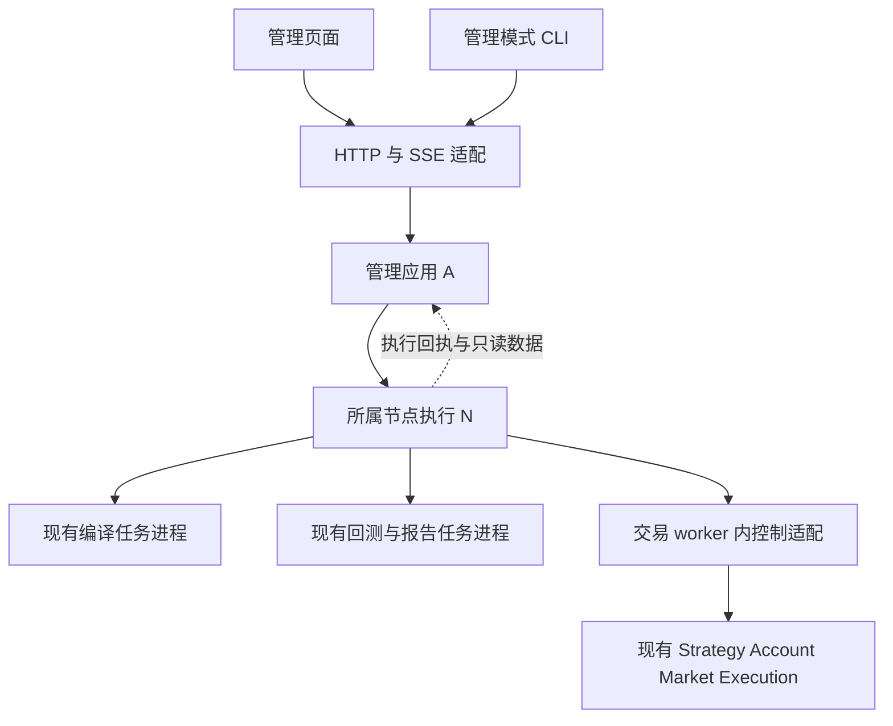

# Titan 管理平台需求文档

版本：v0.3（策略研究工作区归并）  
状态：M1/M2/M3 已实现并验收\
更新日期：2026-10-26  
设计基线：`master`，提交 `5f424533bc7f053a929a21bd4edb4249c99e7aee`

Web 的 PureAdmin 选型、前端结构、API/SSE、部署与验证见 [Web 管理模块技术方案](web_console_technical_plan.md)；功能范围和职责归属以本文为准。

任务拆分、前置依赖、代码迁移和阶段验收见 [管理平台实施计划](management_console_implementation_plan.md)。

全面复核后的修复及验证范围见 [M1/M2/M3 复核修复记录](verification/2026-10-23/management-console/review-fixes/README.md)。金额与最大敞口继续由 E 输出，最大值明确为持久化采样观测值。

v0.3 按用户确认的业务组织方式，将参数版本、编译产物、回测、报告与策略实盘归入每个策略的研究工作区。一级导航为运行总览、策略研究、账户风险；底层编译、部署、运行和账户职责及控制规则保持不变。

管理平台提供参数配置、编译、历史回测、运行监控和生命周期操作。现有交易与编译能力继续复用，新增功能按接入展示、管理应用、节点执行三个边界组织。交易规则、收益计算和恢复判定继续归现有业务引擎负责。

本期采用一个管理服务、每台机器一个节点执行进程、若干独立任务或交易 worker 的部署方式。后端逻辑模块可以先在同一 Rust 应用代码库中实现，暂不要求拆分为独立 crate 或微服务。

## 1 范围与设计约束

首个完整业务对象为当前 Numba 网格：单账户、单品种、线性合约、NET 持仓、Tick 运行模式；当前策略版本为 `1.2.1`，state schema 为 `3`。通用实例和任务页面可展示其他策略，业务详情先覆盖网格。

本期保持以下约束：

1. **每类规则只有一个实现位置。** 参数、制品、收益、风控、停止与恢复规则由对应业务引擎维护，其他模块调用或展示结果。
2. **管理操作只有一个入口和一套记录。** 页面与管理模式 CLI 调用同一个管理应用；耗时和跨节点动作统一使用 Operation。
3. **进程只由所属节点管理。** 创建进程、PID 身份核对、信号和本机 Registry 归节点执行模块；管理应用派发带目标身份的请求。
4. **实际状态由执行方确认。** 任务执行事实来自节点，策略和账户事实来自 runtime；管理应用保存管理进度和带来源的只读结果。
5. **先用固定功能和直接调用。** 不引入通用工作流、动态任务插件、消息总线、独立调度中心或分布式锁服务。
6. **按机器角色限制能力。** 编译、检查和非实盘回测仅在 `192.168.3.88` 执行；真实账户读写仅在所属实盘服务器执行。

现货/双向持仓网格、Bar/Hybrid、运行中热修改网格参数、自动跨节点接管、转账与账户模式修改不纳入本期。首期不建设用户组织管理、任意市场通用回测和独立行情仓库。

## 2 模块划分与唯一职责

### 2.1 四个逻辑边界

| 模块 | 唯一职责 | 输入与输出 | 实现状态 |
| --- | --- | --- | --- |
| U 接入展示 | 页面、管理模式 CLI、HTTP 参数解析、身份认证、响应及 SSE 传输 | 将请求和操作者身份交给 A，展示 A 返回的结果 | 新增页面与 HTTP；调整 CLI 接入 |
| A 管理应用 | 资源版本、权限校验、操作记录、单一待执行队列、目标选择、审计和查询索引 | 接收管理请求，向 N 派发操作，保存执行回执与只读快照 | 复用少量 CLI 编排逻辑，主要新增 |
| N 节点执行 | 本机任务进程、Registry、执行回执、文件落地、worker IPC 和数据转发 | 执行 A 指定的操作，调用 E，返回本机执行事实 | 从 CLI 整理本机控制逻辑，新增节点入口与通信 |
| E 现有业务引擎 | 编译器负责构建；回测器负责撮合和回测结果；交易 runtime 负责账户、策略、风险与恢复；renderer 负责报告渲染 | 接收固定输入，输出制品、业务操作结果、事实快照和结果文件 | 以复用为主，补齐管理适配和实盘记录 |

U 的页面和 CLI 是客户端，HTTP 是服务端适配，两者均使用同一应用契约，不构成可互相依赖的业务组件。E 表示现有能力集合，各引擎保持当前职责和进程隔离，不合并为新的通用执行引擎。

“共享 Rust 控制层”在这里明确为 A 管理应用：共享管理用例和同一个服务入口。进程管理归 N，交易状态迁移归 E；CLI 和 HTTP 不各自运行一套管理调度器。

认证在接入边界确认调用方身份；权限决定统一在 A 中执行。N 验证管理服务身份、节点能力、目标代次和本地执行条件，不再维护另一套用户角色系统。

### 2.2 调用与部署关系

构建节点和实盘节点采用相同节点协议，按配置开放不同能力。worker 内控制适配属于现有运行宿主的内部组件，只负责调用已有服务和导出结果，不单独部署，也不再实现策略状态机。

边界之间只共享一处维护的版本化请求/响应结构，不共享数据库连接、进程句柄或可变业务对象。节点侧 IPC 客户端归 N，worker 侧服务端适配归 E；两侧各负责自己的通信端点。

管理服务内部包含 HTTP 适配和 A；每台目标机器上的 N 管理本机子进程。首期不做管理服务多副本调度或节点自动发现。已有独立 CLI 可继续用于未纳管节点；纳管节点的启动与控制统一经过 N，避免 CLI 和管理服务同时管理同一实例。

### 2.3 需要集中实现的能力

| 能力 | 唯一归属 | 其他模块如何使用 |
| --- | --- | --- |
| 操作者权限与审计 | A | U 传递身份，N 接受已授权请求并核对本地执行条件 |
| 参数、模板、数据集与制品版本目录 | A | U 编辑/选择，N 读取冻结引用；文件内容仍在所属节点 |
| Operation、幂等与待执行队列 | A | U 查询；N 按同一操作 ID 返回或执行，不创建另一套任务队列 |
| 跨节点的网格账户与品种占用 | A | N 核对分配身份和本地事实，E 校验账户/仓位；不再各建占用算法 |
| 本机进程、执行回执与 Registry | N | A 查询回执；现有 worker 仅按授权 owner token 更新本机记录 |
| 参数业务校验与单位规则 | E 中对应领域实现 | A 调用统一校验并保存结果，U 展示结果和 schema 提示 |
| 制品摘要、签名、ABI 和目标兼容校验 | 现有 Rust 制品库 | 编译、接收和加载阶段调用同一实现 |
| 策略生命周期、执行门与恢复判定 | 现有交易 runtime | N 经 worker 适配调用；A/U 展示实际进度 |
| 订单、成交、账户与业务收益事实 | 现有平台账户/运行层及其记录扩展 | N 转发，A 保存查询索引或只读缓存，U 展示 |
| 网格锚点、配对毛收益和退出决策 | 现有网格策略 | runtime 导出业务快照，其他模块按 schema 展示 |
| 实盘风险估值与回测收益指标 | E 中统一 Rust 计算实现 | A、N、U 使用计算结果，不另写公式 |
| 页面告警记录与确认状态 | A | 根据引擎诊断码和数据过期生成记录，不重新判定交易风控 |
| HTTP、SSE 与浏览器重连 | U 的服务端适配 | 读取 A 的查询结果与事件，不直接订阅交易热路径 |

同一校验函数可在多个边界调用，例如接收制品和加载制品时都校验摘要。规则源码仍只有一份。界面提示不代替后端校验，后端也不另写一套与引擎并行的业务规则。

## 3 现成能力与新增工作

“已有”表示底层实现可复用；“需扩展”表示已有基础但管理功能不完整。页面、HTTP 和节点通信尚未实现。

| 能力 | 当前情况与代码入口 | 本期工作与归属 |
| --- | --- | --- |
| 运行组装与 worker | 已有 `TradingRuntime` 和隔离 worker。[组装](../crates/titan-cli/src/core_runtime.rs)、[CLI](../crates/titan-cli/src/main.rs) | N 整理本机启动入口；E 保留运行组装逻辑 |
| 交易所账户与行情接入 | 已有 Binance Futures、OKX、Hyperliquid、Gate CrossEx 静态接入，实际支持范围依 connector 而定。[connector](../connector/README.md) | E 复用连接器；N 返回本机支持的能力，A 配置可用绑定，不新增交易所适配系统 |
| 编译、打包、签名 | 已有 Rust 控制器、冻结输入、受限 Numba 桥接和失败清理。[编译器](../crates/titan-cli/src/compiler.rs) | A 记录构建操作；N 启动独立编译任务；E 复用编译器 |
| 参数与制品元数据 | 已有 `StrategySpec`、参数 schema、描述、制品 inspect/validate。[声明](../python/titan-strategy-sdk/titan_strategy/definition.py)、[描述](../python/titan-strategy-sdk/titan_strategy/static_compiler.py) | A 新增版本目录，E 导出可存储元数据和校验结果 |
| 本机任务记录 | 已有 SQLite Registry、owner token、PID/启动时间核对和心跳。[Registry](../crates/titan-cli/src/registry.rs) | N 保留本机权威，补充操作 ID 对应的幂等回执；A 仅存索引 |
| 暂停、停止与恢复 | 已有进程内策略管理、停止屏障、checkpoint 与账户对账。[管理接口](../crates/titan-strategy-runtime/src/service.rs)、[恢复实现](../crates/titan-strategy-runtime/src/service_core.rs) | E 增加薄控制适配，N 增加 IPC，A 跟踪操作结果 |
| 账户与诊断 | 已有余额、持仓、订单、一致快照、生命周期和诊断。[账户接口](../crates/titan-account-service/src/service.rs)、[策略模型](../crates/titan-strategy-runtime/src/model.rs) | E 导出版本化只读数据，N 转发，A 建立查询入口 |
| 网格业务与风险 | 已有网格、成交/撤单处理、风险预占、退出期限和证明式恢复。[网格说明](../strategies/grid/README.md) | E 导出业务快照；U 新增网格面板 |
| 真实历史回测 | 已有 Rust example 和固定场景脚本，完成三段行情十八组验证。[回放](../hftbacktest/examples/v13_grid_history.rs)、[脚本](../scripts/run_grid_history.sh) | E 将已有输入显式化并统一结果描述；A/N 接入操作流程 |
| 结果与报告 | CLI 有 ResultBundle；历史回放另行输出 result、equity、fills、journal。[历史输出](../hftbacktest/examples/grid_history/engine.rs) | E 增加一次结果适配与完整性清单；A 索引，U 展示 |
| 实盘交易历史与净收益 | 事实基础已有，持续留存和管理查询需扩展；当前 live worker 仍输出空 `returns` 和零订单/成交计数。[实盘入口](../crates/titan-cli/src/main.rs) | E 补齐记录与计算；A/U 不从现有任务计数推造实盘结果 |
| 管理权限、审计与跨节点控制 | 新增；worker owner token 不承担用户权限 | A 实现权限与审计，N 实现节点身份与目标核对 |

当前 CLI 的 controller 使用 `current_exe()` 启动 worker，编译入口注册进程级信号。迁移时由 N 显式指定任务程序并管理独立任务进程，复用已有编译器内部的子进程清理，不能直接将整段 CLI controller 作为 HTTP handler 执行。

## 4 最小数据模型

### 4.1 只保留必要对象

| 对象 | 归属与内容 |
| --- | --- |
| 策略研究归属与参数版本 | 稳定研究身份归集该策略的源码/参数版本及后续引用；A 管理 schema、参数及摘要，冻结后不可覆盖 |
| 制品与数据集引用 | A 管理摘要、适用环境、来源及所属节点；N 管理对应文件 |
| Operation | A 唯一管理耗时/跨节点操作；关联操作者、固定输入、目标和执行结果 |
| Run | 沿用 N 的运行记录，包含节点、worker 启动身份、策略代次和实际加载版本 |
| 只读结果与快照 | E 产生业务数据及完整性信息；A 通过 N 获取，缓存带来源与时间 |

节点地址、角色和资源上限先采用配置文件。部署是 Operation 的一种，当前部署版本从 Run 和实际加载回执读取；不额外建立一套发布/部署状态机。审计作为管理记录保存，不建设独立审计服务。

管理服务先复用 SQLite 技术保存元数据、操作和索引，各节点保留现有本机 Registry 与结果文件。管理应用不直接写节点数据库，也不复制一套可写订单、持仓或策略业务状态。文件缓存和只读投影须保留摘要或来源版本。

研究工作区是现有资源的组织和查询范围，不新增研究 Job、发布状态机或数据库表。归属链为参数版本 → 编译产物 → 回测 → 报告，以及编译产物 → 部署 → 运行实例。实际产物仍由节点保存，研究工作区记录引用与摘要。研究身份与节点模板别名、原生策略 ID、运行实例 ID 分别表达。

模板可显式登记 `research_id`、`research_name`。未配置时，同一节点的同一规范化源码路径共享稳定归属，编辑源码内容不改变工作区；跨节点或源码路径迁移需要使用显式研究身份。同一源码的不同参数预设可归入一个工作区。旧记录仅沿可证明的引用与源码摘要归属，不能改写冻结记录；无法确认的保留为未归属历史记录，不自动归入其他策略。

显式 `research_id` 使用字母、数字、连字符或下划线，最多 119 字符；加上 `research-` 后的工作区身份仍须满足接口的 128 字符上限，不能登记可见但无法查询的工作区。

### 4.2 一套 Operation 模型

描述/校验、构建、数据准备、回测、报告、部署、启动、暂停、恢复运行、停止和 checkpoint 恢复采用固定操作类型。参数草稿保存是普通事务，不进入异步队列，也不代表业务校验通过；各业务流程按页面步骤依次发起，不建设任意流程编排器。

Operation 至少包含：操作 ID、类型、操作者、幂等键、输入摘要、目标节点、可选目标 run/代次、状态、节点回执及错误。状态只保留：待执行、执行中、成功、失败、已取消、结果未知。

- A 负责持久化受理与状态更新，依据 N/E 的回执确认执行结果。节点“已接收”不等于业务成功。
- A 将操作者的幂等键映射为唯一操作 ID；N 只按操作 ID 保存本机受理/执行证据并处理重复派发，不再解析用户幂等键，也不增加独立 Job 对象或调度状态机。
- 运行时已有的 operation ID 作为执行回执关联，不再复制策略生命周期。
- 超时失联时保留最后确认结果并标记未知，先查询同一操作。相同幂等键但不同输入须拒绝；重复提交不会创建第二个实际动作。
- 取消是执行请求。收到节点/引擎取消确认后才显示已取消；取消交易启动不会自动变成平仓，已启动实例通过业务停止处理。

### 4.3 状态由谁确认

| 状态 | 确认方 | 管理应用的作用 |
| --- | --- | --- |
| 管理操作受理、排队、授权结果 | A | 自身记录 |
| 进程是否存在、退出码、文件是否落地 | N | 展示节点回执，不远程猜测 PID 状态 |
| 策略 Running/Stopping/Stopped、交易门状态 | 交易 runtime | 缓存实际快照，不因请求成功直接改状态 |
| 仓位、订单、成交、净权益和风险值 | E 的账户/执行事实与统一计算 | 查询和展示，不用管理任务记录替代 |
| 节点失联、快照过期 | A 根据通信与采集时间标记 | 表示观察状态，不推断策略已经停止或仓位已清空 |

## 5 按模块组织的功能需求

### U01 页面与客户端

一级导航仅提供运行总览、策略研究、账户风险。策略研究先展示授权策略目录，每个策略包含版本与参数、构建记录、回测与报告、策略实盘四个环节。参数草稿、校验、复制、冻结、比较、构建、制品下载、数据准备、执行模型、回测、报告等原有功能全部保留。

策略实盘在当前策略范围内展示制品选择、授权绑定、部署、启动确认、运行实例及生命周期详情，支持原有暂停、恢复运行、停止和 checkpoint 恢复。复用同一运行详情、日志、事实历史、风控与诊断实现。修改研究参数不修改已运行实例；从回测进入实盘时固定其对应的产物，不自动改用最新构建。

日志、操作进度、checkpoint 和告警放在对应详情页，首期不为它们各建设独立业务系统。管理模式 CLI 调用与页面相同的管理入口。旧参数/制品/回测地址保留兼容跳转：只有单一工作区时可直接打开，多策略时先让用户选择，不猜测目标策略。

页面显示引擎提供的 schema、单位、动作能力和实际停止方式。界面可以提供格式提示，最终使用统一校验结果。未知 schema 展示通用状态和不兼容原因。

验收：页面/CLI 对同一输入获得相同权限、校验和操作结果；前端不重算收益或风险，不直接读节点文件或交易所账户。

研究目录和资源列表由服务端先按节点、环境、账户授权和策略归属过滤，再分页。不能仅过滤前端近期缓存。跨策略或无法确认归属的链接不能选择、回测或部署其他资源；切换策略/会话后旧查询不能覆盖新工作区。只读账户观测保留在账户风险与运行总览，不伪装成策略研究或策略实盘。

### U02 实时展示

HTTP 适配从 A 提供查询与 SSE，默认每秒刷新快照，三个发布周期未更新即显示过期。流带游标，断线后补取已有记录或刷新当前快照。慢客户端使用有界缓冲并显示需要重同步。

验收：浏览器失联仅影响观察和操作入口；推送阻塞不会传导到交易回调。响应中的金额、价格、数量、64 位 ID 和纳秒时间保持明确单位和精度。

### A01 资源版本与统一校验入口

登记当前网格模板、可描述的基准参数、参数 schema 和源码身份。支持参数草稿、复制、冻结及差异查看；登记制品、数据集、回测结果及关联操作。元数据从 E 的受限描述或构建流程产生。

参数业务校验和单位换算复用 E 的领域实现；A 保存规范化结果、规则来源和摘要。制品接入复用同一 Rust 校验库。运行实例引用冻结版本，修改参数后生成新制品和实例。

验收：未知参数、无效范围、无法确定的品种单位或最小订单不满足时有明确错误；元数据与源码身份匹配；冻结版本不可覆盖；管理服务展示模板时不导入策略 Python。

### A02 管理操作与单一队列

实现第 4 节的 Operation，维护一个持久化待执行列表，按固定节点配置派发，设置简单并发上限。构建、回测、部署和生命周期操作复用同一受理、幂等、查询和结果处理流程；同一实例的冲突操作串行处理或明确拒绝。

网格 NET 账户/品种占用统一由 A 在启动受理事务中分配并持久记录。占用在执行结果未知或留仓停止后继续保留，取得 E 的完整账户/订单事实并确认安全释放后才允许再次分配；失联或超时不自动释放。纳管节点的本地 CLI 同样先经 A 授权和分配。

验收：重复点击、HTTP 重试、管理服务重启不会产生重复动作；未派发可直接取消，已派发等待确认；未知结果不会通过换操作 ID 盲目重试。服务重启后先查询未完成操作，再决定后续处理。

### A03 权限与审计

首期提供只读、操作员两种权限，节点、环境和账户授权在管理服务配置中维护。所有读写入口在 A 校验授权，写操作保留操作者、请求/操作 ID、输入摘要、目标代次及最终结果。

验收：只读用户直接调用 API 也不能写入；CLI 和页面不能绕过相同授权规则。密钥保留在所属节点，管理记录只保存引用，响应与日志不泄漏凭据。

### A04 查询索引与告警

统一查询版本目录、Operation、Run 索引、只读快照与结果。按运行时错误、对账失败和数据过期建立可查看/确认的告警记录，保留原诊断码及来源；不在管理服务重新实现交易风控阈值或订单状态推导。

验收：查询支持必要的分页、时间和实例筛选；显示数据来源、采集时间和完整性；缺少费用、资金费、估值或归属证明时，相关收益字段显示缺失/不完整，不用零值替代。

### N01 本机执行与幂等回执

节点提供固定的执行、查询及文件访问能力，按操作类型调用现有程序或 worker 控制接口。节点角色决定能否编译、回测或连接真实账户。N 负责进程启动身份、资源上限、本地日志和 Registry；编译器继续管理自己创建的桥接和链接子进程。

验收：相同操作 ID 返回已有回执或唯一执行结果；节点重启能根据持久化身份确认进程；无法确认的执行结果返回未知。旧连接、旧代次、PID 复用和未经授权的文件路径均不能影响新实例或访问其他资源。

### N02 制品落地与运行入口

按 A 提供的冻结引用读取或接收制品和配置，复用校验库检查摘要、签名策略、ABI、系统和 CPU 要求。文件完整验证后原子落地；随后独立执行启动操作，返回实际加载版本。部署与启动成功分别确认。

N 在唯一运行入口核对 A 分配的 run/绑定身份及本地运行事实，不另建全局占用表或租约算法。账户和仓位合法性继续由 E 的启动校验确认。

验收：不兼容制品、配置漂移、本机实例冲突或 E 返回的绑定/仓位错误会拒绝启动；传输失败保留当前有效版本；版本切换也走正常停止、身份及兼容校验，不隐式重置 checkpoint。

### N03 控制与数据转发

N 只实现节点侧 IPC 客户端，向目标 worker 发送带操作身份的命令或只读查询，转发其 operation、状态和错误；worker 侧接口由 E04 提供。快照、历史记录和日志通过同一节点边界读取或转发。N 不另建交易所连接，不重新计算订单状态、收益或敞口。

验收：账户查询仅在所属实盘节点执行；worker 不直接连接管理页面或中央数据库；管理服务连接异常不阻塞 worker。文件或事件缺口有明确标记，重连按来源身份续读。

### E01 编译与参数元数据

复用当前 Rust 编译器、SDK schema、受限描述、冻结输入、原生依赖审计、打包、签名及发布。补充可保存的模板元数据和统一参数校验/规范化结果。构建在独立任务进程中执行。

验收：冻结输入在描述与编译阶段一致；失败或取消不发布未校验制品、不覆盖有效输出；签名私钥不进入 Python 桥接。多处需要的校验统一调用现有实现。

### E02 历史回测与结果适配

第一版支持现有 BTCUSDT 三段行情及已验证执行模型，将固定脚本中的输入显式化。回放继续运行实际 Numba 制品并复用 Rust 撮合、账户、费用和资金费处理。为现有输出统一版本描述与文件完整性清单，报告继续由现有 renderer 渲染。

输出净收益、收益率、最大回撤、最大实际名义持仓、含在途名义上界、费用、资金费、成交和最终残留。保留数据摘要、质量信息、成本及执行假设；不支持的数据范围明确拒绝。

验收：冻结输入重跑可复现 Rust 结果；页面与原始结果一致。本期历史网格回测以确认清仓为成功条件，失败、取消和残留结果不显示正常完成。结果适配只做字段映射，不引入第二套账户或收益计算。

### E03 实盘事实与业务快照

在现有平台账户/运行层补齐持续订单、独立成交、费用、资金费、资金流和权益记录，统一输出净收益、敞口、风险来源及数据完整性。网格策略继续只维护自身业务状态和毛收益，runtime 按制品/schema 导出只读业务快照。

交易事件按原始身份去重并保留必要连续性，账户聚合使用一致边界；后台保存交易记录和权益采样，不额外保存全部行情。NET/LONG/SHORT、品种、币种和交易所身份保持完整。账户净收益区分资金流，策略归属无法证明时只展示账户级结果。

验收：重复、乱序或重连缺口不会被管理层“修正”为另一套事实；已成交数量不重复计入持仓和剩余预占；缺失数据保留不完整标志。采集和落盘使用有界后台路径，业务事实不因页面降频而被采样丢失。

### E04 生命周期与恢复

在运行宿主内增加薄 IPC 服务端适配，继续调用现有 `StrategyAdminService`、停止屏障和恢复对账，不增加另一套生命周期状态机。暂停执行、恢复运行、业务停止、checkpoint 恢复各自保持原有含义。网格的人工停止行为由编译参数 `stop_action` 决定，首期不增加运行中临时覆盖停止方式的协议。

验收：只有 runtime 确认后才显示暂停或停止完成。留仓停止允许已确认库存，并继续显示风险；要求平仓却有残留或超时则显示失败/待对账。制品/schema/绑定不符、缺少订单证据、未消费新增成交、退出期限已过等情形按现有规则拒绝恢复，交易门保持关闭；恢复不重置保护性退出期限。

## 6 关键流程与模块交接

| 流程 | A 管理应用 | N 节点执行 | E 业务引擎 |
| --- | --- | --- | --- |
| 配置与构建 | 保存冻结参数，创建构建 Operation | 在编译节点启动任务并返回回执 | 校验输入、编译、签名及输出制品 |
| 历史回测 | 绑定制品、数据与模型，创建回测 Operation | 运行回测程序，定位结果文件 | 撮合、记账、计算指标、生成统一结果 |
| 部署与启动 | 指定目标和固定版本，核对授权与占用 | 校验并落地文件，经唯一入口启动 worker | 加载校验，准备账户/行情/策略，返回实际状态 |
| 停止 | 记录请求并跟踪同一 Operation | 向目标代次的 worker 转发请求 | 撤单、处理成交、按策略停止方式退出并确认 |
| checkpoint 恢复 | 选择固定 checkpoint，记录恢复 Operation | 定位对应 worker/文件并转发 | 校验身份、对账、恢复业务状态并决定交易门 |
| 只读监控 | 查询/缓存带来源的结果，供 U 使用 | 读取并转发结果与日志 | 产生账户事实、业务快照和诊断 |

所有流程的 U 均只负责提交和展示。浏览器断连不取消已经受理的操作；管理服务或节点失联不触发自动迁移、重复启动或新增风险。恢复连接后按操作 ID、run 身份和实际事实核对。

## 7 交付顺序与实现限制

| 阶段 | 交付内容 | 完成条件 |
| --- | --- | --- |
| M1 离线闭环 | U 的参数/构建/回测页面；A 的版本、Operation、权限和查询；编译节点 N；E 的编译与历史结果适配 | 页面完成参数到历史回测报告，输入和结果可追溯；失败、取消、重启、幂等验收通过 |
| M2 实盘只读 | 扩展同一 N 到实盘只读角色；补齐 E03；运行/账户/网格详情与告警 | 重复、乱序、缺口、失联和慢客户端验收通过；收益与风险数据有来源和完整性 |
| M3 生命周期操作 | 在同一 Operation/节点协议上开放部署、启动、暂停、停止和恢复 | 占用控制、代次、停止屏障及恢复拒绝场景通过，完成目标账户的受控验收 |

首期只实现上述模块需要的明确接口。查询和告警先留在 A 内，调度仅为数据库待执行列表与并发限制；节点角色采用固定配置。引入新服务、通用抽象或独立存储之前，必须有现有边界无法满足的具体需求。

本次为需求与模块边界调整，不代表相关管理能力已经实现。代码迁移时保持依赖由 U 到 A、A 到节点协议、N 到 E；E 不依赖管理应用或页面。具体目录和 crate 划分服从这条依赖方向，不预先为每个功能建立项目。

## 8 验收清单

| 编号 | 场景 | 主责与验收结果 |
| --- | --- | --- |
| V01 | 同一业务规则被多个入口使用 | E 保持唯一实现，A/N 调用相同校验，U 展示同一结果 |
| V02 | 页面或 CLI 绕过权限、修改目标代次 | A 拒绝未授权请求，N 拒绝错误身份，形成统一审计 |
| V03 | 重复点击、相同幂等键不同输入、服务重启 | A 拒绝冲突输入；N 复用同一回执，不产生重复实际动作 |
| V04 | 编译取消、超时或输入变化 | E 明确失败/取消并清理自身子进程，不发布混合制品 |
| V05 | 历史回测重跑、失败、取消或有残仓 | E 结果可复现且状态准确；A/U 不伪造正常完成 |
| V06 | 制品传输失败、目标不兼容或配置漂移 | N 调用统一校验并拒绝启动，保留当前有效文件 |
| V07 | 两个请求或直接 CLI 争用同一网格账户品种 | A 持久化占用，N 唯一入口拒绝冲突；失联不自动释放 |
| V08 | 进程存活但策略对账、节点失联或快照过期 | N/E 返回真实状态，A/U 分别显示进程、策略、账户和观察状态 |
| V09 | 撤单期间成交、订单终态先于独立成交 | E 保留事实与预占；业务停止不早于实际确认 |
| V10 | 连续零成交退出、退出期限耗尽、人工留仓停止 | E 保持原有时限与停止语义，A/U 正确显示进度、留仓或失败 |
| V11 | 恢复身份不符、缺证据或新增成交未消费 | E 拒绝恢复并关闭交易门，A 保留原始原因 |
| V12 | 成交重复、缺口、费用/汇率或收益归属缺失 | E 去重并标记完整性，A/N/U 不增加另一套补算规则 |
| V13 | 慢页面、日志洪峰或管理服务不可用 | U/N/E 缓冲有界，交易热路径不等待管理网络，不启动副本 |

所有编译、格式/静态检查与非实盘测试在 `192.168.3.88` 执行；真实账户验收按 [项目环境约定](../AGENTS.md) 在实盘服务器受控执行。现有 [历史回测](verification/2026-10-22/grid-history/README.md) 与 [合并验证](verification/2026-10-23/merge-ci/README.md) 仅证明底层基线，新增模块和跨模块交接需要独立验收。
