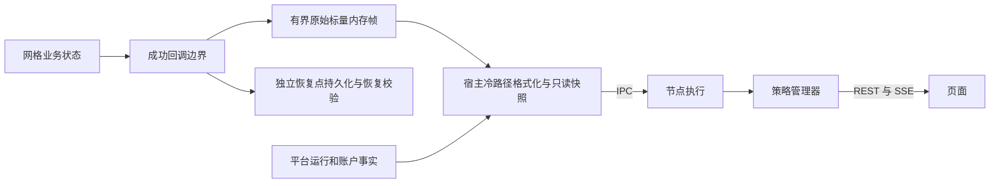

# 策略身份、业务观测协议与恢复状态结构

日期：2026-10-27。实现基线：`638bae69324114e8a2447f648c8b7ced832196bb`。当前实时发布与恢复兼容结果见[本轮验证记录](verification/2026-10-27/strategy-observation-realtime/README.md)，前一阶段见[观测协议解耦记录](verification/2026-10-27/strategy-observation/README.md)。

恢复存储后续按[数据持久化设计](data_persistence_design.md)统一迁入节点本地 SQLite，[实施计划](data_persistence_implementation_plan.md)尚待执行。本文所述当前实现仍使用恢复文件；迁移保留原始载荷字节和 SHA256，公开业务观测继续独立发布，不改从恢复 BLOB 读取。

## 1. 统一定义

策略是唯一的策略业务主体。参数、版本、编译结果、运行、回测、报告、部署和恢复点都归属于策略。账户、节点、共享数据集仍按平台资源管理。编译结果不再成为与策略并列的业务对象。

| 名称 | 字段 | 定义 |
| --- | --- | --- |
| 策略 | `strategy_id` | 稳定的业务归属标识；源码、参数和运行变化不改变它 |
| 策略名称 | `strategy_name` | 可修改的展示名称 |
| 策略类型 | `strategy_type` | 实现类别，例如 `grid` |
| 源码版本号 | `source_version` | 作者声明的说明性版本，例如 `1.2.1` |
| 参数版本 | `parameter_version_id` | 固定的参数和校验依据 |
| 策略版本 | `strategy_version_id` | 固定源码、参数、契约、目标环境和已验证编译结果的不可变记录 |
| 策略运行 | `run_id` | 一次执行记录 |
| 运行代次 | `run_generation` | 运行宿主确认的执行代次，用于拒绝旧控制和旧观测 |
| 运行时编号 | `runtime_strategy_no` | 本地数字路由编号，不是策略业务身份；现有订单命名空间不得重编号 |
| 宿主会话 | `worker_session_id` | IPC 会话身份，与运行代次分别表达 |
| 编译内容校验值 | `compiled_strategy_digest` | 规范化策略编译内容的校验值，不是策略身份 |
| 策略文件校验值 | `strategy_file_sha256` | 策略传输文件完整字节 SHA256 |
| 原生库校验值 | `native_library_sha256` | 动态库字节 SHA256 |
| 恢复点序号 | `recovery_sequence` | 恢复点的内部序号 |
| 恢复点内容校验值 | `recovery_point_sha256` | 固定恢复载荷原始字节；当前为文件，计划迁入 SQLite BLOB 后保留同一字节含义 |

当前参数会编译进 Numba 原生程序，因此源码版本号不能唯一确定可运行策略版本。原有参数记录和成功编译记录分别映射为参数版本、策略版本，保留历史 ID 与引用。参数预设只是节点登记的策略输入预设。

## 2. 三份独立契约

1. **恢复状态结构**：内部字段、类型、偏移、对齐、版本和 hash。用于保存与恢复，不向管理器提供业务语义。
2. **业务观测协议**：公开字段、类型、单位、枚举、空值语义、协议身份与版本。
3. **私有投影**：内部路径、有效条件和枚举映射。由 Rust 编译器按经过校验的恢复结构解析，随策略编译内容签名，加载时重新校验。

公开 schema 的 hash 不包含内部路径、偏移或恢复结构 hash。例如恢复结构从 `grid.anchor_ticks` 改为 `pricing.anchor_value`，只要公开定义不变，仍可输出相同的 `titan.grid` 协议。

业务观测独立从成功回调边界发布到该运行的预分配内存槽位，不读取恢复文件，也不调用恢复点提交或 flush。私有投影在加载时解析成有界标量读取计划；发布仅复制声明的值和有效条件，不复制整个私有状态，不执行 JSON、字符串格式化、SHA256、文件或网络操作。

宿主冷采样请求会合并为一个待发布标志。没有请求时，成功边界只检查一个原子标志；有请求时，交易线程以原子标量更新最多 64 个字段及其条件，总原始载荷上限 1 KiB。所有载荷字和帧版本使用顺序一致原子操作，读取前后相同的偶数版本才接受该帧；冷读取最多重试 8 次，持续冲突时明确报告忙并等待下次采样。写方没有锁或重试，不等待读取方，最终 Stop 帧也不会因读取方暂停而丢失。Start 和最终 Stop 发布边界快照，失败回调使观测不可用。未执行新回调时，重复读取不能推进发布序号。

发布方由运行时现有的回调所有权串行化。值、有效条件、成功回调水位、采集时间和帧版本都参与同一顺序一致原子序列，冷路径只在确认完整后格式化自己的本地副本；它们不会混用相邻帧。取时发生在标记写入开始之前，取时异常不会留下永久未完成帧。初始化、恢复就绪阶段和回调水位为 0 时不发布；未启动即停止也不伪造业务观测。

请求的合并点是发布方认领待发布标志的原子交换。此前的请求合并进本次采集，此后的请求保留到下一成功边界；重复水位不消费请求。最后一次成功停止会强制请求发布，随后重复读取保留相同来源。手动恢复点提交失败、停止持久化失败、执行结果入队失败或运行失效都会撤销该运行的观测可用性。执行结果拒绝和失效请求不依赖回调锁或控制队列受理来撤销观测；终止失效后的交易门在本运行代次内不可重开，排队中的 Start、Resume 或 Stop 不能撤销失效。被队列拒绝的控制操作结束为失败，不永久停留在待处理状态。

成功停止后，执行边界已经排空。即使执行通道随后关闭，迟到的执行回执也不再把已停止运行改成失败或撤销终态观测；停止完成前仍保留执行结果可靠处理和拒绝时失败关闭的约束。

恢复点仍按原周期及指令持久化、恢复、停止屏障提交和 flush。观测不改变这些条件，不修改恢复文件结构和 checksum，也不向恢复文件写入观测帧。恢复后以新的运行代次重新发布，观测帧不参与恢复或交易准入证明。恢复写入故障继续遵循原有交易门失败语义。

更新时效由宿主冷采样、下一个成功回调边界及管理器同步周期决定，与恢复点持久化周期无关。宿主当前每 500 ms 采样；节点和管理器按各自同步周期传输。发布序号、成功回调水位和真实采集时间与宿主心跳分别表达。

观测协议兼容不能作为恢复兼容证据。即使恢复结构未变，重新编译后内容校验值变化，仍按现有恢复校验处理，不自动接受旧恢复点。

## 3. SDK 声明

`StrategySpec` 使用 `strategy_type`、`source_version`、`recovery_state_schema_version`。V13 原生回调的布局和指纹保持冻结，历史字段名只由兼容入口读取。编译桥接元数据协议为 2，策略文件格式为 2，宿主 IPC 协议为 2，业务观测包络协议为 2；这些版本各自独立。

```python
from titan_strategy.observation import BusinessObservationSpec, ObservationField, Equals

observation = BusinessObservationSpec(
    schema_id="titan.grid", schema_version=1,
    fields=(
        ObservationField("anchor_ticks", "decimal", "price_tick", "grid.anchor_ticks",
                         valid_when=Equals("grid.initialized", 1)),
        ObservationField("completed_pairs", "uint64", "count", "grid.completed_pairs"),
    ),
)
# StrategyDefinition(..., business_observation=observation)
```

声明分别输出公共 `schema` 和私有 `projection`。Rust 是路径解析、边界检查、schema hash、策略内容签名和加载校验的唯一实现。描述阶段和对象生成阶段继续比较完整声明，拒绝漂移。

未初始化的可空字段返回 null 和原因，不补零。未知枚举、非有限浮点等无效源值返回 null，标记该次观测不完整；其他可确认字段仍可展示。十进制字符串保留原计算值，不宣称提高浮点计算本身的精度。

## 4. 网格数据归属

| 数据 | 来源 | 输出 |
| --- | --- | --- |
| 生命周期、交易门、暂停能力、运行错误 | 策略运行宿主 | `runtime` |
| 订单、独立成交、持仓、余额 | 平台账户与执行服务 | `account` 与历史接口 |
| 账户权益、费用、资金费、敞口 | 平台账本与风险计算 | `financial`、`risk`，保留账户范围与完整性 |
| 网格业务阶段 | `grid.status` | `phase` 的稳定字符串枚举 |
| 网格锚点 | `grid.anchor_ticks` | `anchor_ticks`，未初始化为空 |
| 完成配对数 | `grid.completed_pairs` | `completed_pairs` |
| 配对数量 | `grid.paired_lots` | `paired_lots` |
| 配对毛收益 | `grid.grid_profit_tick_lots` | `paired_gross_tick_lots`，单位 tick·lot |
| 策略期望库存 | `grid.expected_position_lots` | `expected_inventory_lots` |
| 策略最后处理行情时间 | `grid.market_ts_ns` | `last_market_at_ns` |
| 业务错误码 | `grid.last_error` | `last_error` |

`phase` 与平台生命周期分别展示。期望库存不能替代账户持仓。配对毛收益不含手续费和资金费，不能展示为策略净收益。ticks/lots 使用本次运行绑定的品种步长。缺少策略归属、费用或资金流证据的净收益保持缺失。

内部 `config`、`refs`、`retired`、消费水位和订单清单不再通过业务包络整体导出。参数页读取策略版本关联的冻结参数；平台订单、成交仍走通用接口。

## 5. 数据流和接口



主要接口：

- `GET /api/v2/strategies`：授权策略目录。
- `GET /api/v2/strategies/{strategy_id}`：策略详情。
- `GET /api/v2/strategies/{strategy_id}/parameter-versions`：参数版本。
- `GET /api/v2/strategies/{strategy_id}/versions`：可运行策略版本。
- `GET /api/v2/strategies/{strategy_id}/versions/{id}`：版本公开元数据，去除私有投影、初始状态和恢复布局。
- `GET /api/v2/strategies/{strategy_id}/versions/{id}/business-observation-schema`：公开 schema 与 hash。
- `GET /api/v2/strategies/{strategy_id}/runs/{id}/snapshot`：运行、账户、财务、风险、业务观测、恢复信息。
- `GET /api/v2/strategies/{strategy_id}/runs/{id}/history`：该运行的授权历史查询。
- `POST /api/v2/operations`：沿用同一受理、幂等、权限、审计和执行回执。
- `GET /api/v2/events`：已授权资源的 SSE 更新。

编译动作为 `compile`，输入 `parameter_version_id`；回测和部署输入 `strategy_version_id`。暂停、恢复运行和停止使用 `expected_run_generation`。`resume` 表示从暂停恢复运行，`restore` 表示使用 `recovery_point_sha256` 从恢复点恢复。

业务包络包含 `protocol_version`、`schema_id`、`schema_version`、`schema_hash`、公开 `schema`、`available`、`complete`、原因、`source`、`data` 和逐字段原因。v2 source 使用 `kind=runtime_publication`，携带 `publication_sequence`、`callback_sequence`、`captured_at_ns` 和 `run_generation`，不将发布序号命名为恢复点或引擎持久化水位。`callback_sequence` 表示该运行已成功完成的回调边界，不证明恢复文件已持久化。公开业务 schema 仍为 `titan.grid/v1`，hash 不变；包络版本独立升级。页面兼容 v1 历史包络并明确标记恢复点来源。

快照是采样视图，不是完整事件账本。请求合并可以跳过中间回调，不能据此判断成交历史丢失。页面根据运行代次和资源修订拒绝迟到数据，分别判断账户和业务观测质量，不从任一展示值推导交易准入。

运行快照接口同时匹配策略运行编号和所查询运行的代次；页面也以运行记录的代次校验业务来源。相同运行编号不能跨代次复用观测。原子帧保证业务字段及其来源在同一采集边界内一致，通用运行、账户和业务观测仍是各自带水位的采样，不能把它们当作全局同一事务的事实。管理器收到失效状态之前的缓存仍按采样及连接新鲜度展示，不承诺失效瞬间已刷新所有远端页面。

## 6. 页面与兼容边界

策略列表 → 策略详情 → 参数 / 策略版本 / 回测与报告 / 实盘运行。运行详情使用通用运行、账户、风险和操作组件；业务区域由通用容器选择 `titan.grid/v1` 面板。专用面板按公开字段名、类型和单位检查兼容性。未知 schema 使用有界字段展示，不读取内部布局。

历史目录身份、记录 ID、冻结内容和摘要保持不变。旧字段在兼容适配层映射；不重新计算旧签名或重写旧恢复文件来伪造兼容。无法证明归属的历史记录继续保留为未归属。

报告继续使用冻结的 ResultBundle v1 文件契约，其中历史 `strategy_id`/`strategy_version` 表示源码类型和源码版本，由当前策略元数据显式适配；不据此推导管理器业务身份。

旧策略没有观测声明时显示未声明，继续提供有证据的通用信息，不把原始恢复状态自动解释为新业务协议。旧 URL 保留到策略页面的兼容入口。旧 V13 原生 ABI 和旧签名文件的读取支持由独立兼容测试验证。
