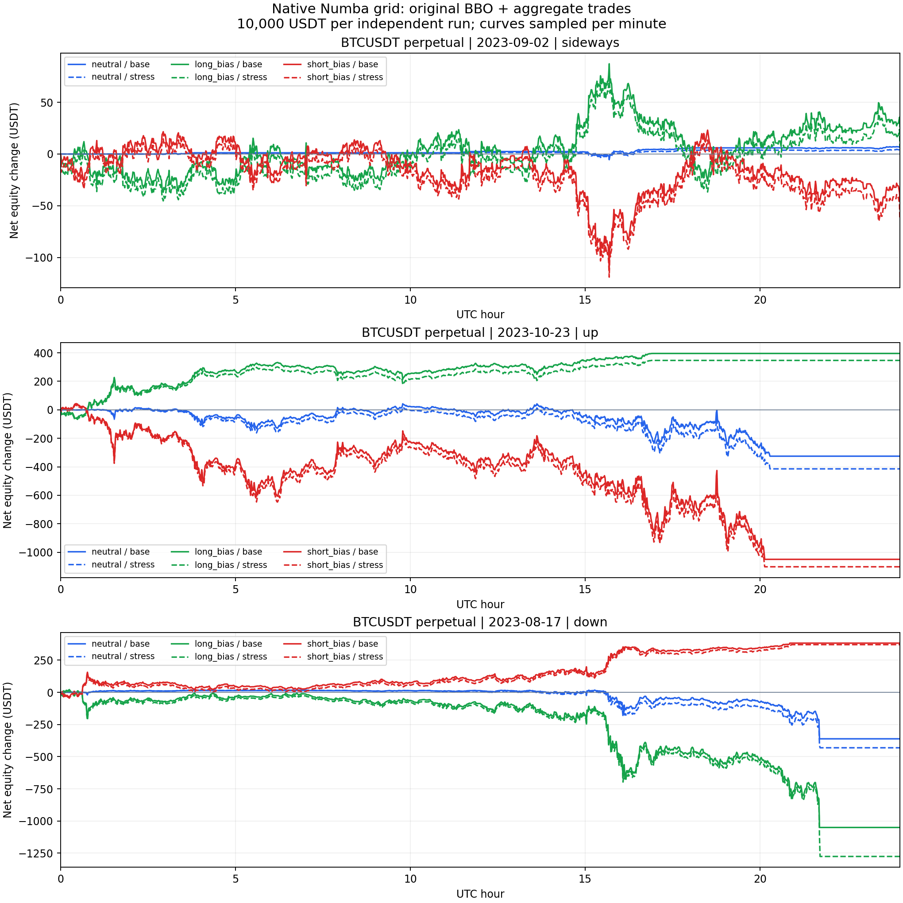

# Numba 网格真实历史行情回测

日期：2026-10-22。所有下载、编译、格式/静态检查、回测和测试均在 `192.168.3.88` 完成。没有连接真实交易账户或部署实盘。运行的是 Rust 加载的实际 Numba 原生制品，不是 Python 复制的策略逻辑，也不是预先写好的成交事件轨迹。

修复后为 `grid 1.2.0` / state schema `3`。**18/18 组完整结束，全部零残仓、零遗留订单，策略毛收益与独立共享账户账本核对通过。** [完整指标 JSON](summary.json)、[十八组表格](table.txt)、[权益曲线](equity.png)。

## 数据与固定参数

使用 Binance BTCUSDT USD-M 永续官方历史归档，格式来源为 [binance-public-data](https://github.com/binance/binance-public-data)。每个 UTC 日期有 `aggTrades`、`bookTicker` 及对应月份的 `fundingRate`，逐一核对官方 `.CHECKSUM`。不是合成震荡/涨跌价格，也没有用 OHLC 猜测盘中路径。

| 场景 | UTC 日期 | 首末成交涨跌幅 | 聚合成交记录 | 原始 BBO 记录 |
| --- | --- | ---: | ---: | ---: |
| 震荡 | 2023-09-02 | +0.23337% | 388,631 | 6,338,127 |
| 上涨 | 2023-10-23 | +10.31506% | 3,600,224 | 16,873,909 |
| 下跌 | 2023-08-17 | -7.32977% | 2,162,862 | 16,548,828 |

共读取 6,151,717 条聚合成交和 39,760,864 条原始 BBO；按 `max(transaction_time,event_time)` 的实际可见时间筛选后，接受 39,760,851 条同日 BBO，13 条跨日可见记录排除。聚合成交 ID 无缺口。数据中有 452 条成交、24 条盘口含不足一个模型订单 tick 的分位价格，输入按 0.01 USDT 无损保留，没有静默丢弃或四舍五入成交价。盘口向外对齐订单粒度后使用。

每个场景、方向独立以 **10,000 USDT** 起始，不合并成一个组合；方向为 `neutral`、`long_bias`、`short_bias`。网格等差、40 格、上下各一张活动单、成交均价锚点、reset_pair；只用首个可见 BBO 固定上下界 ±4%，创建时按资金 × 3 倍杠杆 / 40 / 价格计算数量并冻结。没有按之后的高低点调参或挑选盈利方向。

名义敞口预算 30,000 USDT；毛损失触发值 1,000 USDT；价格退出触发值为创建价 ±5%。订单 tick 0.1 USDT、lot 0.001 BTC、最小名义规模 5 USDT，是本模型明确使用的规则。余额一 unit 为 0.0001 USDT，`quote_units_per_tick_lot=1`。IOC 限价相对当时盘口最多偏移 5 USDT，保护性退出总时限 120 秒；结束前 30 秒人工停止并用剩余真实行情确认平仓。完整编译参数保存在本地 [逐组参数目录](../../../../backtest_reports/grid_history_20261022/runs/artifacts)。

## 撮合、费用与指标口径

| 假设 | 基础组 base | 压力组 stress |
| --- | ---: | ---: |
| 单向下单/回报延迟 | 50ms | 500ms |
| Maker / taker 费率 | 0.02% / 0.05% | 0.05% / 0.10% |
| 单笔历史成交及 IOC 可见最优档参与上限 | 10% | 1% |
| IOC 在最优价之外的附加冲击 | 0.1 USDT | 0.5 USDT |

这些是固定费用/执行假设，不是读取真实账户的费率。Maker 只在订单抵达后出现**相反主动方向且严格穿过限价**的历史成交时成交，触价本身不成交；同一历史成交的数量预算在本策略订单之间共享，参与量向下取整，低于一个 lot 不补足。IOC 只消耗模型比例的已知最优档数量，可能部分成交或零成交过期；reduce-only 不允许反转仓位。撤单有传输延迟，直到终态回报才释放本地意图。订单、独立成交、持仓分别交付，持仓再额外滞后 1ms。

全部合格原始 BBO 更新用于撮合、估值和风险指标，只有策略 BBO 回调最短间隔为 100ms；定时器和账户回调仍正常驱动。不存在用未来盘口回填过去订单。账户/费用沿用 HftBacktest 的 Rust `ExecutionCoordinator` 和衍生品 PnL 账本。每组结束核对清仓、清单和策略毛收益；差异达到 0.01 USDT 即失败。

- **净收益**：期末权益减起始权益，已经扣除假设手续费，并计入历史资金费。资金费使用官方历史费率 × 当时 BBO 中价 × 实际仓位；未取得历史 mark price，这部分为明确的估值近似。
- **最大回撤**：逐原始有效盘口更新及成交/资金费事件计算权益相对此前峰值的最大下降；百分比使用对应此前峰值。图中的分钟采样只用于展示，没有用分钟曲线重算回撤。
- **最大持仓名义敞口**：`abs(净持仓 BTC) × 当时盘口中价`。
- **含在途保守上界**：考虑所有待买或所有待卖可能形成的最大绝对净仓，包含传输中和未确认撤单。已经实际成交的部分不重复计入；reduce-only 和待确认撤单使该值有意保守。不是保证金占用。

## 实际结果

金额单位 USDT，收益率以每组初始 10,000 USDT 为分母。

| 行情 | 方向 | 模型 | 净收益 | 净收益率 | 最大回撤 / % | 最大持仓名义 | 含在途保守上界 |
| --- | --- | --- | ---: | ---: | ---: | ---: | ---: |
| 震荡 | 中性 | base | 6.39 | 0.064% | 7.39 / 0.074% | 2,259.80 | 3,013.07 |
| 震荡 | 中性 | stress | 2.45 | 0.025% | 8.01 / 0.080% | 2,259.80 | 3,013.07 |
| 震荡 | 多头偏置 | base | 26.47 | 0.265% | 118.90 / 1.178% | 15,709.12 | 16,457.18 |
| 震荡 | 多头偏置 | stress | 7.34 | 0.073% | 119.61 / 1.186% | 15,709.73 | 16,457.82 |
| 震荡 | 空头偏置 | base | -43.23 | -0.432% | 139.92 / 1.396% | 17,325.16 | 18,078.43 |
| 震荡 | 空头偏置 | stress | -62.32 | -0.623% | 141.79 / 1.416% | 17,325.16 | 18,078.43 |
| 上涨 | 中性 | base | -325.45 | -3.254% | 415.56 / 4.118% | 14,962.48 | 14,962.48 |
| 上涨 | 中性 | stress | -414.44 | -4.144% | 470.36 / 4.677% | 15,689.38 | 15,689.38 |
| 上涨 | 多头偏置 | base | 395.51 | 3.955% | 146.44 / 1.429% | 15,736.35 | 16,485.70 |
| 上涨 | 多头偏置 | stress | 346.61 | 3.466% | 141.19 / 1.380% | 15,742.62 | 16,492.27 |
| 上涨 | 空头偏置 | base | -1,049.50 | -10.495% | 1,100.50 / 10.954% | 27,525.36 | 27,525.36 |
| 上涨 | 空头偏置 | stress | -1,101.79 | -11.018% | 1,140.17 / 11.358% | 27,502.48 | 27,502.48 |
| 下跌 | 中性 | base | -361.30 | -3.613% | 378.79 / 3.781% | 13,284.94 | 13,307.86 |
| 下跌 | 中性 | stress | -430.95 | -4.309% | 449.44 / 4.486% | 13,783.12 | 13,806.90 |
| 下跌 | 多头偏置 | base | -1,050.33 | -10.503% | 1,074.52 / 10.719% | 25,396.42 | 25,449.92 |
| 下跌 | 多头偏置 | stress | -1,275.57 | -12.756% | 1,292.57 / 12.904% | 25,392.59 | 25,447.60 |
| 下跌 | 空头偏置 | base | 382.29 | 3.823% | 164.38 / 1.614% | 15,711.61 | 16,459.79 |
| 下跌 | 空头偏置 | stress | 370.50 | 3.705% | 178.45 / 1.754% | 15,711.61 | 16,459.79 |

所有组的含在途名义上界均低于 30,000 USDT，本次最大为 27,525.36 USDT。中性网格在两种趋势样本中都亏损；逆势偏置的压力组最大回撤为 12.904%。1,000 USDT 毛损失阈值是**开始退出的触发条件**，不是最终亏损担保；执行延迟、部分成交、价格保护和费用会使最终损失越过该阈值。没有为得到正收益调整测试参数。



逐笔成交、权益采样、每组 journal、参数、制品和 loader 校验保存在本地 [完整运行目录](../../../../backtest_reports/grid_history_20261022/runs)；大体积原始归档及规范化行情留在编译服务器。

## 历史回测发现及直接修复

1. **保护性平仓被开仓重试上限永久中止。** `1.1.0` 暴跌压力组在连续 IOC 零成交后进入 ERROR 303，仍有 **0.904 BTC** 多仓。明确退出拒单还会通过 ERROR 905 触发同类问题。修复前 [结果](before/result.json)、[事件日志](before/journal.txt)、[两项针对回归均失败](exit-before.txt)。
   - `1.2.0` 区分新增风险和保护性退出：初始化/普通网格保留原重试上限，STOPPING 中的零成交、明确拒单继续按既定退避处理，使用独立 `flatten_timeout_ns` 总时限。原 IOC 滑点、reduce-only、数量、事实确认和未知结果超时均保留；不扩大订单或放宽保护。
   - 默认总时限 120 秒；行情刷新、重试和恢复不重置。到期进入 RECONCILING，保留库存事实且不释放停止屏障；时钟回退也拒绝恢复。新增字段因此升级 schema 到 3，旧 checkpoint 不做隐式迁移。
   - 相同数据、撮合器和成本压力下，新版本在 **56.545 秒**内确认清仓，最终零残仓，净收益 **-1,275.57 USDT**。旧版失败时的浮动权益不能与已清仓收益直接比较。还用同一最终撮合器重放旧制品，再次复现失败，见 [旧制品复验](before-final-runner.txt)。
2. **原生数学库依赖被宿主掩盖。** 制品未显式链接 libm，在新的纯 Rust 回测宿主中 `fmod` 无法解析，见 [修复前加载错误](native-load-before.txt)。Rust 编译链增加 `-lm` 和 `-Wl,-z,defs`，让强未解析符号在链接阶段失败。新增测试用不预载 libm 的独立 C 程序 `dlopen(RTLD_NOW)` 实际加载数学制品，并核对 DT_NEEDED，见 [回归](math-load-test.txt)。
3. 回测入口校准也保留了证据：早期撮合器用 1 秒判定盘口失效，误拒绝了无行情变化时仍在 5 秒策略阈值内的报价；已与策略配置对齐。还修正了源数据分位精度和在途敞口中已成交数量的重复计量。这些是回测模型修正，不计作策略获利改进；最终十八组全部使用同一最终模型。

## 验证及复现

| 检查 | 结果 | 证据 |
| --- | --- | --- |
| 真实历史矩阵 | 18/18 完成，零遗留订单/仓位、毛收益账本一致 | [汇总](summary.json)、[运行日志](run.txt) |
| SDK 全量 | 112 passed，含 144 种历史审查排列和新增退出/恢复/原生回归 | [SDK](sdk.txt) |
| Rust 全量 all-targets/all-features | 517 passed、0 failed、12 ignored | [Rust](rust-tests.txt) |
| Clippy `-D warnings` / Rust fmt check | 通过 | [Clippy](clippy.txt)、[格式](fmt.txt) |
| 实际 NativeV13Runtime 停止、恢复 | 通过：撤单、reduce-only、独立成交及权威零持仓；缺恢复证据/新增成交拒绝，门保持关闭 | [宿主](host-smoke.txt) |
| 原生制品 | 九组历史参数与默认/源兼容参数共十一份均经 Rust loader 校验 | [文件摘要](artifact-checksums.txt)、[默认](default-validation.json)、[兼容](compatible-validation.json) |

本地基线 HEAD 为 `2aafc598b0ac43d40a2852cae26a16aed09d9408`，保留已有未提交变更，验证对象是完整工作区快照。远端新隔离目录 `/home/dominolu/dev/titan-grid-history-20261022-2aafc598`，未覆盖原源码目录。显式绑定本轮 SDK/Python 路径；[源码版本](source-version.txt)、[完整输入 SHA256](source-sha256.txt)、[远端核对](source-check.txt)、[工具链](toolchain.txt)。本证据目录自身不纳入输入摘要，避免递归。

[原始数据摘要](input-sha256.txt)、[规范化行情摘要](normalized-checksums.txt)、[质量汇总](summary.json)。官方归档 URL 按固定 UTC 日期写入下载目录的 `.url` 文件；若官方日后修订数据，应使用本次保存的归档和 SHA256 复现。

在编译服务器上述目录执行：

```bash
export CARGO_BUILD_JOBS=8
export TITAN_STRATEGY_PYTHON="$PWD/.venv/bin/python"
export TITAN_STRATEGY_SDK="$PWD/python/titan-strategy-sdk"
export TITAN_TEST_BINARY="$PWD/target/debug/titan"
cargo +1.94.1 build -p titan-cli
cargo +1.94.1 rustc -p hftbacktest --example v13_grid_history -- -C opt-level=2
bash scripts/download_grid_history.sh data/grid-history
bash scripts/run_grid_history.sh data/grid-history verification-artifacts/grid-history/new-run
.venv/bin/python scripts/report_grid_history.py \
  --input verification-artifacts/grid-history/new-run --data data/grid-history \
  --output backtest_reports/grid_history_new_run
```

入口：[Rust 回放](../../../../hftbacktest/examples/v13_grid_history.rs)、[下载及校验](../../../../scripts/download_grid_history.sh)、[矩阵脚本](../../../../scripts/run_grid_history.sh)、[编译辅助](../../../../scripts/compile_grid_history.py)、[报告](../../../../scripts/report_grid_history.py)、[策略说明](../../../../strategies/grid/README.md)。Python 仅参与 Numba 编译/布局描述及报告，账户与撮合在 Rust 中执行。

这三段样本用于覆盖不同市场和执行失败情形，不构成长周期收益结论。没有 L2 全档队列、完整市场冲击、历史阶梯保证金或精确 mark-price 清算模型；维护保证金线被穿越会直接判失败，不伪造清算成交。真实部署仍需目标账户与品种规则的独立验证，未运行真实账户交易，也未统一开启 ignored 测试。
