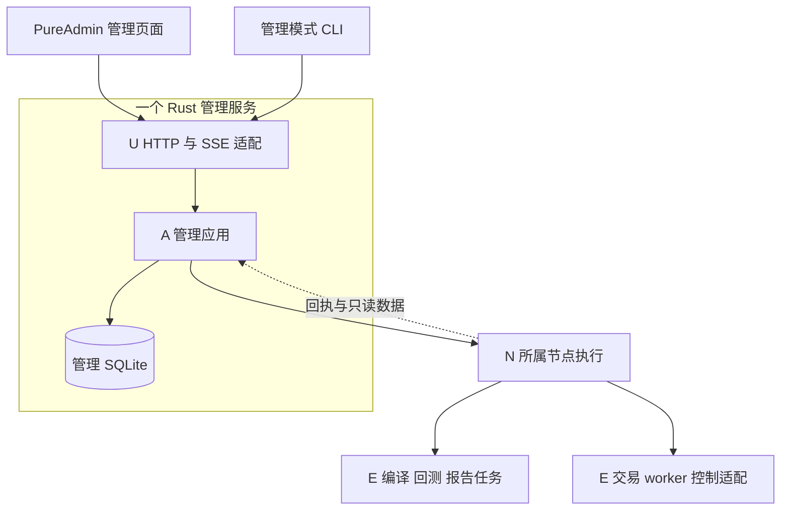

# Titan Web 管理模块技术方案

版本：v0.2（策略研究工作区）  
状态：M1/M2/M3 已实现并验收\
更新日期：2026-10-26  
设计基线：`master`，提交 `5f424533bc7f053a929a21bd4edb4249c99e7aee`\
功能范围与模块职责：[管理平台需求 v0.3](management_console_requirements.md)

任务依赖、代码迁移与分阶段验收安排见 [管理平台实施计划](management_console_implementation_plan.md)。

运行总览与策略详情的[高保真设计 v0.1](design/management-console-v0.1/README.md)已确认。首批页面接入现有接口，保留 Vue 3、请求、SSE、状态与基础控件，采用 Titan 工作台布局；实现范围、数据口径和本轮验证见[页面改造记录](verification/2026-10-26/management-console-ui/README.md)。

策略参数、构建制品、历史回测、账户风险继续采用同一视觉与公共布局，拆为各自的页面组件；事实历史、日志、账户快照和操作回执共用展示实现。四页功能对照、接口边界和验证证据见[四页改造记录](verification/2026-10-26/management-console-pages/README.md)。

随后按用户确认的研究流程归并一级导航：运行总览、策略研究、账户风险。每个策略工作区统一组织版本与参数、构建记录、回测与报告、策略实盘；复用既有页面能力和同一运行详情，底层 Operation、编译、部署和恢复规则保持原边界。

Web 管理端以 PureAdmin 官方精简版为工程基础，复用其前端设施和基础组件，业务页面按 Titan 工作台设计接入参数配置、编译、历史回测、运行监控和生命周期管理。生产环境由一个 Rust 管理服务提供静态页面、REST API 与 SSE，节点和交易 worker 保持独立运行。

本方案细化需求中的 U 接入展示，以及 U 与 A 管理应用的契约；A、N、E 的业务职责以需求文档为准。设计基线尚无管理页面、HTTP 服务或节点协议；当前实现位于 `web/console`、`titan-cli::management` 与既有 E 服务。分阶段实现及验证证据由实施计划维护。

## 1 技术选型

| 部分 | 采用方案 | 使用范围 |
| --- | --- | --- |
| 工程基础与布局 | PureAdmin 官方精简版，非国际化版本；Titan 工作台布局 | 复用工程设施、会话和基础控件；`ConsoleLayout` 统一管理导航、连接与通用入口 |
| 页面开发 | Vue 3、TypeScript、Vue Router | 五类业务页面和类型约束 |
| UI 组件 | Element Plus，沿用模板现有封装 | 表单、表格、弹窗、分页和状态展示 |
| 图表 | ECharts | 权益、回撤、敞口和网格状态绘图 |
| 请求与前端状态 | 沿用模板 Axios 请求封装和 Pinia | 统一请求、会话、偏好及共享查询快照 |
| 构建 | Vite、pnpm | 锁定依赖，输出静态资源 |
| HTTP 与实时传输 | Rust Axum、Tokio、REST、SSE | 接入适配、身份认证、查询和事件传输 |
| 类型契约 | Rust DTO、Serde、ts-rs | 从 Web 边界 DTO 生成 TypeScript 类型 |
| 管理数据 | A 使用 SQLite | 版本目录、Operation、审计和查询索引；Web 不新增数据库 |

[PureAdmin 精简版](https://github.com/pure-admin/pure-admin-thin)采用 MIT 协议，其[依赖清单](https://github.com/pure-admin/pure-admin-thin/blob/main/package.json)已包含上述前端基础库。首次引入时记录上游提交、保留许可证和版权声明，提交 lockfile，并锁定编译服务器上的 Node.js 与 pnpm 版本。后续按明确变更更新上游，不自动跟随浮动分支。

首期沿用精简版的工程结构，只增加业务所需代码。页面使用中文固定菜单；权限由服务端返回。后台模板的演示业务、Mock、示例账户和无关菜单在接入时移除。

## 2 模块边界与部署关系



| 归属 | 负责内容 | 交接方式 |
| --- | --- | --- |
| U 浏览器页面 | 表单交互、查询展示、操作提交、连接状态和数据过期提示 | 仅访问管理服务 API |
| U HTTP 与 SSE | 解析请求、确认身份、序列化、传输和连接管理 | 调用 A 的应用接口，传递操作者身份 |
| A 管理应用 | 授权、版本目录、Operation、幂等、排队、占用、审计和只读查询 | 向 N 派发固定操作，读取执行事实 |
| N 节点执行 | 本机进程、Registry、文件、幂等回执及 worker IPC 客户端 | 调用既有任务程序或 E 的薄控制适配 |
| E 现有业务引擎 | 编译、撮合、账户、成交、风控、收益、停止和恢复 | 返回业务事实、结果及诊断 |

HTTP handler 不启动子进程、不访问节点 Registry、不直接调用交易所。页面和管理模式 CLI 共用 A 的应用入口；E 不依赖 Web 或管理数据库。Rust 服务端先按逻辑模块组织，具体二进制与 crate 划分随迁移确定。

前端只保存服务端事实的展示副本。页面按钮、路由守卫和表单提示不承担最终授权、业务校验或策略状态迁移。

## 3 前端结构与模板复用

新增前端目录为 `web/console/`。以下为职责布局，模板已有文件可保留原命名；同一职责只保留一个实现入口。

```text
web/console/
  src/
    layout/             模板布局、导航和主题
    router/             三个一级入口、研究工作区、运行详情及旧地址跳转
    api/                模板请求封装、资源接口、SSE 客户端
    generated/          Rust DTO 生成的 TypeScript 类型
    store/              模板 Pinia，会话、偏好及共享查询快照
    views/
      console/          共用工作台布局、事实与 Operation 展示
        ResearchIndex.vue      授权策略研究目录
        ResearchWorkspace.vue  当前策略四个研究/实盘环节
        StrategyParameters.vue 版本与参数
        ResearchArtifacts.vue  构建与编译产物
        HistoricalBacktests.vue 回测与报告
        StrategyLive.vue       部署、启动与实盘实例，复用 RunDetail
        RunDetail.vue          唯一运行详情与生命周期交互
        AccountRisk.vue        账户事实与风险
    components/         实际重复的业务展示组件
  package.json
  pnpm-lock.yaml
  UPSTREAM.md           上游提交、引入范围和升级记录
```

保留模板的请求层和状态管理，业务接口在现有请求层上扩展。SSE 客户端统一更新共享查询快照；各页面维护自己的筛选、展开状态和表单草稿。退出登录或切换身份时，关闭 SSE 并清除与原身份有关的查询缓存。

查询缓存只保留当前列表页、正在查看的详情及有上限的近期数据，离开页面后淘汰不再使用的内容。待确认请求按身份隔离保存，退出时清理；重新登录后从 A 查询自己的操作记录，不沿用其他身份的缓存。

首批公共组件包括状态标记、数据更新时间、Operation 进度、参数字段和指标图表。先服务于实际页面，不建设通用页面生成器或可配置工作流。

### 3.1 页面划分

| 页面 | 展示与交互 | 数据及能力来源 |
| --- | --- | --- |
| 运行总览 | 跨策略查看授权运行事实，进入对应详情 | N 进程事实、E 业务快照 |
| 策略研究 / 版本与参数 | 当前策略模板预设、schema、草稿、校验、冻结及差异 | A 目录，E 元数据与统一校验 |
| 策略研究 / 构建记录 | 当前策略冻结输入、构建进度、日志、摘要、下载及回测/实盘入口 | Operation、N 回执、E 制品校验 |
| 策略研究 / 回测与报告 | 固定制品、历史场景及模型，收益指标、曲线与报告 | A 结果引用、E 权威结果 |
| 策略研究 / 策略实盘 | 固定产物、授权绑定、部署、启动与实例，嵌入唯一运行详情 | N 进程事实、E 业务快照及生命周期服务 |
| 账户与风险 | 余额、持仓、成交、净权益、敞口、完整性和诊断 | E 账户事实与统一计算 |

日志、Operation、checkpoint 和告警作为对应详情页的页签或面板，不分别建设独立业务系统。当前网格优先提供专用业务面板；未知 schema 展示通用状态和不兼容原因。

研究目录使用 `GET /api/v1/research`；既有资源列表增加 `research_id`、`resource_id` 查询条件。Rust A 保证授权与归属过滤发生在 offset/limit 之前，并沿旧资源引用只读解析历史归属。工作区保存每类当前页和有限选择，SSE 只更新同一资源事实，不从全局缓存猜测归属。模板归属变更后不继续显示它为旧工作区的可操作输入。

研究目录与资源历史查询在阻塞任务线程使用独立的 SQLite WAL 只读连接，不占用操作受理的数据库互斥锁。目录与归属解析只读取授权、名称和引用字段，仅为最终授权分页加载完整资源；不新增研究数据库或状态机。页面按挂载组件分别持有有限固定资源，汇总后沿用原缓存，销毁组件时释放，不能因切换环节而覆盖实盘详情的固定部署。参数复制/编辑按请求代次、会话、组件存活和当前输入校验异步写回。

工作区各环节通过同一路由的 tab 查询参数切换，保留当前策略表单；切换策略路径则销毁工作区并丢弃旧响应。构建产物传给回测或实盘时携带明确资源 ID，再经服务端验证归属；禁止选择失败后回退到先前制品。共享数据集、账户绑定继续走既有目录和授权，不成为研究策略的私有副本。

参数表单仅映射文本、整数、十进制、布尔和枚举等有限字段类型，读取 schema 的单位、范围与说明。跨字段约束、品种单位、最小订单和风险条件调用 E 的统一校验。草稿保存成功与业务校验通过分别展示；冻结后修改生成新版本。

### 3.2 运行状态与控制交互

运行详情同时展示以下信息，避免使用单一绿色状态概括整个实例：

- A 的 Operation 受理与执行进度。
- N 确认的进程身份、存活及退出事实。
- E 确认的策略生命周期、交易门、账户与风险状态。
- 数据来源、采集时间、完整性和观察是否过期。

控制按钮使用 A 返回的可用动作和禁用原因，服务端受理与执行时仍重新校验。停止弹窗展示目标账户、品种、run/代次、当前仓位及编译参数 `stop_action`；首期不提供临时覆盖停止方式的选项。

暂停执行、恢复运行、业务停止和 checkpoint 恢复使用各自的动作及说明。留仓停止继续展示已确认库存和风险；平仓失败、超时、待对账分别展示引擎结果。页面不通过订单数量或进程退出自行确认清仓。

## 4 API 与类型契约

管理 API 使用 `/api/v1` 前缀。Rust Web DTO 是请求和响应的唯一契约来源，通过 [ts-rs](https://docs.rs/ts-rs/latest/ts_rs/)生成 TypeScript 类型；只导出边界结构，不将整个 runtime 类型图暴露给浏览器。生成在编译服务器执行，生成结果与 Rust DTO 一起提交，CI 检查差异。

接口按固定资源和操作提供，首期核心入口如下；各操作的输入使用对应 Rust 类型，不接受任意命令、脚本或文件路径。

| 接口 | 用途 |
| --- | --- |
| `POST /api/v1/session`、`GET /api/v1/session`、`DELETE /api/v1/session` | 登录、查询当前身份与版本、退出 |
| `GET /api/v1/strategies`、`GET /api/v1/strategies/{id}` | 模板、schema 和可用版本 |
| `POST /api/v1/parameter-versions`、`PATCH /api/v1/parameter-versions/{id}` | 草稿保存与版本操作；冻结使用匹配输入摘要的有效校验结果 |
| `GET /api/v1/artifacts`、`GET /api/v1/backtests` | 制品与回测列表及关联引用 |
| `POST /api/v1/operations` | 受理描述/校验、构建、回测、部署和生命周期等固定操作 |
| `GET /api/v1/operations`、`GET /api/v1/operations/{id}` | 查询操作；支持按当前操作者的幂等键查找 |
| `POST /api/v1/operations/{id}/cancel` | 请求取消同一操作，等待执行方确认 |
| `GET /api/v1/runs`、`GET /api/v1/runs/{id}` | 运行索引、实际状态和动作能力 |
| `GET /api/v1/accounts/{id}` | 已授权账户的只读快照；明细按子资源分页 |
| `GET /api/v1/files/{ref}` | 经授权的结果、报告或日志文件引用 |
| `GET /api/v1/events` | 已授权资源的 SSE 更新 |

列表提供有上限的分页和必要筛选，明细通过资源 ID 查询。参数版本更新带当前修订号，过期页面不能覆盖新草稿；冻结版本不可修改。API 接口最终名称随实现收敛，但对应职责和调用方向保持不变。

错误响应统一包含错误码、可读说明、请求 ID 和可选字段错误或 Operation ID。解析错误使用 400，未认证/未授权使用 401/403，输入修订、目标代次、占用或幂等键冲突使用 409。已受理操作的执行失败记录在 Operation 中，不将失败包装成正常完成。

### 4.1 精度与结果完整性

金额、价格、数量使用带明确币种或单位的十进制字符串；64 位 ID、纳秒时间和需要精确比较的大整数使用字符串。Rust DTO 必须实际按该格式序列化，不能只将生成的 TypeScript 类型改成字符串。

前端保留原始字符串用于表单、明细和提交。图表可以转换为近似数值绘制，指标卡、导出值和操作输入使用原始精度；前端不从曲线重算净收益、最大回撤或最大敞口。

缺失指标返回空值及原因或完整性标志，页面显示“缺失”“不完整”或“不适用”。网格配对毛收益与平台净收益分别展示；缺少费用、资金费、估值或策略归属时，不补零，也不合成为可比较的净收益。

## 5 Operation 提交与结果确认

页面通过以下流程提交耗时和跨节点动作：

1. 选择冻结资源、目标节点及可选 run/代次，展示实际动作和关键输入。
2. 提交前生成幂等键；同一请求的网络重试沿用该键。暂存待确认请求的键、输入摘要和资源引用，避免刷新后创建新动作；不暂存凭据。
3. A 完成授权和受理，返回 Operation；首次异步受理使用 202，重复请求返回已有操作，输入冲突明确拒绝。
4. 页面通过 SSE 或查询接口显示 A 保存的进度与 N/E 回执，完成状态由执行方确认。
5. HTTP 超时显示“受理结果待确认”，先按原幂等键查询。浏览器不能自行把服务端 Operation 改成失败或结果未知，也不能换键盲目重发。

Operation 沿用需求中的待执行、执行中、成功、失败、已取消和结果未知六种状态。页面刷新后从 A 重新读取未完成操作；浏览器关闭、切换页面或断网不取消已受理任务。

取消入口请求取消同一 Operation。已派发动作只有执行方确认后才显示已取消；已经启动的交易实例使用正常业务停止。部署完成和启动完成分别确认，进程启动与策略进入可交易状态分别展示。

前端针对按钮禁用和请求中的状态提供交互反馈，唯一幂等与冲突判定仍归 A。N 的执行证据和 E 的 runtime operation 作为同一管理操作的回执关联，不增加 Web 任务状态机。

## 6 实时更新与重同步

浏览器首次通过 REST 获取快照，再通过 SSE 接收后续变化。每个标签页使用一个应用级共享连接，组件读取同一查询快照。浏览器使用原生 EventSource，服务端使用 [Axum SSE](https://docs.rs/axum/latest/axum/response/sse/)；命令继续通过 REST 提交。

### 6.1 快照与事件约定

快照至少携带来源身份、资源版本、源采集时间、服务端新鲜度及完整性；事件包含游标、类型、资源 ID/代次和对应资源版本。业务诊断码及错误来源原样保留。

A 的查询接口在同一投影边界返回快照与流游标。U 负责携带游标续读，防止先查询再订阅之间丢失变化。客户端只合并同一资源身份下更新的版本，旧代次和旧版本不能覆盖新状态；不同资源的版本不相互比较。

游标是不透明的续读位置，浏览器不根据全局序号是否连续判断业务数据完整性。权限筛选与订阅范围由 A 校验，不能通过修改订阅参数读取其他账户数据。

### 6.2 断线与过期处理

- 默认业务快照每秒更新，连续三个发布周期没有有效采集进度即显示过期。A 提供新鲜度判断，重复转发旧快照不能刷新业务新鲜度；浏览器连接心跳只表示传输仍然存在。
- 断线后使用已有游标续读；超出缓存窗口、来源代次变化或管理服务重启使游标失效时，返回需要重同步，重新获取快照和游标。首次连接的游标通过查询参数传递，自动重连使用 SSE 的事件 ID 续读语义。
- 重同步完成前保留最后确认值并标记过期。HTTP 可用而 SSE 暂时不可用时，由同一查询层有限频率轮询；SSE 恢复后停止轮询，避免两套更新持续竞争。
- 写操作是否可执行由 A 按最新事实决定；页面展示观察受限及服务端禁用原因，不因失联推断策略停止、库存归零或允许重复启动。

SSE 使用有界缓存。状态更新可以合并成最新快照；日志按分页或有界尾部读取，缺口明确提示。慢客户端超过缓冲上限后断开并要求重同步，不累积无限队列，也不阻塞交易热路径。

SSE 是查询更新通道，Operation 与业务事实仍保存在各自权威层。无需为了页面续读另建一套持久事件总线。原生 EventSource 的连接、事件 ID 和重连语义见 [MDN 文档](https://developer.mozilla.org/en-US/docs/Web/API/Server-sent_events/Using_server-sent_events)。

## 7 图表 历史明细与报告

指标卡使用 E 返回的权威汇总。历史曲线使用 E 已产出的权益、回撤和敞口序列，查询层按时间范围和点数上限提供展示视图。显示采样范围及原始结果引用；绘图降采样不改变全量指标和验收结论。

订单与成交表分别读取对应事实，不能由订单累计成交量推造成交价格或费用。历史明细和日志使用分页及有界显示，页面不长期保存全部事件。重复、乱序或缺口的处理留在 E，页面展示其完整性结果。

报告复用现有 renderer，通过报告 Operation 生成并返回引用。文件 API 根据资源引用和授权定位文件，不能接受浏览器传入的任意服务器路径。日志按文本转义；HTML 报告使用受限 sandbox 容器展示，不授予脚本及管理页面同源权限。

## 8 身份 权限与安全会话

首期身份及节点、环境、账户权限由管理服务配置维护，角色沿用只读和操作员。U 确认身份，A 执行统一授权和审计；模板中的角色字段只用于展示。节点继续验证管理服务身份、能力和目标代次，不新增用户权限系统。

配置中的登录口令仅保存密码哈希，不向前端下发；身份信息与账户权限的修改通过管理服务配置生效，首期不建设用户管理页面。

浏览器使用同源 HTTPS 安全会话，Cookie 设置 HttpOnly、Secure 和 SameSite。状态修改接口校验 CSRF token 及请求来源；登录接口限制尝试频率。会话标识不存入 localStorage，不放进 SSE URL；模板的 Mock 登录、演示 token 和对应刷新流程替换为 Rust 会话接入。

会话过期、退出或权限撤销后，终止对应 SSE，并清除页面中的受限数据。身份有效性与资源授权均覆盖查询、订阅、下载和写操作；SSE 长连接不能绕过会话失效。

交易所凭据和签名私钥保留在所属节点。页面与管理记录仅使用引用；凭据、Cookie、CSRF token 和敏感请求头不进入日志或构建产物。管理 API 只允许定义好的操作，不提供任意 shell、SQL 或路径执行能力。

## 9 构建与生产部署

生产部署采用一个入口、一个 Rust 管理服务及一份配套静态资源。HTTPS 可由现有入口代理终止，或由管理服务接入 TLS；节点服务与 worker 不向浏览器开放。

```text
https://管理地址/
  /                     PureAdmin 静态入口
  /assets/              带内容摘要的 JS CSS 等资源
  /api/v1/              Rust REST API 与 SSE
```

Vite 输出静态文件由 Rust 管理服务托管，Node.js 仅用于构建。生产环境不运行 Vite 开发或 preview 服务，符合 [Vite 静态部署说明](https://vite.dev/guide/static-deploy.html)。发布时前后端作为一组版本切换，保留上一个完整版本用于回滚。

静态入口每次校验更新，带摘要资源可长期缓存。前端路由回退到页面入口时必须排除 `/api/` 和不存在的静态资源，避免 API 错误被替换成 HTML。HTTPS 代理为 SSE 关闭响应缓冲并允许持续连接。

会话查询返回 API 契约版本和前后端构建身份。不兼容时页面提示更新并关闭写入口；服务端仍执行自身校验。浏览器刷新、Web 发布和回滚都不应改变已受理 Operation 或交易 worker 的生命周期。

所有依赖安装、类型生成、构建、格式/静态检查及非实盘自动验证在 `192.168.3.88` 执行。本地只编辑和审查；远端验证前确认目录、源码版本和工作区状态。构建记录包含源码提交或变更清单、上游模板提交、工具链、lockfile、API 版本及产物摘要。

管理页面的部署位置不改变机器职责：编译和非实盘回测只派发到编译服务器，真实账户查询和动作只派发到所属实盘节点。实盘服务器只部署编译服务器已验证的产物，受控验收遵循 [AGENTS.md](../AGENTS.md)。

## 10 分阶段交付与验收

Web 交付顺序跟随需求文档的 M1、M2、M3，不为前端另建一套业务路线。

| 阶段 | Web 交付 | 必须具备的后台能力 |
| --- | --- | --- |
| M1 离线闭环 | 模板裁剪、会话、参数/制品/回测页面、Operation、SSE、结果与报告 | A 版本与权限、N 编译节点、E 参数元数据和历史结果适配 |
| M2 实盘只读 | 运行详情、账户风险、网格面板和诊断展示 | E03 持续事实与统一指标、N 转发、A 带来源的查询 |
| M3 生命周期操作 | 部署、启动、暂停、停止和 checkpoint 恢复交互 | A 占用与冲突控制、N 唯一执行入口、E04 控制适配和执行回执 |

M2 必须等待实盘事实留存与指标输出补齐，不能用当前 live worker 的空收益与零计数填充页面。M3 必须复用已有停止屏障和恢复判定；前端可演示交互不代表真实控制已经验收。

| 编号 | 验收场景 | 预期结果 |
| --- | --- | --- |
| W01 | Rust DTO 变更、精度边界和未知 schema | 类型生成无漂移，大整数及十进制不丢精度；不兼容有明确提示 |
| W02 | 参数编辑、冻结、历史回测到报告 | 输入与结果引用可追溯，页面指标与 E 原始结果一致；冲突编辑被拒绝 |
| W03 | 重复点击、HTTP 超时、刷新和管理服务重启 | 找回同一 Operation，不重复执行；受理、业务完成和未知结果表达准确 |
| W04 | 查询与订阅交接、旧版本、断线和过期游标 | 无静默缺口，旧快照不覆盖新状态，必要时明确重同步 |
| W05 | 只读身份、越权订阅/下载、会话失效和 CSRF | A 拒绝越权，连接与缓存及时清理，直接调用 API 也不能绕过授权 |
| W06 | 进程存活但策略停止中、失联、人工留仓及平仓失败 | 分别显示进程、策略、账户与观察状态，不误报清仓或可重启 |
| W07 | 慢浏览器、日志洪峰及多次切换页面 | 缓冲和显示有界，标签页不泄漏连接，交易 worker 不等待页面 |
| W08 | 静态发布、资源缓存、API 错误和版本回滚 | 页面可刷新，API 不返回页面 HTML，契约不兼容限制写入，任务持续可查询 |

实现阶段在编译服务器完成前端类型检查、格式/静态检查、生产构建、Rust API 契约与权限测试，以及浏览器端到端验证。非实盘场景使用模拟节点或历史回测，不读取真实账户；实盘验收独立记录目标、版本和风险边界。验证证据应覆盖本次源码，不能引用既有引擎测试替代新增 Web 验收。

## 11 关联文档

- [管理平台需求文档](management_console_requirements.md)：功能范围、唯一职责和跨模块验收。
- [Titan CLI](titan_cli.md)：当前入口与 worker 管理能力。
- [ResultBundle schema](result_bundle_schema.md)：当前结果与完整性约定。
- [Numba 网格](../strategies/grid/README.md)：当前网格能力、停止方式与恢复约束。
- [可复用工程经验](memory/engineering.md)：账户事实、恢复和远端验证边界。
